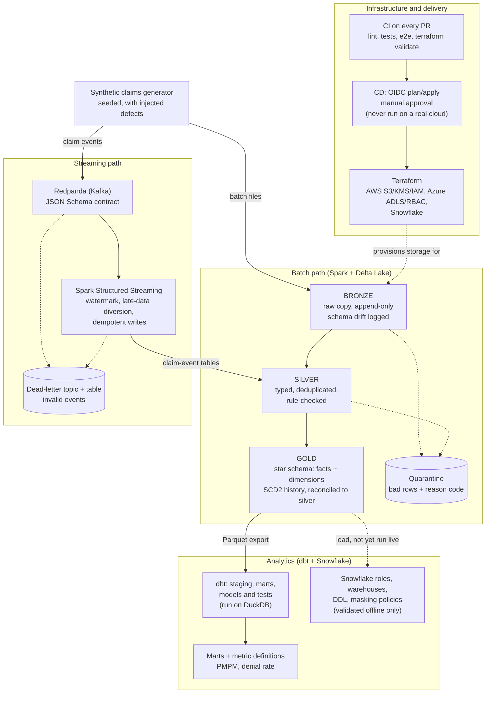

# claims-lakehouse

A data platform that turns messy health-insurance claims into trusted, queryable, privacy-aware data, built on 100% synthetic records and designed to run on AWS and Azure.

> **Status: mostly built, nothing run on a real cloud.** The batch pipeline, streaming with quality gates, dbt models, Great Expectations checks, keyed privacy tokens, observability, an Airflow DAG, a Databricks bundle, a governed Q&A prototype, a feature store, a claim-denial machine-learning pipeline with a model card, lineage events, Terraform, CI and a dashboard are written and tested on synthetic data. The open tickets are mostly the "run it on a real cloud account" checks. No AWS, Azure, Snowflake, Databricks, Bedrock or SageMaker account has ever been used. See [What is real vs simulated](#what-is-real-vs-simulated).

**Live dashboard: <https://nikshepkulli.github.io/claims-lakehouse/>**: cost, denials, provider performance, a data-quality view and a **Pipeline runs** tab (a lineage graph of how data flows from raw to gold, a timeline of pipeline runs and a quality trend). It is built from a synthetic, gold-shaped test fixture (not from the Spark pipeline output) and says so on the page. Details: [docs/dashboard.md](docs/dashboard.md), including the [Pipeline runs tab](docs/dashboard.md#pipeline-runs-ticket-30). The Pipeline runs data comes from a sample run on the synthetic fixture, not from a production system, and because the site is redeployed by hand the live copy may not show the tab yet.

## What problem this solves

Health insurers receive claims (a request to be paid for care) from thousands of sources. The feeds arrive late, out of order, duplicated and with typing errors, and they contain personal information. If analysts or machine-learning models use them as they come, the numbers are wrong and privacy is at risk.

This platform ingests the raw feed, keeps an untouched copy, cleans and checks every record, sets aside the bad ones with a stated reason instead of silently dropping them, and publishes tidy tables that finance and analysts can query, with identifiers masked for analyst use.

**One bad record, followed through.** A claim line arrives with procedure code `99-99`, which is not a valid code format.

1. **Bronze (raw copy):** stored exactly as received, with file name and load time, so it can always be replayed.
2. **Silver (cleaned):** the rule `INVALID_PROCEDURE_CODE` fails. The row is moved to a quarantine table with its full contents and the reason. It is not deleted and not "fixed" by guessing.
3. **Reconciliation:** the job checks `rows in = clean rows + quarantined rows + exact duplicates` and fails if the counts do not add up, so nothing can vanish unnoticed.
4. **Gold (business tables):** only trusted rows reach the tables analysts use. The quarantine table tells the data owner what to fix upstream; re-running the batch then moves the corrected row through.

## At a glance

| | |
| --- | --- |
| Layers | Bronze (raw), silver (cleaned), gold (star schema), plus a Snowflake and dbt analytics layer |
| Compute and storage | Spark 3.5 and Delta Lake; Redpanda (Kafka-compatible) for streaming; DuckDB for local dbt |
| Clouds (as code) | AWS (S3, KMS, IAM) and Azure (ADLS Gen2, RBAC) Terraform modules; Snowflake Terraform and SQL |
| Tests | A large automated suite: Python unit tests that need no Spark, Spark tests in CI, and dbt model tests on DuckDB. Exact counts are deliberately not quoted here because they change with every pull request; see the latest CI run and [docs/ci.md](docs/ci.md) |
| CI | Every pull request runs lint, unit tests, Spark tests in parallel, an end-to-end pipeline run (with Great Expectations quality gates), dbt build, SQL lint, Databricks bundle validation, dashboard build, Terraform validate on every root, a non-blocking security scan and a ticket-link check. The current list is in [docs/ci.md](docs/ci.md) |
| Tickets | Every task is a GitHub issue first; the [roadmap issue #48](https://github.com/nikshepkulli/claims-lakehouse/issues/48) lists them by milestone and its checklist is the live status. Counts are not quoted here because they drift |
| Dashboard | **[Live on GitHub Pages](https://nikshepkulli.github.io/claims-lakehouse/)**, built from the synthetic gold-shaped fixture and labelled as such; redeployed by hand, so it can lag `main` |
| Data | Synthetic only. Seeded generator with injected defects. No real patient data |

## Architecture





**How to read it.** Solid arrows are data flowing; dotted arrows are rejects, or links that are designed but not exercised end to end.

- **Bronze, silver, gold** (the "medallion" pattern): raw copy, then cleaned data, then business-ready tables. Each layer has one job, which makes problems easy to locate. Detail: [ADR-0001](docs/adr/0001-medallion-layout.md).
- **Quarantine / dead-letter:** where rejected records go, with the reason, so they can be reviewed and replayed.
- **Streaming path:** claim events flow through a Kafka-compatible broker and are checked against a written contract before they are trusted.
- **dbt and Snowflake:** dbt builds the analyst-facing tables and tests them; Snowflake is the target warehouse. Only the DuckDB path has actually run; Snowflake code is validated offline.
- **Terraform and CI:** infrastructure is code, checked on every pull request. Deployment workflows exist but have never touched a real cloud account.

Diagram source: [docs/img/architecture.mmd](docs/img/architecture.mmd) (also available as [PNG](docs/img/architecture.png)). Longer design with ticket numbers: [docs/architecture.md](docs/architecture.md).

## How this was built

- **Ticket first.** Every task is a GitHub issue before any code is written. Each pull request says `Closes #N` (or `Part of #N` when a live-cloud check is still open), and a CI check (`ticket linked`) fails the PR if it does not. The [roadmap issue #48](https://github.com/nikshepkulli/claims-lakehouse/issues/48) lists every ticket by milestone.
- **Gates.** Pull requests must pass lint, tests, an end-to-end pipeline run and Terraform validation ([docs/ci.md](docs/ci.md)). Tests and docs ship in the same PR as the code.
- **Decisions are written down.** One short ADR (architecture decision record) per significant choice, in [docs/adr](docs/adr/README.md).
- **AI assistance, stated plainly.** Much of the code and documentation was produced by AI coding agents (Claude Code) working in parallel, each on its own ticket and branch. The repo owner defines the tickets, reviews and merges each pull request, and every change must pass the same CI gates. The agents' work is therefore reviewed and tested, but the volume of code is not hand-typed.
- **Honest limits.** CI checks can pass on code that was never run on a cloud; the [real vs simulated table](#what-is-real-vs-simulated) says which is which.

Example pull requests to read:

| PR | What it shows |
| --- | --- |
| [#50](https://github.com/nikshepkulli/claims-lakehouse/pull/50) | CI rule that every PR must link a ticket |
| [#63](https://github.com/nikshepkulli/claims-lakehouse/pull/63) | Silver layer: quarantine instead of drop, reconciliation |
| [#74](https://github.com/nikshepkulli/claims-lakehouse/pull/74) | Streaming with watermarks and idempotent writes |
| [#75](https://github.com/nikshepkulli/claims-lakehouse/pull/75) | Gold star schema with history (SCD2) and reconciliation |
| [#68](https://github.com/nikshepkulli/claims-lakehouse/pull/68) | PII classification and masking policies |
| [#87](https://github.com/nikshepkulli/claims-lakehouse/pull/87) | Replacing reversible id hashes with keyed tokens |

## Requirement-to-code mapping

Mapped against a Senior Data Engineer job description (AWS and Azure, Databricks, Snowflake, SageMaker and Bedrock). "Done" means built and tested in this repo, not necessarily run on a real cloud.

| Skill | What was built | Where | Status |
| --- | --- | --- | --- |
| Python and SQL | Seeded data generator, pipeline code, SQL marts and analyst queries | [src/](src), [analytics/queries](analytics/queries), [docs/data-generator.md](docs/data-generator.md) | Done |
| Spark (batch) | Bronze, silver, gold jobs on Spark and Delta Lake, tested end to end in CI | [bronze](docs/bronze.md), [silver](docs/silver.md), [gold](docs/gold.md) | Done |
| Databricks | Asset Bundle (dev and prod targets, one three-task job) that runs the same Spark jobs; checked offline with the real Databricks CLI against a stub. Never deployed, never run on Databricks | [databricks](docs/databricks.md), [ADR-0002](docs/adr/0002-delta-vs-iceberg.md), PR [#79](https://github.com/nikshepkulli/claims-lakehouse/pull/79), ticket [#10](https://github.com/nikshepkulli/claims-lakehouse/issues/10) | Written and validated offline only (ticket open for a live run) |
| Kafka and streaming | Redpanda topics, schema contract, producer, Spark Structured Streaming with watermark and late-data handling, per-batch quality gates, dead-letter table and replay (PR [#88](https://github.com/nikshepkulli/claims-lakehouse/pull/88)) | [streaming](docs/streaming.md), [streaming-spark](docs/streaming-spark.md), [ADR-0004](docs/adr/0004-streaming-contract-format.md) | Done on the local stack, with a file source in CI; the Kafka dead-letter publish and Kafka replay paths are written but unverified (ticket [#13](https://github.com/nikshepkulli/claims-lakehouse/issues/13) stays open) |
| Snowflake | Warehouses, roles, resource monitors, DDL, load and merge SQL as code; never executed on Snowflake | [docs/snowflake.md](docs/snowflake.md) | In progress (ticket [#14](https://github.com/nikshepkulli/claims-lakehouse/issues/14) open for live run; tuning [#16](https://github.com/nikshepkulli/claims-lakehouse/issues/16) planned) |
| dbt and data modelling | Kimball star schema with SCD2; dbt staging, marts, tests and metric definitions; the dbt tests pass on DuckDB | [gold](docs/gold.md), [dbt](docs/dbt.md), [analytics guide](docs/analytics-guide.md) | Done on DuckDB; Snowflake run open (ticket [#15](https://github.com/nikshepkulli/claims-lakehouse/issues/15)) |
| Terraform and IaC | AWS S3/KMS/IAM, Azure ADLS/RBAC, Snowflake modules; `fmt` and `validate` in CI | [infra-aws](docs/infra-aws.md), [infra-azure](docs/infra-azure.md) | Done (validate only, never applied) |
| AWS and Azure, cloud-agnostic design | Storage URI abstraction (`file`, `s3a`, `abfss`) and a stated portable-core boundary | [multi-cloud](docs/multi-cloud.md), [ADR-0003](docs/adr/0003-cloud-agnostic-boundary.md) | Done as code and design; not run on either cloud |
| CI/CD | CI on every PR; OIDC plan/apply workflows with manual approval | [ci](docs/ci.md), [cd](docs/cd.md) | CI done; CD written, never executed |
| Data quality | Rule-based silver checks, quarantine, reconciliation identity asserted in code, contract compatibility tests; Great Expectations suites per layer (PR [#82](https://github.com/nikshepkulli/claims-lakehouse/pull/82), ticket [#22](https://github.com/nikshepkulli/claims-lakehouse/issues/22) closed) run in CI on the real Spark output; streaming gates | [data-quality](docs/data-quality.md), [silver](docs/silver.md), [streaming](docs/streaming.md) | Done; GE reads local Delta/Parquet with pandas, not Spark; never run on a cloud |
| Governance and privacy | Column classification registry, masking policies, row access example; member and provider ids are keyed HMAC tokens in gold (PR [#87](https://github.com/nikshepkulli/claims-lakehouse/pull/87), ticket [#71](https://github.com/nikshepkulli/claims-lakehouse/issues/71) closed, [ADR-0005](docs/adr/0005-keyed-tokens-for-identifiers.md)); not a HIPAA claim | [privacy-and-access](docs/privacy-and-access.md) | Tokens done and tested locally and in CI with a fake test key; Snowflake policies never executed; key-in-task-closure and single-key limits documented |
| Observability | Run ledger, JSON logs, freshness and volume alerts (PR [#78](https://github.com/nikshepkulli/claims-lakehouse/pull/78)) | [observability](docs/observability.md), ticket [#23](https://github.com/nikshepkulli/claims-lakehouse/issues/23) | Built and tested on fixtures. The Airflow DAG runs bronze, silver and gold under the ledger wrapper and ends with an alert check (spec-tested, not run inside Airflow or with Spark); the dashboard's pipeline-runs view reads a sample ledger, not a real pipeline run (ticket open) |
| Lineage | OpenLineage events for each pipeline layer, with column-level lineage for gold, sent to Marquez or a file (PR [#93](https://github.com/nikshepkulli/claims-lakehouse/pull/93)); also drawn as a graph in the dashboard's Pipeline runs tab (PR [#95](https://github.com/nikshepkulli/claims-lakehouse/pull/95)) | [lineage](docs/lineage.md), [local-stack](docs/local-stack.md), ticket [#24](https://github.com/nikshepkulli/claims-lakehouse/issues/24) | Built and tested without Docker; **never seen in a live Marquez** (ticket open) |
| Orchestration | One Airflow 2.10 DAG (`claims_daily`: land, bronze, silver, gold, dbt, quality gates) with per-date idempotent runs, retries with backoff, SLAs and a failure webhook (PR [#85](https://github.com/nikshepkulli/claims-lakehouse/pull/85)) | [orchestration](docs/orchestration.md), ticket [#9](https://github.com/nikshepkulli/claims-lakehouse/issues/9) | DAG import and structure tested in CI; run with `airflow dags test` natively on one laptop; `airflow dags backfill` and the Docker path are unverified; never on MWAA or any cloud; ticket stays open |
| Self-service analytics | Curated marts and documented metrics (PMPM, denial rate); [live dashboard](https://nikshepkulli.github.io/claims-lakehouse/) | [analytics guide](docs/analytics-guide.md), [dashboard](docs/dashboard.md), ticket [#29](https://github.com/nikshepkulli/claims-lakehouse/issues/29) | Done on the fixture, including the Pipeline runs tab ([#30](https://github.com/nikshepkulli/claims-lakehouse/issues/30)); not yet built from Spark gold output (tickets open) |
| ML and GenAI readiness (SageMaker, Bedrock) | Point-in-time feature store (PR [#84](https://github.com/nikshepkulli/claims-lakehouse/pull/84)); governed natural-language Q&A over gold with guardrails, tested with a fake model (PR [#86](https://github.com/nikshepkulli/claims-lakehouse/pull/86)); SageMaker-ready claim-denial training and batch scoring (PR [#94](https://github.com/nikshepkulli/claims-lakehouse/pull/94)), with a [model card](docs/model-card.md) | [features](docs/features.md), [ML pipeline](docs/ml.md), [model card](docs/model-card.md), [genai](docs/genai.md), tickets [#26](https://github.com/nikshepkulli/claims-lakehouse/issues/26), [#27](https://github.com/nikshepkulli/claims-lakehouse/issues/27), [#28](https://github.com/nikshepkulli/claims-lakehouse/issues/28) | Features done on a fixture export; Q&A tested offline only, **no Bedrock call has ever been made** and real-model accuracy is unmeasured (ticket open); the ML pipeline trains and scores locally with scikit-learn, **no SageMaker job or AWS resource has ever been created**, and because the synthetic denials are random the model correctly scores no better than chance (see the model card) |

## What is real vs simulated

All data is synthetic, produced by [claimsgen](docs/data-generator.md). "CI" means GitHub Actions runners, not a cloud account.

| Component | Ran locally | Ran in CI | Run on a real cloud account |
| --- | --- | --- | --- |
| Data generator | Yes | Yes | n/a |
| Bronze, silver, gold (Spark + Delta) | Yes (Docker; see note below) | Yes, including an end-to-end run | No (local filesystem only; S3 and ADLS paths are not exercised) |
| Streaming (Redpanda + Spark) | Yes, local stack | Spark logic tested with a file source; broker not in CI | No managed Kafka |
| dbt | Yes, on DuckDB | Yes, including on the real gold export | No Snowflake run |
| Snowflake SQL, roles, masking policies | No | Syntax lint and structural tests only | No: no Snowflake account |
| Terraform AWS, Azure, Snowflake | `fmt` and `validate` | `fmt`, `validate`, non-blocking security scan | No `plan` or `apply` ever |
| CD (OIDC plan/apply) | No | Plan jobs are skipped until cloud variables exist | No |
| Privacy rules and keyed tokens | Yes (pure Python; Spark gold with a fake test key) and DuckDB model of the analyst view | Yes (fake test key) | Snowflake enforcement unverified; no real key or secret store used |
| Great Expectations quality checks | Yes (pandas and delta-rs, no Spark) | Yes, on the real Spark output of the end-to-end job | No |
| Streaming quality gates, dead-letter table | Yes (local stack) | Gate logic with a file source; broker not in CI | Kafka dead-letter publish and Kafka replay: written, not run; no managed Kafka |
| Observability (run ledger, alerts, freshness and volume checks) | Yes, on fixtures | Unit tests only | Airflow wiring written and spec-tested, not run in Airflow or with Spark; dashboard shows a sample ledger only; webhook tested against a local server only |
| Airflow DAG | Yes: `airflow dags test` for three dates, natively (not Docker) | DAG import and structure tests | No; backfill and Docker path unverified; no MWAA or other service |
| Databricks bundle | Validated offline with the Databricks CLI against a stub | Same validation | No: never deployed, never run on Databricks |
| Features (point-in-time) | Yes, on a fixture export | Yes (unit tests) | No |
| ML training and scoring (claim denial risk) | Yes, scikit-learn and DuckDB (`make ml-demo`) | Yes (unit tests) | No: no SageMaker job, endpoint or AWS resource was ever created; metrics on random synthetic labels say nothing about real performance |
| Lineage events (OpenLineage) | Yes, to a file and in tests, no Docker | Yes (unit tests) | Never sent to a live Marquez; no cloud |
| Governed Q&A (text-to-SQL) | Yes, with a deterministic fake model | Yes (offline tests) | No: the Bedrock client has never made a call |
| Dashboard (including Pipeline runs tab) | Yes | Built and tested on every PR | Published to GitHub Pages ([live](https://nikshepkulli.github.io/claims-lakehouse/)), built from the synthetic fixture, not Spark output; no cloud account involved |

Note: `make bronze`, `make silver`, `make gold` and `make test-spark` currently fail on a fresh laptop because of a Python and numpy version mismatch in the Spark image ([#76](https://github.com/nikshepkulli/claims-lakehouse/issues/76)). CI is unaffected and runs the full pipeline.

## Quick start

Needs Python 3.11 to 3.13. The last step also needs Docker. Run from the repo root.

```bash
python3 -m venv .venv && . .venv/bin/activate
pip install -r requirements-dev.txt
make lint test                                                  # ruff and sqlfluff lint, then the tests that need no Spark
PYTHONPATH=src python -m claimsgen --rows 2000 --seed 42 --out data/raw   # synthetic claims in ~2 seconds
make demo                                                       # local stack: MinIO, Redpanda, Spark, Postgres
make produce-demo                                               # stream 1,000 claim events through Redpanda
```

Optional: build the dbt analytics layer on DuckDB (separate dependencies, Python 3.11 to 3.13):

```bash
pip install -r requirements-dbt.txt
python scripts/make_gold_fixture.py --raw data/raw --out data/gold
cp dbt/profiles.yml.example dbt/profiles.yml
dbt deps --project-dir dbt --profiles-dir dbt
dbt build --project-dir dbt --profiles-dir dbt --target duckdb    # models and tests
```

A single-command 10-minute demo (`make demo` running the whole pipeline) and a demo GIF are still open under ticket [#31](https://github.com/nikshepkulli/claims-lakehouse/issues/31); today `make demo` starts and verifies the local stack only. Stop it with `make down`.

## Documentation index

See [docs/index.md](docs/index.md) for the full list. Short version:

| Audience | Start here |
| --- | --- |
| Managers | This page, the [model card](docs/model-card.md) (plain-language limits of the ML demo), the [ADR summary](docs/adr/README.md), the [glossary](docs/glossary.md) |
| Engineers | [bronze](docs/bronze.md), [silver](docs/silver.md), [gold](docs/gold.md), [streaming](docs/streaming.md), [dbt](docs/dbt.md), [data quality](docs/data-quality.md), [orchestration](docs/orchestration.md), [snowflake](docs/snowflake.md), [privacy](docs/privacy-and-access.md), [lineage](docs/lineage.md), [ML pipeline](docs/ml.md), [model card](docs/model-card.md), [dashboard](docs/dashboard.md) |
| Operators | [runbook](docs/runbook.md), [cd](docs/cd.md), [ci](docs/ci.md), [local stack](docs/local-stack.md) |

## Decisions worth knowing

- [ADR-0001 Medallion layout](docs/adr/0001-medallion-layout.md): three layers so raw data is replayable and bad data is visible, not hidden.
- [ADR-0002 Delta Lake](docs/adr/0002-delta-vs-iceberg.md): one open table format with safe updates, with an interop path to Iceberg for other engines.
- [ADR-0003 Portable core, native edges](docs/adr/0003-cloud-agnostic-boundary.md): pipeline logic is identical on AWS and Azure; only thin storage and identity layers differ.
- [ADR-0004 Streaming contract](docs/adr/0004-streaming-contract-format.md): events are checked against a versioned schema, using plain JSON so they stay readable and replayable.
- [ADR-0005 Keyed identifier tokens](docs/adr/0005-keyed-tokens-for-identifiers.md): member and provider ids are keyed HMAC tokens, because an unkeyed hash of a sequential id can be reversed by enumeration.

All records: [docs/adr](docs/adr/README.md).

## License

MIT. All data is synthetic; do not mix it with real data.
