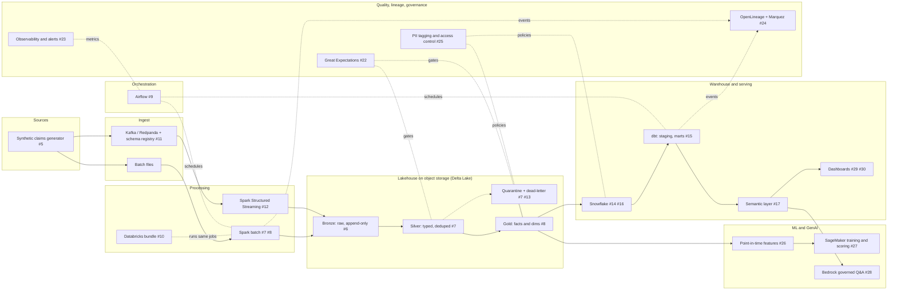
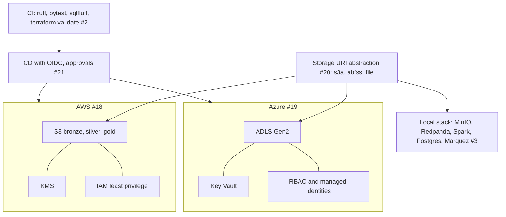

# Architecture

Planned platform for the claims lakehouse. Labels such as `#7` refer to GitHub issues. Design rationale lives in the [ADRs](adr/README.md): [medallion layout](adr/0001-medallion-layout.md), [Delta vs Iceberg](adr/0002-delta-vs-iceberg.md), [cloud boundary](adr/0003-cloud-agnostic-boundary.md).

## Platform overview

## Infrastructure and delivery

## Notes

- Streaming and batch converge on the same Delta tables, so business logic exists once.
- Portable: Spark, dbt, SQL, Airflow, Great Expectations, lineage. Cloud-native: Terraform modules, identity, SageMaker/Bedrock. See ADR-0003.
- Snowflake receives gold by load (primary) or reads it as Iceberg metadata over Delta files (secondary). See ADR-0002.
