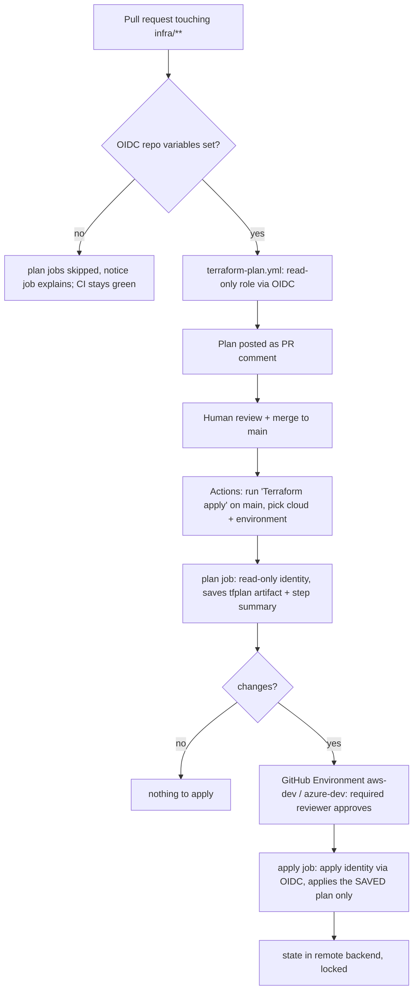

# CD: OIDC plan/apply with approval gates

> **Status: written and statically checked, never executed against a real cloud.**
> No AWS account or Azure subscription is attached to this repo. What was verified
> and what was not is listed in [Untested](#untested-no-cloud-account-attached).

Workflows: `.github/workflows/terraform-plan.yml` (PRs) and `.github/workflows/terraform-apply.yml`
(manual). Optional one-time trust setup: `infra/aws/bootstrap/oidc/`, `infra/azure/bootstrap/oidc/`.

## Flow



Guarantees: no apply on push or PR; apply runs only from `main`; the exact plan a human read is the
plan that is applied (Terraform rejects a stale saved plan); one apply per cloud+environment at a time
(`concurrency`, never cancelled mid-apply).

## How OIDC works and why there are no long-lived keys

1. A job with `permissions: id-token: write` asks GitHub for a signed JWT. Its claims state exactly
   where it runs: `sub` = `repo:nikshepkulli/claims-lakehouse:pull_request`, or
   `...:environment:aws-dev`, or `...:ref:refs/heads/main`.
2. The job presents the JWT to AWS STS (`AssumeRoleWithWebIdentity`) or Microsoft Entra
   (federated credential). The cloud verifies the signature against GitHub's public keys and
   checks the claims against the trust policy / credential subject.
3. It returns credentials valid for about an hour. Nothing is stored in GitHub secrets, so there is
   nothing to leak, rotate or expire. A fork or a different repo/environment gets a different `sub`
   and is refused.

Two identities per cloud, separate on purpose:

| | Plan identity | Apply identity |
|---|---|---|
| Trusts `sub` | `...:pull_request`, `...:ref:refs/heads/main` | `...:environment:<cloud>-<env>` only |
| Can | read metadata and state | create/change lakehouse resources |
| Used by | PR plan, plan stage of apply workflow | apply job after approval |

The apply token only exists once the Environment gate has passed, because the `environment:` `sub`
is minted only for a job that targets the Environment. AWS also pins `job_workflow_ref` to
`terraform-apply.yml@refs/heads/main`.

## Setup, step by step

All names below are exact; the workflows read them.

### 1. Create the trust (one time, by a human admin)

AWS (`infra/aws/bootstrap/oidc`, local state, run with admin credentials; `create_oidc_provider=false` if the account already has the GitHub provider):

```sh
cd infra/aws/bootstrap/oidc
terraform init && terraform apply \
  -var name_prefix=claims-lakehouse-dev -var environment=dev \
  -var state_bucket_name=<state-bucket> -var state_lock_table_name=<lock-table>
terraform output
```

Azure (`infra/azure/bootstrap/oidc`; needs Entra permission to create app registrations and Owner or
User Access Administrator on the resource group). The resource group must exist first, and it must
be the one `envs/dev` deploys into (default `rg-claims-lakehouse-dev`). The lakehouse module
*creates* its resource group, so a first apply would collide; import it once into the env state:

```sh
az group create -n rg-claims-lakehouse-dev -l centralindia
cd infra/azure/bootstrap/oidc && terraform init && terraform apply
# then, in infra/azure/envs/dev with the remote backend configured:
terraform import 'module.lakehouse_storage.azurerm_resource_group.this' \
  /subscriptions/<sub>/resourceGroups/rg-claims-lakehouse-dev
```

### 2. Remote state (required for apply)

The envs default to `backend "local"`, which does not survive a CI runner. The workflows write a
`backend_override.tf` selecting `s3` or `azurerm` from the variables below and the **apply workflow
refuses to run without them**. Create the state bucket + DynamoDB lock table (AWS) or a private storage
account + `tfstate` container (Azure) yourself; this repo does not provision them.

### 3. Repository variables (Settings > Secrets and variables > Actions > Variables)

These are variables, not secrets: none is sensitive.

| Variable | Used by | Value |
|---|---|---|
| `AWS_PLAN_ROLE_ARN` | plan + apply (plan stage) | output `plan_role_arn` |
| `AWS_REGION` | AWS | e.g. `us-east-1` (default if unset) |
| `TF_TRUSTED_PRINCIPAL_ARNS` | AWS env | JSON list, e.g. `["arn:aws:iam::123456789012:role/data-eng"]` (maps to the required `trusted_principal_arns`) |
| `TF_STATE_BUCKET`, `TF_LOCK_TABLE` | AWS | state bucket, DynamoDB lock table |
| `AZURE_PLAN_CLIENT_ID` | plan + apply (plan stage) | output `plan_client_id` |
| `AZURE_TENANT_ID`, `AZURE_SUBSCRIPTION_ID` | Azure | outputs of the same names |
| `TF_STATE_RESOURCE_GROUP`, `TF_STATE_STORAGE_ACCOUNT`, `TF_STATE_CONTAINER` | Azure | state storage (container defaults to `tfstate`) |

While `AWS_PLAN_ROLE_ARN` and `AZURE_PLAN_CLIENT_ID` are empty (today) the plan jobs are skipped and a
`plan skipped (OIDC not configured)` job prints a notice. Skipped is green.

### 4. GitHub Environments (Settings > Environments)

Create `aws-dev` and `azure-dev` (names are `<cloud>-<environment>` and must match the bootstrap `environment` variable):

1. **Required reviewers**: add yourself (and others). This is the manual approval. Tick "Prevent self-review" once there is a second reviewer.
2. **Deployment branches and tags**: "Selected branches" > `main`.
3. **Environment variables**: `aws-dev` gets `AWS_ROLE_ARN` = output `apply_role_arn`; `azure-dev` gets `AZURE_CLIENT_ID` = output `apply_client_id`. Keeping the apply identity on the Environment means PR code cannot read it.
4. Do not add environment secrets; there are none.

Optional hardening: add a `prod` entry to the `environment` choices only after a prod env and
bootstrap exist; give it more reviewers and a wait timer.

### 5. Run it

Actions > "Terraform apply" > Run workflow on `main` > choose cloud + environment. Read the plan in the
run summary, then approve the `apply` job when GitHub asks.

## Least-privilege notes (AWS apply policy)

Granted: bucket-level configuration on `<name_prefix>-*` buckets; role/inline-policy management on
`<name_prefix>-*` roles; KMS key create/policy/rotation/tag/schedule-delete (region-conditioned);
aliases named `<name_prefix>-*`; state objects and lock table if configured. Object deletion is granted
in `dev` only (module uses `force_destroy` there).

Deliberately **not** granted: reading or writing lakehouse *objects* (CD manages infrastructure, not data);
`iam:CreateUser`, access keys, `iam:AttachRolePolicy` to AWS-managed policies, `iam:PassRole`, creating or
editing OIDC providers; any edit of the two CD roles (explicit deny); `kms:Decrypt/Encrypt`;
Organizations, billing, CloudTrail, VPC, anything outside this stack; immediate KMS deletion.

Known residual risk: the apply role can create roles named `<name_prefix>-*` with arbitrary inline
policies, which is a privilege-escalation path inside the account. Closing it needs a permissions
boundary that the module attaches to its roles and the policy requires via `iam:PermissionsBoundary`.
That is a follow-up, not done here. KMS key ARNs are unknown before creation, so key actions cannot be
ARN-scoped.

Azure: plan = `Reader` on the resource group. Apply = `Contributor` plus `Role Based Access Control
Administrator` on the resource group, the latter conditioned to assign/remove only Storage Blob Data
Contributor/Reader. Not granted: subscription scope, Owner, User Access Administrator, any Entra directory
role. The optional CMK role assignment (`Key Vault Crypto Service Encryption User`) is on a Key Vault outside
the resource group and is not covered; grant that separately if you enable the CMK.

## Rollback runbook

See [runbook.md](runbook.md#failed-apply-and-drift) for the commands. Principle: roll forward through git.

1. A bad change is reverted with `git revert` on `main`, then the same plan, review, approve, apply loop. State is the source of truth; never hand-edit it first.
2. Apply failed halfway: do not re-run blindly. Read the failed job, fix cause, re-run the workflow (new plan will cover what is left). Locks are released by Terraform; see runbook for a stuck lock.
3. Data-bearing resources (S3 buckets, storage account) are not "rolled back" by Terraform. Recover objects from S3 versioning / Azure soft delete (14 d default). KMS keys are only scheduled for deletion (7-30 d); cancel with `aws kms cancel-key-deletion`.
4. Emergency stop: disable the Environment (remove reviewers' approval by cancelling the run), or delete the cloud-side trust (bootstrap `terraform destroy`, or remove the federated credential / role trust). No secret needs revoking because none exists.

## Untested (no cloud account attached)

Verified locally/CI: `terraform fmt -check`, `init -backend=false`, `validate` on both bootstrap modules (run
by hand: CI auto-discovers only `infra/*/envs/*` and `infra/*/modules/*`, so `infra/*/bootstrap/*` is **not**
validated by CI; adding it needs a `ci.yml` change); `actionlint` on all workflows; the plan workflow
skipping cleanly on this repo.

Never run: any real OIDC token exchange; the plan comment step; the saved-plan upload/download; the
approval gate; the S3/azurerm `backend_override.tf` swap; the IAM/Entra policies actually permitting every
call Terraform makes (expect to iterate on missing actions in the first real plan); the AWS
`job_workflow_ref` condition key (if your IAM does not support it, the apply role fails closed; set
`-var pin_workflow_ref=false` and rely on the Environment branch policy); the Azure ABAC condition
syntax; the Azure resource-group import step.
