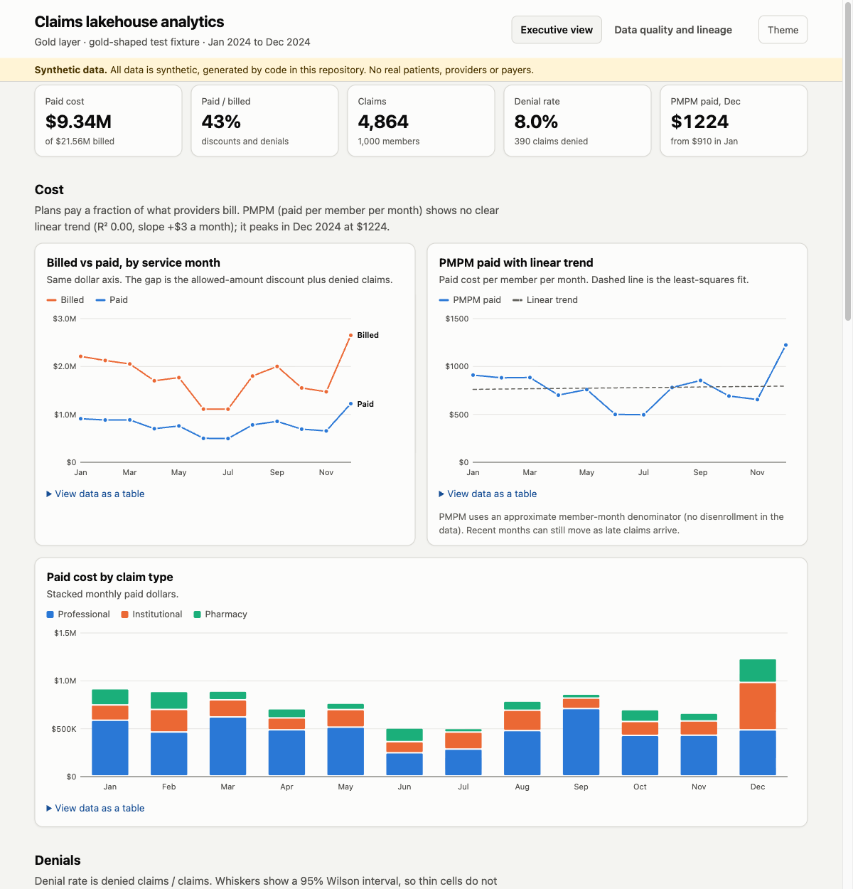
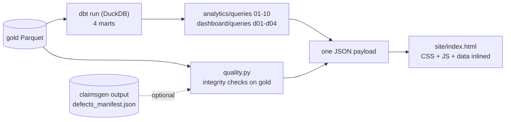
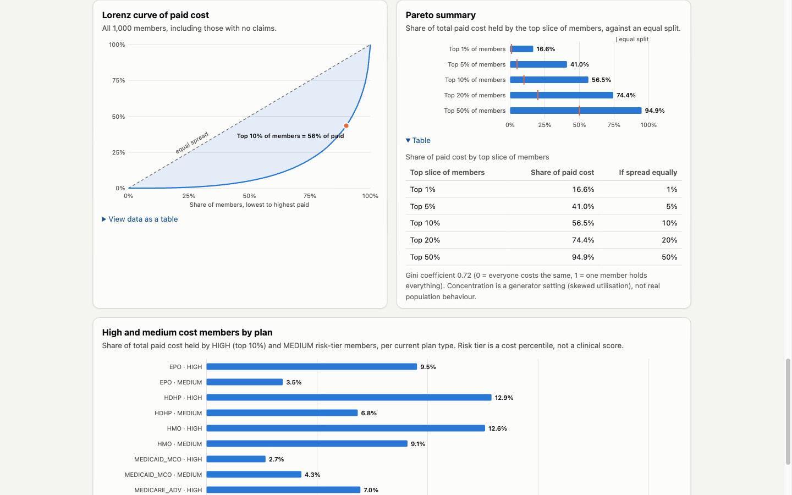
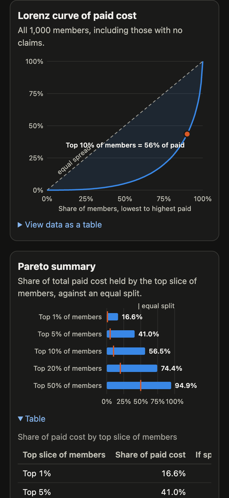
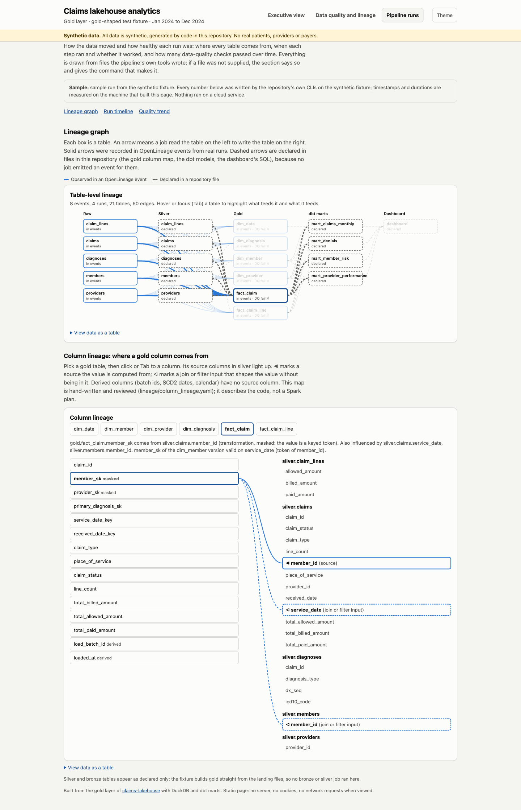
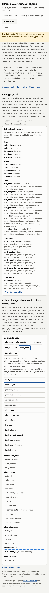
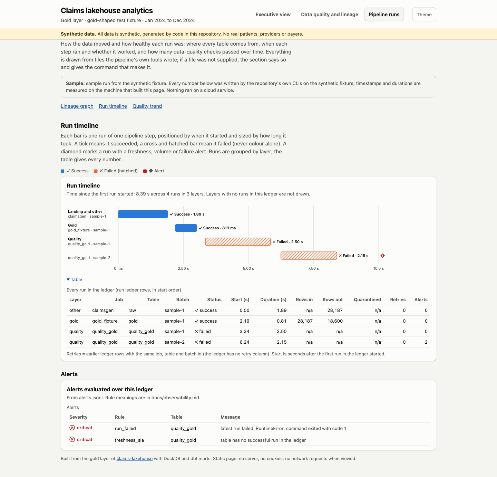
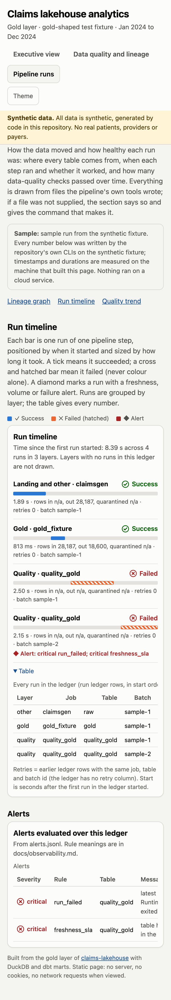
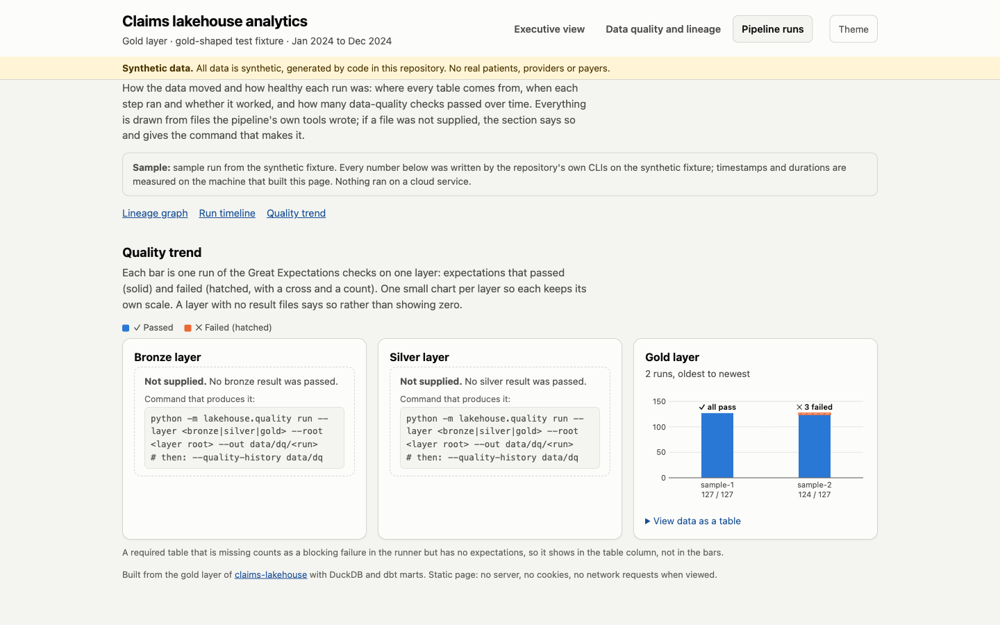
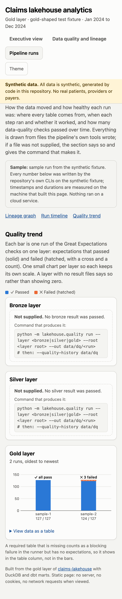

# Analytics dashboard

Ticket #29 (M7). **Live: <https://nikshepkulli.github.io/claims-lakehouse/>** (built from the synthetic gold-shaped test fixture, labelled as such on the page). A static, zero-backend page built from the gold layer: executive view (cost, denials, provider performance, member cost concentration), a data-quality view, and (ticket #30) a **Pipeline runs** view with a lineage graph, a run timeline and a quality trend. All data is synthetic.



> **What ran and what did not.**
> - Built and tested **locally and in CI** against the **gold-shaped test fixture** (`scripts/make_gold_fixture.py`, 5,000 claims, seed 42): claimsgen, then fixture, then `dbt run` on DuckDB, then the queries, then `site/index.html`. The screenshots above are that build, rendered in Chrome.
> - It has **not** been built from the Spark gold export in CI. The builder accepts that export (`--gold <gold root>`; it finds `export/`), but no job wires it up yet.
> - **Deployed to GitHub Pages** at the link above by the manual `pages.yml` workflow (`workflow_dispatch`); it redeploys only when the owner triggers it, so the live page can lag `main`. It shows the fixture build, not Spark gold.
> - Nothing here ran on AWS, Azure or Snowflake.

## Build it

```bash
pip install -r requirements-dbt.txt           # Python 3.11 or 3.12
make dashboard                                # dbt-data (if needed) + build -> site/index.html
make dashboard-serve                          # same, served on http://localhost:8000
python -m dashboard.build --gold data/gold --raw data/raw --out site   # the direct form
make dashboard-sample                         # sample run (real CLIs) + build with the Pipeline runs view
make dashboard-test                           # pytest tests/dashboard
```

Takes about 5 seconds for the 5,000-claim fixture (most of it `dbt run`); the tests, which build the page once, take about 15 seconds.

| Flag | Meaning |
|---|---|
| `--gold` | Gold Parquet root (`<table>/*.parquet`), or a Spark gold root containing `export/`. Required |
| `--out` | Output directory, default `site/`. Writes one file, `index.html` |
| `--marts-db` | Reuse a DuckDB file that already holds `marts.mart_*` and skip `dbt run`. Name it anything except `marts.duckdb`: a database called `marts` collides with the `marts` schema |
| `--raw` | claimsgen output root. Adds the injected-defect table and the raw-to-gold reconciliation |
| `--reconciliation` | Extension point: exported Spark `gold_reconciliation` (JSON list or Parquet) |
| `--quality-json` | Data-quality framework result: the runner's `<layer>-result.json` (ticket #22), or the minimal summary below |
| `--lineage-events`, `--column-lineage`, `--runs`, `--alerts`, `--quality-history`, `--pipeline-label` | Inputs of the Pipeline runs view (all optional; see [Pipeline runs](#pipeline-runs-ticket-30)) |
| `--gold-label` | How the page names its source, e.g. `Spark gold export`. Default `gold-shaped test fixture` |

## How it is built



- **Marts, not gold, feed the queries.** The existing ten analyst queries run unchanged under the same contract checks as `scripts/run_analytics_queries.py` (the builder imports its header parser and table check, so a query that reads staging or breaks its declared columns fails the build). Four new queries in `dashboard/queries/` follow the same header format and rules.
- **dbt runs without tests** (`dbt run`, not `build`): the `dbt` workflow and `pipeline e2e` already test the models. The builder uses a temporary profiles dir and target dir, so the working tree stays clean.
- **Quality checks read gold directly**, not the marts, so they are an independent path.
- **Rendering** is vanilla JavaScript and hand-written SVG: no charting library, no CDN, no fonts. The page contains `<script type="application/json" id="dashboard-data">` with every number it shows.

| Source | Feeds |
|---|---|
| `01`, `02`, `03`, `04`, `05`, `06`, `07`, `09` (analytics) | KPIs, claim-type mix, denial cuts, tier summary, specialty benchmark, flagged providers |
| `d01_monthly_cost_and_denials` | Billed vs paid, PMPM and trend, monthly denial rate |
| `d02_denials_by_specialty` | Denial rate by specialty |
| `d03_provider_peer_index` | Provider scatter (every provider with at least 20 claims) |
| `d04_member_cost_lorenz` | Lorenz curve, Pareto shares, Gini |

## What the charts show, and how to read them

- **Billed vs paid, PMPM.** Billed is what providers asked for; paid is what the plan paid (0 on denials). The PMPM trend is an ordinary least-squares line over the months; the text says "no clear trend" when R-squared is under 0.2. PMPM has the approximate member-month denominator described in [analytics-guide.md](analytics-guide.md).
- **Denials.** Rate is denied claims / claims, combined as a ratio of sums. Whiskers are 95 percent Wilson intervals so small cells do not look more certain than they are. The generated data has **no denial reason and no payer**, so "by reason and payer" is shown as claim type, specialty and current plan type (a payer proxy), and the page says so.
- **Provider performance.** Provider ids are long keyed tokens (`tok_<key_id>_<hex>`, see [privacy-and-access.md](privacy-and-access.md)), so the scatter labels show only an ellipsis and the last 6 characters; the tooltip and the flagged-providers table show the full token next to the short label. Cost index = provider allowed per claim / specialty allowed per claim (the mart's normalisation, claims-weighted over the months), so 1.00 means "at specialty peers" and a large pharmacy and a small radiology group are comparable. Providers under 20 claims are dropped: their ratio is noise. Flag at 1.25 or more, the same rule as query 09. There is no case-mix adjustment, so this flags cost, not quality. The headline counts how many flagged providers are in the ELEVATED or HIGH_COST tiers the generator planted, which is a check that the normalisation finds what was built in.
- **Member cost concentration.** Three views, all rendered side by side (no tabs or toggles, so none can be hidden): the **Lorenz curve** of paid cost over all members (including those with no claims; the table under it lists every percentile), the **Pareto summary** (share of paid cost held by the top 1, 5, 10, 20 and 50 percent of members against an equal split, plus the Gini coefficient) and **high and medium cost members by plan** (query 05: share of paid cost held by HIGH and MEDIUM risk-tier members per current plan type). Concentration is a generator parameter, not real population behaviour. `MEMBER_VIEWS` in `dashboard/build.py` declares the views; `app.js` throws if a declared view has no renderer, and shows "No data" if a view's data is empty. Charts draw through a `ResizeObserver`, so a page opened in a background tab or switched from a hidden view still draws.





## Data-quality scorecard

Three layers, each shown or marked "not supplied", never invented:

1. **Gold integrity checks** (always): 12 independent DuckDB checks on the gold Parquet (unique keys, member and provider resolution, no orphan lines, valid procedure and ICD-10 codes, no negative amounts, header equals sum of lines, denied claims paid 0, one current SCD2 version per key). The expected violation count is zero. `tests/dashboard` plants a duplicate claim and a negative amount in a copy of gold and asserts the checks fail.
2. **Injected defects vs gold** (`--raw`): each defect in `defects_manifest.json`, how many were injected, how many of that kind are still visible in gold, and the catch rate. "Caught" means absent from gold; it does not say whether silver quarantine, a gold exclusion or de-duplication removed it. Null and invalid procedure code (and null and invalid ICD-10) share one check, so their "still in gold" counts are combined. `late_arrival` is kept on purpose; the two event defects belong to the streaming job and are marked not applicable. Also the row identity raw = duplicates + quarantined or excluded + gold, per fact table.
3. **Great Expectations result** (`--quality-json`) and **Spark `gold_reconciliation`** (`--reconciliation`). The first is wired into `pages.yml` and the `dashboard` CI job (below); the second is still an extension point and shows "not supplied".

### `--quality-json`: Great Expectations result (ticket #22)

`pages.yml` and the CI `dashboard` job run `python -m lakehouse.quality run --layer gold --root data/gold --out data/dq` on the fixture and pass `data/dq/gold-result.json`. The loader (`dashboard/quality.py::load_quality_json`) turns the runner's output into one row per gold table: expectations evaluated, passed, failed, and a status.

What the page shows, and does not hide: the fixture has no `gold_reconciliation` or `gold_exclusions` table (only the Spark gold job writes them), and the runner treats them as required, so the run **exits 1** with two "table missing" blocking failures. The six star tables pass all 127 of their expectations. The page lists the two as "Table missing from this source: not evaluated" with a note, and the headline tile shows the failing status. It does not claim the fixture passed everything. The workflow tolerates exit 1 (and fails on exit 2 or a missing result file). Running it on the real Spark gold would clear the two failures; that has not been wired.

The loader also accepts a minimal hand-written summary; a file that matches neither shape fails the build.

```json
{
  "generated_by": "great_expectations 1.x",
  "suites": [
    {"name": "silver_claims", "layer": "silver", "evaluated": 24, "passed": 23, "failed": 1}
  ]
}
```

### Extension point: `--reconciliation`

The Spark gold job writes `gold_reconciliation` to Delta only, and the dashboard does not read Delta. Export the table as a JSON list of objects or as Parquet with the columns `gold_table, batch_id, silver_rows, gold_rows, excluded_rows, identity_ok` (extra columns are ignored); the page renders it with a holds or broken marker per row.

## Pipeline runs (ticket #30)

A third tab, `#pipeline`, with three sections (`#pipeline/lineage`, `#pipeline/timeline`, `#pipeline/trend`). It answers, in plain language: where does each table come from, when did each step run and did it work, and how many data-quality checks passed over time.

> **What ran and what did not.** The numbers come from a **sample run from the synthetic fixture**, labelled that way on the page: `python -m dashboard.sample` wraps real local steps in the repository's own observability and lineage wrappers and runs the Great Expectations gold check. No Spark, Docker, cloud or Marquez was involved. There was **no bronze or silver job** in it (the fixture builds gold straight from the claimsgen landing files), so those layers appear as declared only. Row counts, statuses and expectation counts are deterministic for the seed; timestamps and durations are measured on the building machine and differ per build.

### Inputs, and what the page does without them

Every input is optional. A missing one renders **"Not supplied."** plus the command that produces it; nothing is invented and nothing is shown as zero.

| Flag | File | Produced by | Feeds |
|---|---|---|---|
| `--lineage-events` | OpenLineage JSON lines | `python -m lakehouse.lineage wrap`, `emit`, `quality` ([lineage.md](lineage.md)) | Table-level graph (solid edges) |
| `--column-lineage` | `lineage/column_lineage.yaml` | checked in, reviewed ([lineage.md](lineage.md)) | Column drill-down, silver to gold declared edges |
| `--runs` | Run ledger: Parquet dir/file, or JSON lines | `python -m lakehouse.observability wrap` / `runs` ([observability.md](observability.md)) | Run timeline |
| `--alerts` | `alerts.jsonl` | `python -m lakehouse.observability check` | Alert markers and the alerts table |
| `--quality-history` | `<layer>-result.json` files or directories | `python -m lakehouse.quality run --layer ...` ([data-quality.md](data-quality.md)) | Quality trend |
| `--pipeline-label` | text | you | Banner on the view (CI passes "sample run from the synthetic fixture") |

```bash
make dashboard-sample     # = python -m dashboard.sample --out data/dashboard-sample, then the build with all five inputs
```

`dashboard/sample.py` runs: `claimsgen` (landing files), `gold_fixture` (landing to the six gold tables), and `quality_gold` twice. Each step is `observability wrap` outside `lineage wrap`, so one run id appears in the ledger and in the events. Batch `sample-1` checks the fixture; batch `sample-2` checks a copy of gold with a planted duplicate claim and negated line amounts, so the trend shows a real change. Then `observability check` evaluates the rules over the ledger (with `expected_tables` narrowed to the tables this sample runs). Its two alerts are real: the gold quality run exits 1 because the fixture lacks `gold_reconciliation` and `gold_exclusions`, so the ledger records `failed`, which fires `run_failed` and `freshness_sla` (`never_succeeded`).

### Lineage graph





- **Layered DAG**: raw, bronze, silver, gold, dbt marts, dashboard, hand-written SVG (no library). A layer is drawn only if it has tables. Hover or focus (Tab) a table to highlight what feeds it and what it feeds; every table is a focusable group with a text label.
- **Evidence is part of the picture.** Solid blue edges and solid boxes were **recorded in OpenLineage events** (the final event of each run: COMPLETE or FAIL; a run with only START has no outputs and adds no edge). Dashed grey edges and dashed boxes are **declared in files in this repository**: silver to gold from the column map, gold to marts from the `ref()` chain in `dbt/models` and marts to the dashboard from the `marts.mart_*` tables each query file reads. A table's sub-line says "in events" or "declared"; gold tables also show the latest `quality.<layer>` run result (tick or cross plus a word).
- **Why raw to gold skips silver**: the fixture has no silver job, so the events say raw to gold and the dashed silver boxes come only from the column map. The graph draws that rather than inventing a silver run.
- **Dataset to stage**: the stage is the right-most path segment (or namespace token such as the bucket `claims-silver`) that is `raw`/`landing`, `bronze`, `silver` or `gold`; the table is the last path segment (`dashboard/pipeline.py::dataset_ref`, tested for file, `s3` and `abfss` spellings).
- **Column drill-down**: pick a gold table, then click or Tab to a column. Its silver source columns get a solid frame and a `◀` mark, join or filter inputs a dashed frame and `◁`, and a sentence spells it out (including masking, and derived columns that have no source). Connector lines are drawn on wide screens. The map is the hand-written `column_lineage.yaml`; it describes the code, not a Spark plan.
- **Narrow screens**: under 860 px the SVG graph is replaced by a nested list (stage, table, "from ..."), the column picker stacks, and every edge and column is also in a "View data as a table" fallback.

### Run timeline





- One bar per ledger row, grouped by layer (in order of first start), positioned by start offset and sized by duration. Success is a solid bar with a tick; failure is a **hatched** bar with a cross and the word "Failed", so status never relies on colour. Duration, rows in/out/quarantined and retries are in the tooltip, the focusable bar's label and the always-open table.
- **Retries** are derived: earlier ledger rows with the same job, table and batch id (the ledger has no retry column). The sample has none; the derivation is unit-tested.
- **Alerts**: a diamond with "!" marks a run with an alert. An alert carrying a `run_id` sits on that run; a table-level alert (freshness) is pinned to the table's latest run and flagged `scope: table` in the payload. The alerts table lists severity (icon plus word), rule, table and message. If `--alerts` is given and empty, the page says no alert fired; if it is not given, it says "not supplied".
- Under 640 px the Gantt becomes a list with a small positioned bar per run.

### Quality trend





Small multiples, one chart per layer (bronze, silver, gold), one bar per run: expectations passed (solid) and failed (hatched, with a cross and a count), the run label under the bar and `passed / evaluated`. A layer with no result files shows "not supplied" and the `lakehouse.quality run` command, not an empty chart. A required table that is missing counts as a blocking failure in the runner but has no expectations, so it appears in the table column "Tables missing" (the sample's gold runs each have 2). The sample has gold only: the quality runner needs bronze or silver data with the pipeline's metadata columns, which the fixture does not have.

### How it is wired

`dashboard/pipeline.py` parses the inputs into one `pipeline` payload section (pure functions, tested against the raw files); `dashboard/pipeline.js` renders it and is spliced into `app.js` at build time, so the output is still **one self-contained `index.html`** with no external requests. `PIPELINE_VIEWS` in `pipeline.py` declares the three sections; `pipeline.js` throws if a declared view has no renderer, and the tests check each one (the same guard as the member-concentration views).

## Design notes

- **One axis per chart**, no dual axes. Billed and paid share a dollar axis; PMPM and denial rate get their own charts.
- **Palette.** Blue, orange and green categorical slots from the dataviz reference palette, validated on the light surface (`#fcfcfb`) and dark surface (`#1a1a19`): adjacent colour-vision-deficiency separation at least 9.2 (target 8), normal-vision separation at least 26. Green is below 3:1 on the light surface, so it is only used for the claim-type stack, which has a legend and a table view. Text always uses text tokens, never the series colour. Pass/fail status always pairs an icon with a word.
- **Direct labels** on the two headline lines and on bar values; legend present whenever there are two or more series; hover or focus tooltip on every chart; every chart has a "View data as a table" fallback, and the tooltips are also reachable by keyboard (arrow keys on line charts, Tab on bars and columns).
- **Light and dark.** Follows the OS setting; the Theme button overrides it and remembers the choice in `localStorage` when available (the page works without it).
- **Mobile.** Single column below 880 px; SVGs re-render to the container width; wide tables scroll inside their card.

## Tests (`tests/dashboard`)

| File | What it pins |
|---|---|
| `test_metrics.py` | OLS trend, Wilson interval, Gini, top-share maths (pure Python) |
| `test_quality_inputs.py` | Defect-catch table logic, `--quality-json` validation (both shapes, missing tables), `--reconciliation` loader, provider label shortening |
| `test_dashboard_build.py` | Build under 60 s; every declared member-cost view has a renderer and data; the Lorenz curve starts at (0,0), ends at (1,1), is monotone and lies on or below the equality line; Pareto shares equal a direct computation on gold; one file output; the dashboard's headline, monthly and concentration numbers equal sums computed directly on the gold Parquet (an independent path from the marts); denial cuts sum to the headline; flagged providers equal the index rule; planted defects fail the checks; extension points render |
| `test_pipeline_view.py` | Pipeline runs view. Unit: timeline equals ledger rows, derived retries, alert attachment, empty ledger, dataset-to-stage naming, edges only from final events, trend counting, ledger Parquet = JSON lines. Integration on the real sample run: timeline durations, counts, statuses and alerts equal the ledger and `alerts.jsonl` read independently; row counts equal the Parquet files on disk; graph edges equal the events; declared edges include marts and the dashboard; the column map equals `column_lineage.yaml` entry by entry; trend counts equal the result JSON. Static: every declared view has a renderer, section and nav target; no network or HTML injection; focusable nodes, bars and buttons; narrow-screen fallbacks; every empty input says "Not supplied" with its command |
| `test_dashboard_html.py` | No external requests (no `src`/`href` to a network URL, no `fetch`/XHR/`import()`, no `@import`); landmarks, title, lang, labelled SVGs, table fallbacks, keyboard support; WCAG contrast of the CSS tokens in both themes (text 4.5:1, headline series 3:1) |

The pure tests run in the plain `pytest` job. The build tests need duckdb, dbt and claimsgen's numpy/pyarrow and skip themselves when those are missing; the CI `dashboard` job installs `requirements-dbt.txt` and runs them.

## CI and publishing

- **`dashboard` job** in `ci.yml`: runs `pytest tests/dashboard`, runs the gold quality checks on the fixture, generates the sample inputs (`python -m dashboard.sample`, about 10 s), builds the page (with the Pipeline runs inputs) from the fixture and uploads `site/index.html` as the `dashboard-site` artifact. It deploys nothing.
- **`pages.yml`**: `workflow_dispatch` only (unchanged trigger; it was not run for #30, so the live page does not show the new view until the owner triggers it). Builds the same page (including the quality and sample steps) and deploys with `actions/deploy-pages`. Pages is enabled (Source: GitHub Actions); the owner triggers a redeploy by hand. Cloudflare Pages needs no workflow: point a Pages project at the `dashboard-site` artifact or at `site/`.

## Known limits

- Source is the fixture, not the Spark gold; real-gold numbers differ (for example, no second SCD2 version).
- Provider and member views use *current* SCD2 attributes, like the marts they read.
- Bronze and silver row counts are not measured in this build, so the lineage strip says "not run here" for that stage rather than showing a number.
- Hover tooltips on the provider scatter and Lorenz chart are pointer-only; their data is in the table view.
- Pipeline runs: the sample has no bronze or silver job, no retry, and no volume or freshness-by-age alert (the ledger is a few seconds old and has too little history); those code paths are covered by unit tests, not by the sample. Lineage was read from a file, never from a live Marquez. Raw-to-gold edges are drawn behind the silver boxes, so read the sub-line ("in events" or "declared") rather than assuming a silver step ran. Screenshots are of the sample build, rendered in Chrome; keyboard behaviour was checked in the browser and by static tests, not by an automated browser suite.
