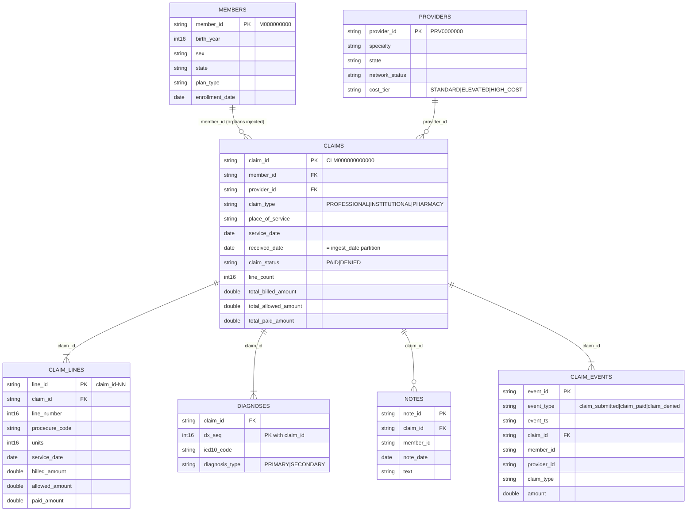

# Synthetic claims data generator (`claimsgen`)

> **All data produced by this generator is 100% synthetic. It contains no real PHI or PII, is not derived from any real patient, member, provider or payer, and must never be mixed with real data.** Member and provider identifiers are sequential fabricated tokens, notes are templated text carrying a `[SYNTHETIC NOTE ...]` marker, and phone-like strings use the reserved fictional `555-01xx` range. Code *formats* (CPT-shaped procedure codes, ICD-10 codes) are real public vocabularies; their pairing with people is random.

## Quick start

```bash
pip install -r requirements-claimsgen.txt          # numpy + pyarrow
PYTHONPATH=src python -m claimsgen --rows 100000 --seed 42 --out data/raw
```

| Flag | Default | Meaning |
|---|---|---|
| `--rows` | 100000 | distinct **claims** (headers, min 1000). Lines are about 2.4x, diagnoses about 2x |
| `--seed` | 42 | whole output is a pure function of seed + settings |
| `--out` | `data/raw` | output root (gitignored). Refuses to overwrite unless `--overwrite` |
| `--chunk-size` | 250000 | claims per chunk; bounds memory (part of the determinism contract) |
| `--formats` | `parquet` | comma list; `--formats parquet,csv` opts in to CSV copies (about doubles write time and disk) |
| `--target-file-mb` | 128 | target uncompressed size of each output file; see "File layout" |
| `--start-date`, `--days` | 2024-01-01, 366 | service-date window |
| `--notes-rate` | 0.25 | share of claims that get a clinical note |

Output layout (Hive-style date partitions; the date is the **ingest/batch date**, i.e. `received_date`):

```
data/raw/
  members/snapshot_date=2024-01-01/part-00000.parquet
  providers/snapshot_date=2024-01-01/part-00000.parquet
  claims/ingest_date=YYYY-MM-DD/part-<n>.parquet   # (+ .csv with --formats parquet,csv)
  claim_lines/ingest_date=.../part-<n>.parquet
  diagnoses/ingest_date=.../part-<n>.parquet
  events/claim_events.jsonl            # JSON-lines claim event stream (time-ordered within a chunk, plus injected duplicates / out-of-order events)
  notes/ingest_date=.../part-<n>.jsonl   # free-text clinical notes
  defects_manifest.json                # ground truth for every injected defect
```

## Schema



## File layout (compaction)

Generation is chunked for bounded memory, but a chunk contains rows for many `ingest_date` partitions, so writing straight out would create one file per chunk per day: at millions of rows that is tens of thousands of tiny files, the classic small-files anti-pattern (slow listing, per-file task overhead in Spark, poor Parquet row-group stats). Instead, each chunk is spilled to a private `_staging/` directory, and after the last chunk every table/`ingest_date` partition is compacted, **one day at a time** (so memory is bounded by one day's data, not the dataset): the day's rows are concatenated in chunk order and written as `ceil(day_bytes / target)` files of near-equal size, named `part-00000`, `part-00001`, ... (`--target-file-mb`, default 128 MB of uncompressed Arrow data; Parquet/zstd files on disk are several times smaller). Staging is deleted when done. A normal day is a single file per table; only a day larger than the target splits. Notes (JSONL) follow the same rule by bytes. File names and row order are a pure function of the inputs, so determinism is preserved. CSV is opt-in because Parquet is the lakehouse landing format; CSV copies use the same file split as Parquet.

Amounts are `float64` rounded to cents (raw layer); downstream layers are expected to cast to `DECIMAL(12,2)`. Header totals equal the sum of their lines (after negative-amount injection).

## Realism

- **Cost skew:** ~80% of providers standard, ~18% elevated (1.2-2x), ~2% `HIGH_COST` (4-8x prices). Claim volume per provider is Zipf-distributed. Procedure and diagnosis frequencies are Zipf-weighted; billed amounts are log-normal around a per-code base price.
- **Member utilisation:** skewed (`id ~ N * u^2`), so a minority of members generate most claims.
- **Seasonality:** daily volume = winter respiratory-season cosine (+/-25%, peak mid-January), weekends at 35%, plus noise; the per-day counts are drawn from one multinomial so they sum exactly to `--rows`.
- **Lifecycle:** each claim emits `claim_submitted` then `claim_paid` or `claim_denied` (8% denied, paid = 0).

## Defect catalogue

Every defect is injected at a configurable rate (`DefectRates` in `config.py`) and counted in `defects_manifest.json` (`count`, `rate`, `table`, `description`, 5 `sample_ids`). Counts are of **distinct** injected records (event defects: distinct `event_id`s; the `events` row count in `rows_written` includes the duplicate copies); duplicate copies replicate rows including any other defect they carry.

| Defect | Table | How it looks | Default rate | Detect with |
|---|---|---|---|---|
| `duplicate_claim` | claims, claim_lines, diagnoses | whole claim re-sent in the same batch, byte-identical rows | 0.5% of claims | `count(*) > count(distinct claim_id)` |
| `late_arrival` | claims (and children) | `received_date` is 31-90 days after `service_date` (normal 0-2) so the claim lands in a far-later partition | 2% of claims | lag > 30 days; watermark / late-data handling |
| `orphan_member_id` | claims | `member_id` absent from `members` | 0.3% of claims | anti-join to members |
| `null_procedure_code` | claim_lines | NULL | 0.4% of lines | not-null test |
| `invalid_procedure_code` | claim_lines | e.g. `ABCDE`, `99-99`, `0000` | 0.4% of lines | `^(\d{5}\|[A-V]\d{4})$` |
| `negative_amount` | claim_lines | billed/allowed/paid negated | 0.3% of lines | amount >= 0 test |
| `null_icd10` | diagnoses | NULL | 0.4% of dx rows | not-null test |
| `invalid_icd10` | diagnoses | e.g. `123.45`, `??.1`, `i1o` | 0.4% of dx rows | `^[A-TV-Z]\d[0-9A-Z](\.[0-9A-Z]{1,4})?$` |
| `duplicate_event` | events | identical event line (same `event_id`, `event_ts`, payload) re-sent 1-199 stream positions later | 0.5% of events | `count(*) > count(distinct event_id)`; dedupe on `event_id` |
| `out_of_order_event` | events | `event_ts` is 1 min to 4 h earlier than the preceding event in file order (never earlier than the claim's own submission), i.e. the event arrives after later-stamped events | 1% of events | `event_ts` < running max of `event_ts`; needs watermark / event-time handling |
| `schema_drift` | claims | **one** weekday partition (chosen by seed, days 100-250) has an extra column `prior_auth_flag` in every file of that partition (Parquet and CSV if enabled) | 1 day | schema-evolution / contract check |

Notes and events are built from the clean claim data (notes show the true diagnosis even where the diagnosis row was corrupted), which gives later reconciliation checks something real to find.

## Determinism and scale

Each chunk draws from `SeedSequence([seed, stream, chunk_index])`, so output depends only on `(seed, rows, chunk_size, config)`: no clock, no iteration-order effects. Tests assert byte-identical trees for repeated runs. Changing `--chunk-size` changes the sampled data (documented, deliberate). Memory is bounded by the chunk during generation and by one ingest_date partition during compaction (dimension tables are held in memory: members = rows/6 capped at 5M, providers = rows/400 capped at 100k).

### Measured performance

Apple-silicon laptop, Python 3.14, pyarrow 26, numpy 2.5, single process, default settings (parquet only, 128 MB target files, chunk size 250k), seed 42. Measured, not extrapolated.

| Claims (`--rows`) | Table rows written (claims+lines+dx) | Wall time | Peak RSS | Disk | Files per core table (claims / lines / dx) | Files total incl. notes + dims |
|---|---|---|---|---|---|---|
| 100,000 | 541k (+201k events) | 2.1 s | 0.47 GB | 66 MB | 448 | 1,762 |
| 1,000,000 | 5.4M (+2.0M events) | 9.8 s | 1.08 GB | 607 MB | 456 | 1,824 |
| 5,000,000 | 27.0M (+10.1M events) | 43.5 s | 1.20 GB | 2.9 GB | 456 | 1,826 |

File count is flat in volume: one file per table per `ingest_date` (about 450 partitions: 366 service days plus late-arrival days), because a day stays far below the 128 MB target at these sizes. Before compaction the same 5M run wrote about 7.9k files in total (previous measurement). Compaction costs roughly a third of wall time (about 6.5 s -> 9.7 s at 1M claims, parquet only), the price of not writing small files. Memory is flat in volume (about 1.2 GB at 5M).

**Extrapolation (not measured):** time scales about linearly, so 50M claims would be on the order of 7-8 minutes and ~30 GB; a day would then be ~10x larger (about 30 MB uncompressed per table), still one file per table/day under the 128 MB default. The 50M figure has not been run.

## Tests

`pytest tests/claimsgen` covers: byte-level determinism, seed sensitivity, manifest counts vs counts recomputed from the data for every defect, referential integrity of non-injected rows (and that orphans are exactly the injected set), header/line reconciliation, duplicates being exact re-sends, schema drift confined to one partition, partition/`received_date` agreement, cost and seasonal skew, events/notes parseability and synthetic marker, CSV/Parquet row parity, parquet-only default, compaction (one file per table/day by default, target-size splitting with identical rows/order, staging removed), event duplicates (identical, counted) and out-of-order events (counted, isolated from baseline), and a CLI smoke test.

Privacy: the synthetic identifiers, `birth_year`, dates and the phone-like strings in notes are classified in `governance/data_classification.yaml` and used as the test corpus for tokenisation and note scrubbing; see [privacy-and-access.md](privacy-and-access.md).
