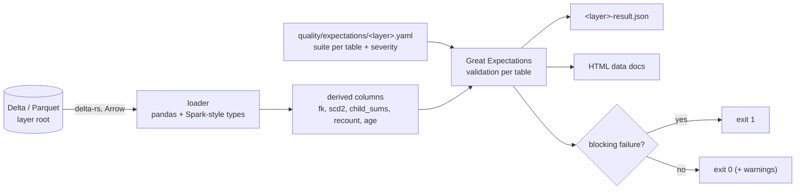

# Data quality framework

Ticket #22. Quality is **measured on the data on disk**, per medallion layer, with [Great Expectations](https://greatexpectations.io) (GE) 1.11. One suite file per layer lives in `quality/expectations/`, the runner is `src/lakehouse/quality/`, and the result of every run is a machine-readable JSON file plus HTML data docs.

> **What ran and what did not.** The framework runs on a laptop and in the `pipeline e2e` CI job: pandas + [delta-rs](https://github.com/delta-io/delta-rs) over Delta/Parquet, **no Spark, no cloud**. The data is 100% synthetic. Nothing here ran on S3, ADLS, Databricks or Snowflake. See [What ran where](#what-ran-where) for the exact list.

## Run it

```sh
pip install -r requirements-quality.txt            # GE 1.11.3, pandas 2.3.3, deltalake 1.6.6
make pipeline-e2e                                  # (Docker + Spark) produces data/e2e/{bronze,silver,gold}
make dq                                            # all three layers; exit 1 on a blocking failure
python -m lakehouse.quality run --layer silver --root data/e2e/silver --out data/dq
make dq-test                                       # unit + injected-defect tests, no Spark
```

| Flag | Meaning |
|---|---|
| `--layer {bronze,silver,gold}` | which suite file to load (`quality/expectations/<layer>.yaml`) |
| `--root` | the layer root: Delta tables (or plain Parquet directories) one level below |
| `--out` | where `<layer>-result.json` and `data_docs/` go (default `data/dq`) |
| `--now ISO` | clock for freshness checks (tests pin it) |
| `--no-docs` | skip the HTML build |
| `--fail-on-warn` | promote warnings to failures (a stricter gate for releases) |
| `--expectations DIR` | alternative suite directory |

Exit codes: **0** no blocking failure (warnings are printed, and become `::warning::` annotations in GitHub Actions), **1** a blocking expectation failed or a required table is missing or unreadable, **2** usage error (unknown layer, no suite file).

## How it works



1. **Load.** Delta tables are read through the transaction log (so files removed by a `replaceWhere` overwrite are not double counted); directories without `_delta_log` are read as Parquet. Decimals become `float64` (cent-exact for `DECIMAL(12,2)`), timestamps naive UTC, small ints `int64`. The Arrow schema is kept and rendered as Spark `simpleString` types (`decimal(12,2)`, `timestamp_ntz`) so it can be compared with the contract.
2. **Derive.** GE validates one table at a time, so cross-table and aggregate rules are computed first as per-row booleans and then asserted with `expect_column_values_to_be_in_set: [true]` (`quality/expectations` calls these *derived* columns; `derived.py` has the builders). A defect therefore appears as a count with sample rows, exactly like a plain column rule.
3. **Validate.** One GE suite per table (`<layer>.<table>`), plus an auto-built *schema* suite (`<layer>.<table>:schema`) that compares the actual columns and types with the contract.
4. **Report.** Severity travels in each expectation's `meta`; the runner folds results into `LayerResult`, writes the JSON, builds the data docs and decides the exit code.

### Derived-column kinds

| kind | Asserts |
|---|---|
| `fk` | `column` resolves to `ref` (`table.column`); `allow_null` for optional keys |
| `eval` | a pandas expression over the row (`bronze_rows == silver_rows + quarantined_rows + deduped_rows`) |
| `child_sums` | header `line_count` and totals equal the sum of the child lines |
| `scd2` | one current version per key, no gap, no overlap, `is_current` agrees with `effective_to` |
| `batch_count` | a **recorded** reconciliation count equals the rows really in the table for that batch (an independent re-count) |
| `age_hours` | age of a load timestamp, for freshness (`expect_column_min_to_be_between` on it = age of the newest row) |

## Suite map

Counts are expectations in the shipped files; the schema suites add more at run time (gold: contract columns, types, NOT NULLs, classification).

| Layer | Table | Schema | Not null / unique keys | Referential integrity | Ranges and domains | Reconciliation / volume / freshness |
|---|---|---|---|---|---|---|
| **bronze** | claims, claim_lines, diagnoses, members, providers | columns present (types not pinned: landed as-is) | `_batch_id`, `_ingest_date`, `_ingest_ts`, `_source_file` not null (blocking); business keys not null / unique (**warn**: defects are injected) | n/a (silver enforces) | `_batch_id` is `bYYYYMMDD` (blocking); claim type/status, procedure and ICD-10 patterns, amounts >= 0, sex, cost tier (**warn**) | row count >= 1 (blocking); newest `_ingest_ts` under 7 days (warn) |
| | notes, events (optional), `_meta/schema_log`, `_meta/quarantine` (optional) | columns present | batch id, dataset, reason not null | | no unreadable file in a batch; schema drift flagged (warn) | |
| **silver** | members, providers | columns **and types** | keys not null and unique | n/a | sex F/M/U, birth year 1900-2100, cost tier; plan type, id shapes (warn) | row count >= 1; freshness (warn) |
| | claims | columns and types | `claim_id` unique | `member_id` in members, `provider_id` in providers | claim type/status; `received_date >= service_date`; line_count and header amounts (warn) | row count >= 1; freshness (warn) |
| | claim_lines, diagnoses | columns and types | `line_id` unique; `(claim_id, dx_seq)` unique | `claim_id` in claims | procedure code and ICD-10 patterns, amounts >= 0, units >= 1, diagnosis type | row count >= 1 |
| | silver_quarantine | columns | reason code, dataset, source batch, payload not null | | | |
| | silver_reconciliation | columns and types | | | | `identity_ok`; identity recomputed from the counts; recorded `silver_rows` equals rows really in the table; quarantine share <= 20% (warn) |
| **gold** | all 6 star tables + `gold_reconciliation`, `gold_exclusions` | **exact** columns, types, NOT NULLs from `lakehouse.gold.schema` (= the Snowflake DDL); every star column is in `governance/data_classification.yaml` | primary keys and natural keys unique; surrogate keys are sha256 hex | all fact -> dim keys (`member_sk`, `provider_sk`, nullable `primary_diagnosis_sk`, both date keys), `fact_claim_line.claim_id` | claim type/status, sex, cost tier, birth year, month/quarter/day ranges, amounts >= 0, units >= 1, date key order, `is_weekend` agrees with `day_of_week` | header = sum of lines (count and 3 amounts); SCD2 history sound; `gold_reconciliation` identity recomputed and `gold_rows` equals fact rows per batch; `key_violations = 0`; no `UNRESOLVED_*` exclusions; exclusion share <= 10% and fact freshness (warn) |

Value domains come from [data-generator.md](data-generator.md) (claim types, statuses, procedure and ICD-10 patterns, cost tiers, plan types) and the silver rule catalogue ([silver.md](silver.md)); classification coverage comes from `governance/data_classification.yaml`.

## Severity policy

Every expectation carries `severity` in its metadata (`blocking` is the default).

| Severity | Used for | On failure |
|---|---|---|
| `blocking` | a guarantee the layer's own job claims: contract columns and types, NOT NULL and unique keys, referential integrity, reconciliation identities, SCD2 soundness, silver's own validity rules, ingestion metadata, non-empty tables | exit 1, red `::error::`, the DAG/CI job fails |
| `warn` | plausibility bounds the pipeline does not enforce, **defects bronze is meant to contain**, freshness, shares (quarantine/exclusion), id shapes, optional-column checks | printed as `WARN` and a `::warning::` annotation, exit 0 (`--fail-on-warn` promotes) |

Bronze is the deliberate exception to "almost everything blocks": it keeps the generator's duplicates, nulls, bad codes and orphans so silver can quarantine them, so asserting them as blocking would fail every healthy run. A bronze warning is information (it should match `defects_manifest.json`); a **silver or gold** warning means a bound drifted.

## Outputs

* `<out>/<layer>-result.json`: `layer`, `root`, `success`, `summary` (tables, expectations, passed, failed_blocking, failed_warn), and per table `status` (`validated`, `skipped`, `missing`), `rows`, `storage` (`delta`/`parquet`) and every expectation with `type`, `kwargs`, `severity`, `note`, `success`, `unexpected_count`, `unexpected_percent`, `observed_value`, up to 5 `samples`, and `error`.
* `<out>/data_docs/index.html`: GE data docs (suites and validation results for every layer that was run into the same `--out`). The GE project (stores, suite JSON) is under `<out>/gx/`.

Data docs and results contain **sample values from the data**. Here they are synthetic; with real data, set `result_format` to `BASIC` in `runner.py` before publishing the docs anywhere.

CI builds the docs in the `pipeline e2e` job and uploads `data-quality-docs` (docs plus the three JSON files) as a build artifact. They are deliberately **not** published to GitHub Pages.

## How it complements the dbt tests

| | dbt tests ([dbt.md](dbt.md)) | These GE suites |
|---|---|---|
| Where | on the gold **export**, inside the warehouse engine (DuckDB in CI, Snowflake in production) | on **Delta/Parquet files** of all three layers, before the warehouse |
| Layers | gold sources, staging, intermediate, marts | bronze, silver, gold (and the quarantine, reconciliation and exclusion tables) |
| Strength | model-level business rules (marts, grain, rates in 0..1, header = sum of lines in staging) | contract and lineage rules: schema/types vs the DDL, classification coverage, silver's own rules re-asserted, **independent re-count of recorded reconciliation numbers**, SCD2 soundness, bronze metadata |
| Failure | blocks `dbt build`, skips dependent marts | exits non-zero with a result JSON; the orchestration gate for the layer |

The overlap on gold keys, fact -> dim relationships and header = sum of lines is intentional: dbt guards what analysts query, GE guards what the pipeline wrote. They read the same data but are different code paths, so a bug in one reader or one rule cannot hide a defect from both.

## Orchestration

The gate is a plain CLI whose exit code is the contract, so any scheduler can fail the DAG on it. Today it is wired into CI (`pipeline e2e`, one step after gold; blocking failures fail the job). The Airflow DAG (ticket #29, which this ticket blocks) should run `python -m lakehouse.quality run --layer <l> --root <uri>` after each layer task and treat a non-zero exit as a failed task; no Airflow code is in this ticket.

## Tests

`tests/quality/` (no Spark, runs in the plain `pytest` job once `requirements-quality.txt` is installed):

* the clean fixture (a tiny, internally consistent bronze/silver/gold written as real Delta tables) passes with **zero** failures;
* 30+ **injected defects**, each of which must exit 1 and fail the named expectation: duplicate and null keys, orphan foreign keys at silver and gold, bad domains and patterns, negative amounts, header != sum of lines, double-current SCD2 version, a recorded reconciliation count that no longer matches the table (rows deleted afterwards), a missing required table, an empty table, an extra column, type drift, an unclassified column;
* severity policy: bronze defects warn and exit 0; `--fail-on-warn` flips it; stale data is a warning;
* CLI contract (subprocess exit codes 0/1/2), result JSON shape, data docs built;
* unit tests of the suite parser, schema frame and each derived builder.

## What ran where

| Check | Status |
|---|---|
| `tests/quality` (clean fixture + injected defects + CLI + docs build) on Python 3.13, GE 1.11.3, pandas 2.3.3, deltalake 1.6.6 | ran locally |
| Same tests in the `pytest` CI job (Python 3.11) | CI |
| Suites against the **real Spark/Delta output** of claimsgen (2000 claims, seed 42) -> bronze -> silver -> gold | CI `pipeline e2e` passed (PR #82): bronze 53 expectations / 5 expected warnings (injected duplicates, bad codes, negative amounts, schema drift), silver 69 / 1 warning (5 headers with a negative total after a negative line was quarantined), gold 152 / 0. Not reproduced locally (Docker Desktop was unavailable) |
| HTML data docs built and uploaded as an artifact | CI (`data-quality-docs`) |
| S3 / ADLS / Databricks / Snowflake | not run |
| Spark-side execution of GE (the suites are written for pandas) | not built; fine at this scale (2000 claims), the loader would need sampling or a Spark datasource for tens of millions of rows |

## Known limits

* **Memory.** Each table is loaded into pandas. Fine for the 2000-claim CI data and a few million rows; beyond that, validate a partition (`--root` can point at a slice) or move the loader to a Spark/DuckDB datasource.
* **Latest snapshot only.** Delta time travel is not validated; the current version is.
* **Bronze row-level defects are not tied to the defect manifest.** Warnings are reported, but a test that the counts equal `defects_manifest.json` is future work (silver's reconciliation already ties bronze to silver counts).
* **Freshness thresholds are fixed** (7 days) and warn-only; tune per environment.
