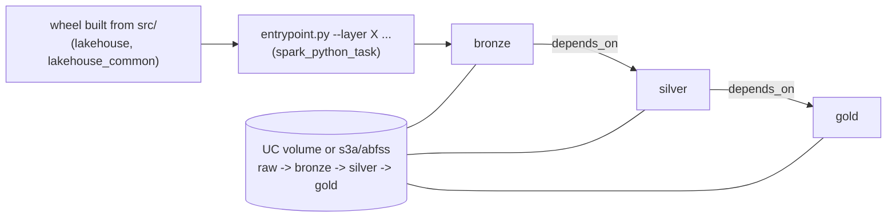

# Databricks bundle: run the Spark jobs on Databricks

Ticket #10. Bundle: [`databricks/databricks.yml`](../databricks/databricks.yml). Entrypoint: [`databricks/entrypoint.py`](../databricks/entrypoint.py).

> **Status: validated offline, never deployed or run.** No Databricks account is attached to this
> repo. Everything below marked "not verified live" is written from the Databricks docs and the
> shape of this code, not from a run. The data is 100% synthetic.

## What it does

One job, three tasks, the same module CLIs you run locally (`python -m lakehouse.bronze|silver|gold`):



| Piece | Choice |
|---|---|
| Targets | `dev` (default, `mode: development`): **serverless** tasks with an `environments` spec, Free Edition compatible. `prod` (`mode: production`): classic **job cluster** for a paid AWS/Azure workspace. |
| Tasks | `bronze` -> `silver` -> `gold` via `depends_on`. Retries: bronze/silver 2, gold 1 (60 s apart). A failed reconciliation exits non-zero, so retrying gold rarely helps. |
| Schedule | Daily 02:00 UTC cron, **`PAUSED`** (`schedule_status` variable; development mode also pauses schedules). Unpause with `--var schedule_status=UNPAUSED`. |
| Parameters | Job parameter `batch_date` (`all` or `YYYY-MM-DD`); bundle variables `raw_input`, `bronze_root`, `silver_root`, `gold_root`, `catalog`, `schema`, `volume`. Overridable with `--var name=value`. |
| Pseudonym key (#71) | The `gold` task needs `LAKEHOUSE_PSEUDONYM_KEY` (keyed HMAC tokens for member/provider ids) and fails fast without it. The classic-cluster job reads it from a Databricks secret reference (`{{secrets/lakehouse/pseudonym_key}}`, scope and key created by you; the bundle holds no key). **Serverless (Free Edition) has no cluster `spark_env_vars`**: the key must reach the gold task's environment some other way (not solved or run here, so the serverless gold task will stop with `MissingKeyError` until it is). Rotation runbook: [privacy-and-access.md](privacy-and-access.md#key-management-and-rotation-runbook). |
| Storage roots | Default: a Unity Catalog volume, `/Volumes/<catalog>/<schema>/<volume>/{raw,bronze,silver,gold}`. For a paid workspace use `s3a://...` or `abfss://...`; the entrypoint rejects anything `lakehouse_common.storage.parse_uri` rejects (`s3://`, `wasbs://`, ...). |
| Wheel | `pip wheel . --no-deps` from the repo root (added `[build-system]` and `packages.find` to `pyproject.toml`). Ships `lakehouse` and `lakehouse_common` only; **no declared dependencies** because PySpark and Delta come from the Databricks runtime. |
| Secrets | None in the repo. Auth is a CLI profile or `DATABRICKS_HOST` + `DATABRICKS_TOKEN` from the environment (GitHub Environment secrets in CI). |

### Why an entrypoint shim

The layer CLIs call `lakehouse.bronze.spark.build_spark`, which makes a *local* Delta session through the `delta-spark` pip helper and calls `spark.sparkContext.setLogLevel`. On Databricks the session already exists with Delta, and serverless (Spark Connect) has no `sparkContext`. `entrypoint.py` therefore swaps that one module for a shim returning the runtime session (a proxy with a no-op `sparkContext.setLogLevel` and `stop()`), then calls the unchanged CLI `main`. No file under `src/` is touched. If a layer CLI later stops using `build_spark`, the shim silently becomes a no-op: `tests/databricks` pins the current arguments and import path.

## Run it on your own Free Edition account

Prerequisites: a laptop with Python 3.11+, `git`, the [Databricks CLI](https://docs.databricks.com/aws/en/dev-tools/cli/install) (tested here: v1.24.0, `bundle validate` only).

1. **Sign up** for [Databricks Free Edition](https://docs.databricks.com/aws/en/getting-started/free-edition) (email OTP, Google or Microsoft sign-in). Note the workspace URL (`https://dbc-xxxx.cloud.databricks.com`).
2. **Authenticate the CLI.** Try OAuth first: `databricks auth login --host <workspace-url>`. Community reports disagree on whether OAuth and personal access tokens both work on Free Edition ([thread](https://community.databricks.com/t5/get-started-discussions/free-edition-and-databricks-asset-bundles/m-p/122137)); if OAuth is refused, generate a PAT (User Settings -> Developer -> Access tokens) and `export DATABRICKS_HOST=... DATABRICKS_TOKEN=...`. Never commit either.
3. **Create the volume** (the catalog `workspace` exists by default on Free Edition; check the name in Catalog Explorer and pass `--var catalog=<name>` if it differs):
   ```sh
   databricks schemas create claims_lakehouse workspace
   databricks volumes create workspace claims_lakehouse lake MANAGED
   ```
4. **Generate and upload synthetic raw data** (2000 claims, seed 42, as in CI):
   ```sh
   pip install -r requirements-claimsgen.txt
   PYTHONPATH=src python -m claimsgen --rows 2000 --seed 42 --out data/e2e/raw --overwrite --quiet
   python scripts/bucket_raw_batches.py --raw data/e2e/raw --out data/e2e/raw_batched --batches 3
   databricks fs cp -r data/e2e/raw_batched dbfs:/Volumes/workspace/claims_lakehouse/lake/raw
   ```
5. **Validate, deploy, run** (from the repo root; `make databricks-deploy` / `make databricks-run` wrap these):
   ```sh
   cd databricks
   databricks bundle validate -t dev
   databricks bundle deploy -t dev        # builds the wheel (pip wheel), uploads wheel + entrypoint, creates the job
   databricks bundle run -t dev claims_pipeline --params batch_date=all
   ```
6. **Inspect.** Workflows -> Jobs -> `[dev <you>] claims-lakehouse-pipeline` -> the run. Gold tables are under `/Volumes/workspace/claims_lakehouse/lake/gold`; the Parquet export is under `.../gold/export`. Query with `SELECT * FROM delta.\`/Volumes/workspace/claims_lakehouse/lake/gold/fact_claim_line\` LIMIT 10` (check the real gold table names in [gold.md](gold.md)).
7. **Screenshot** the successful run graph and commit it as `docs/img/databricks-run.png`; link it here.
8. **CI deploy (optional).** Create GitHub Environment `databricks-dev` with secrets `DATABRICKS_HOST` and `DATABRICKS_TOKEN`, then Actions -> "Databricks deploy" -> Run workflow (main only, manual only).
9. **Paid workspace (`prod`).** `databricks bundle deploy -t prod --var node_type_id=<vm type> --var bronze_root=abfss://bronze@<account>.dfs.core.windows.net/ --var silver_root=... --var gold_root=... --var raw_input=...`. Give the cluster storage access through an instance profile or managed identity / Unity Catalog external location; this bundle configures no keys.

## Verified offline vs not verified live

| Claim | Status | Evidence |
|---|---|---|
| `databricks.yml` is accepted by the real CLI for `dev` and `prod`, with schema warnings treated as errors | **Verified** (CLI v1.24.0, local and CI job `databricks bundle (validate)`) | `databricks/offline_validate.py` runs `databricks bundle validate` against a loopback stub that answers the two workspace calls validate makes (current user, path lookup). Proves shape only. |
| Task graph, retries, paused schedules, variables all defined and used, no host/token/secret in the bundle | **Verified** | `tests/databricks/test_bundle.py` |
| Task parameters parse with the real `lakehouse.bronze/silver/gold` CLIs | **Verified** | same, imports each CLI's `parse_args` |
| Root URIs follow the storage resolver (`/Volumes`, `s3a://`, `abfss://`; `s3://`, `wasbs://` rejected) | **Verified** | `test_bundle.py`, `test_entrypoint.py` |
| Entrypoint forwards args, propagates exit codes, shim satisfies the CLIs' import | **Verified** with a fake session and fake CLI | `test_entrypoint.py` |
| Wheel builds and contains the job packages, no `claimsgen`, no dependencies | **Verified** | `test_wheel_and_validate.py` |
| Deploy workflow is manual-only | **Verified statically** | test + YAML parse; never executed |
| `bundle deploy` builds and uploads the wheel; `../dist/*.whl` resolves in the serverless `environments` spec and the cluster `libraries` | **NOT verified** | docs-based; relative-path rules differ between versions |
| Serverless `environment_version: "4"` installs the wheel and `import lakehouse...` works | **NOT verified** | |
| The existing job code runs on serverless Spark Connect (see risks) | **NOT verified** | |
| Free Edition: PAT/OAuth login, volume creation, `databricks fs cp` to a volume | **NOT verified** | community reports conflict |
| Any real run, run duration, quota consumption, the screenshot | **NOT done** | no account |
| `prod` classic cluster, `s3a://`/`abfss://` from Databricks | **NOT verified** | needs a paid workspace and cloud storage |

### Known risks to check on the first live run

- `silver` calls `DataFrame.persist()` (`src/lakehouse/silver/job.py`) and gold keeps a cached intermediate. Serverless limits are documented as "Only Spark Connect APIs are supported" with no RDD support; whether DataFrame caching is accepted there should be checked first. If it is not, the fix belongs in the layer code (separate ticket), not in this bundle.
- Delta maintenance (`DeltaTable.forPath(...).optimize()` / `.vacuum()`, used by `--optimize`, `--vacuum`) is not enabled by the bundle; try it only after a plain run works.
- `lakehouse_common.storage.spark_conf_for` is not applied on Databricks: access to volumes, S3 and ADLS comes from Unity Catalog / the cluster identity, not Hadoop `fs.s3a.*` settings.
- Serverless adds its own automatic retries on top of `max_retries` ([job task types](https://docs.databricks.com/aws/en/dev-tools/bundles/job-task-types)); set `disable_auto_optimization: true` per task if a task must run at most once.

## Cost and limits (Free Edition)

Checked 2026-11-06 against the official pages; re-check before relying on them.

| Topic | Fact | Source |
|---|---|---|
| Compute | Serverless only; "Custom compute configurations are not supported." So the `prod` job-cluster target cannot run on Free Edition. | [Free Edition limitations](https://docs.databricks.com/aws/en/getting-started/free-edition-limitations) |
| Jobs | "Max of 5 concurrent job tasks per account." The pipeline runs its tasks sequentially, so one run uses one at a time. | same |
| Quota | Fair-usage quota per account; exceeding it shuts workspace compute down until the limit resets (data and settings are kept). Size is not published as a number there. | same |
| Network | Outbound internet restricted to a limited set of trusted domains (the wheel is uploaded by the CLI, not pulled from PyPI). | same |
| Other | One workspace and one metastore per account; no account console or account-level API; R and Scala unsupported; non-commercial use only; inactive accounts may be deleted. | same |
| Serverless semantics | Only Spark Connect APIs (no RDD); DBFS access limited, use UC volumes; Maven coordinates not supported; max serverless run 7 days. | [Serverless limitations](https://docs.databricks.com/aws/en/compute/serverless/limitations) |
| Environment versions | Version 4 = Python 3.12.3 (latest listed was 6 on 2026-09-03); the wheel needs Python >= 3.11, so versions 2 and up qualify. | [Serverless environment versions](https://docs.databricks.com/aws/en/release-notes/serverless/environment-version/) |
| Cost | Free Edition has no bill. A paid workspace running `prod` pays DBUs plus cloud VMs/storage; not estimated here. | |

Dataset size matters: the CI-sized dataset (2000 claims in 3 batches) is deliberately tiny so a first run stays far from any quota.

## Checklist for the live boxes left in #10

- [ ] Free Edition account created; CLI authenticated (note which method worked, update step 2)
- [ ] Volume created, synthetic data uploaded
- [ ] `databricks bundle deploy -t dev` succeeds (record any path fix needed for `../dist/*.whl`)
- [ ] `databricks bundle run -t dev claims_pipeline` finishes bronze -> silver -> gold green
- [ ] Persist/cache and Delta behaviour confirmed on serverless (or a follow-up ticket opened)
- [ ] Screenshot of the successful run saved under `docs/img/` and linked above
- [ ] "Databricks deploy" workflow run once from Actions with the `databricks-dev` Environment
- [ ] Update the status table above: move rows from NOT verified to verified, with run date
- [ ] Optional: `prod` target on a paid workspace with `s3a://` or `abfss://` roots

Local equivalents: `make databricks-test`, `make databricks-validate` (needs the CLI on `PATH`), `make databricks-wheel`.
