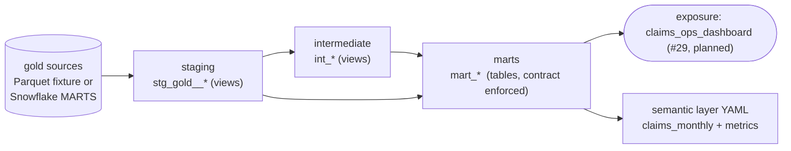

# dbt project: staging, marts, tests and docs on the gold contract

Ticket #15 (M3). Code lives in `dbt/`. All data is synthetic.

> **What ran and what did not.**
> - **Primary source: the real gold.** The Spark gold layer ([gold.md](gold.md), ticket #8) writes a Parquet export, and the `pipeline e2e` job in `.github/workflows/ci.yml` runs claimsgen -> bronze -> silver -> gold and then `dbt build --target duckdb` on that export (all 186 models and tests pass on it; a failing dbt test fails the job). Locally: `make gold-dbt` (reads `data/gold-delta/export`).
> - **Fallback: a gold-shaped test fixture.** `.github/workflows/dbt.yml` (path-filtered) and `make dbt-build` still build against `scripts/make_gold_fixture.py`, a DuckDB approximation of silver -> gold. It needs no Spark and no Java, and it carries a deliberate second SCD2 version for a few members/providers (the generated gold has one version per entity). It is **not** the Spark gold; the default `gold_path` is still the fixture directory so existing jobs are unchanged. See [Switching between fixture and real gold](#switching-between-fixture-and-real-gold).
> - Also runs for real: `dbt deps/parse/build`, `dbt source freshness` and `dbt docs generate` on **DuckDB**.
> - **Snowflake has not been run.** There is no Snowflake account. The `snowflake` target was only checked offline with `dbt parse --target snowflake` (dbt-snowflake 1.12.5, dummy credentials), which validates YAML, refs and macros but executes no SQL. Compiled Snowflake SQL, contract data-type checks on Snowflake and the source/test queries are unproven there. A live run is the remaining checkbox on #15.

## Layers and naming



| Layer | Folder / prefix | Materialized | Schema | Rule |
|---|---|---|---|---|
| source | `models/staging/gold/_gold__sources.yml` | n/a | `marts` (Snowflake) / Parquet (DuckDB) | One source table per gold table. Column list equals the DDL (tested). |
| staging | `stg_gold__<table>` | view | `staging` | One model per source. Rename, cast, trim/upper, derive dates from `*_date_key`. **No joins, no filters**: bad rows are surfaced by tests, never silently dropped. SCD2 columns are renamed `valid_from` / `valid_to`; load timestamp is `_loaded_at`. |
| intermediate | `int_<noun>` | view | `staging` | Joins and row-level derivations shared by several marts. |
| marts | `mart_<subject>` | table | `marts` | Consumption grain. `contract: enforced` (names and data types). Grain is stated in each model's description. |
| semantic | `models/semantic/` | n/a | n/a | MetricFlow semantic model and metrics, plus the day-grain `metricflow_time_spine`. |

Other conventions: SQL keywords upper case, lower-case identifiers, trailing `_id` for natural keys and `_sk` for surrogate keys, `is_` prefix for booleans, `_amount` for money (`numeric(18,2)` in marts), `_count` for counts, `_rate` for ratios in 0..1. `generate_schema_name` uses the custom schema as-is (`STAGING`, `MARTS`), matching the schemas Terraform creates (`docs/snowflake.md`). Gold dimension/fact tables and `mart_*` tables share the `MARTS` schema on Snowflake; names do not collide.

### Marts

| Model | Grain | Metrics |
|---|---|---|
| `mart_claims_monthly` | one row per service month | claims, denied claims, **PMPM paid** (`paid_amount / member_months`), **denial rate**, **average allowed per line**, paid by claim type, **readmission proxy** count |
| `mart_provider_performance` | provider_id x service month (current SCD2 attributes) | claims, denial rate, avg allowed per line, avg paid per claim, specialty cost index (provider allowed per claim / specialty average), readmission proxy |
| `mart_member_risk` | one row per member_id (current version), incl. members with no claims | claims, paid, distinct providers, readmission proxy, `risk_score` (0-100 percent rank of total paid) and `risk_tier` |
| `mart_denials` | service month x claim_type x provider specialty | claims, denied claims, denial rate, billed and denied-billed amounts |

Metric definitions and caveats:

- **PMPM** denominator is `int_member_months`: members whose current version has `enrollment_date <=` month end (null counts as enrolled). The synthetic data has no disenrollment, so this is an approximation, and `member_months` is a monthly denominator that must not be summed across breakdowns (that is why `mart_claims_monthly` has month grain only).
- **Readmission proxy**: a paid institutional claim whose member's previous paid institutional claim was 0..`readmission_window_days` (default 30, a dbt var) days earlier. The data has no discharge dates, so this is a proxy on service dates, not a clinical readmission measure.
- **risk_score** is a cost-percentile heuristic on synthetic data. It is not a clinical or actuarial risk model.
- Dimensions are SCD2: facts already carry the member/provider *version* valid on the service date. Marts that need a stable attribute per entity use the current version; `mart_denials` uses the version at service time.

### Semantic layer

Analyst-facing grain, caveats and ten tested example queries for these marts are in [analytics-guide.md](analytics-guide.md).

`models/semantic/_semantic_layer.yml` defines a `claims_monthly` semantic model over `mart_claims_monthly` and metrics (`total_paid`, `pmpm_paid_cost`, `denial_rate_metric`, `avg_allowed_per_line_metric`, `readmission_proxy_total`, ...) using the YAML spec of the pinned dbt-core (1.12.6). `dbt parse` validates it. Nothing here queries it: that needs MetricFlow / a semantic layer service, which this repo does not run.

### Exposure

`claims_ops_dashboard` (maturity `low`, no URL) records the planned dashboard of ticket #29 and its dependency on the four marts, so lineage in the docs site shows who will consume them.

## Tests and the data-quality story

| Where | What | Catches |
|---|---|---|
| Source tests (`_gold__sources.yml`) | unique/not_null keys, `relationships` fact -> dims, `accepted_values` on claim type/status | A broken gold load or key drift before anything is modelled |
| Source freshness | `loaded_at` warn after 2 days, error after 7 (not on `dim_date`) | A stalled load. In the fixture `loaded_at` is the fixture build time, so this passes trivially |
| Staging tests | keys, relationships, `accepted_values` (sex, plan, network, cost tier), SCD2 uniqueness (`member_id`, `valid_from`) | Contract drift between gold and staging |
| Singular: `assert_claim_paid_equals_sum_of_line_paid` | header billed/allowed/paid = sum of lines | The generator's reconciliation invariant; partial line quarantine |
| Singular: `assert_claim_line_count_matches_lines` | header `line_count` = line rows | Dropped or duplicated lines |
| Singular: `assert_no_negative_amounts_in_staging` / `_in_marts` | no negative money | The generator's `negative_amount` defect leaking past gold |
| Singular: `assert_denied_claims_paid_zero` | denied => paid 0 | Business rule |
| Singular: `assert_scd2_one_current_and_no_overlap` | one current version per key, no overlapping windows, `is_current` agrees with `valid_to` | SCD2 merge bugs |
| Singular: `assert_fact_uses_version_valid_on_service_date` | fact points at the dimension version valid on the service date | Wrong as-of join in gold |
| Singular: `assert_marts_reconcile_to_staging` | mart totals = staging totals | Fan-out or lost rows in joins |
| Mart generic tests | `unique` grain keys, `dbt_utils.unique_combination_of_columns`, `accepted_range` (>= 0, rates in 0..1, score 0..100), `accepted_values` | Bad aggregation |
| Mart contracts | enforced column names and data types, `not_null` constraints | Silent schema change for dashboards |

Where this sits in the wider story: the generator injects defects (`docs/data-generator.md`); silver quarantines them (#7); gold carries only clean rows (#8); these dbt tests are the **last line of defence** and fail loudly rather than filtering. The fixture applies the same quarantine rules, so the suite passes. To confirm the tests have teeth, corrupt one line in a copy of the fixture (negate a `paid_amount`) and run `dbt build` with `GOLD_PATH` pointed at it: `assert_no_negative_amounts_in_staging` and `assert_claim_paid_equals_sum_of_line_paid` fail and every dependent mart is skipped (done once by hand; it is not an automated test). Row-level quality gates (Great Expectations or similar, #22) are separate.

Result of the last local run on DuckDB (5,000 claims, seed 42): **13 models** (6 staging views, 2 intermediate views, 5 tables), **173 tests** (8 of them singular), 1 exposure: `PASS=186 WARN=0 ERROR=0 NO-OP=1` (the exposure is a no-op node).

## Run it on DuckDB

```bash
python3.13 -m venv .venv && . .venv/bin/activate   # 3.11-3.13; no pyarrow/dbt wheels for 3.14
pip install -r requirements-dbt.txt

make dbt-data      # claimsgen --rows 5000 -> data/raw, then the gold TEST FIXTURE -> data/gold
make dbt-build     # dbt deps + build (models and tests), file data/claims.duckdb
make dbt-docs      # docs site in dbt/target/index.html (open it, or `dbt docs serve`)
make dbt-lint      # sqlfluff for dbt/
```

Without make: `cp dbt/profiles.yml.example dbt/profiles.yml` (git-ignored), then `dbt build --project-dir dbt --profiles-dir dbt --target duckdb` from the repo root (paths are relative to the repo root). `GOLD_PATH` (default `data/gold`) and `DBT_DUCKDB_PATH` (default `data/claims.duckdb`) override locations. `pytest tests/dbt` runs the contract tests; the DuckDB-dependent ones skip when `duckdb` is not installed, so the plain pytest job needs no dbt.

## Switching between fixture and real gold

The sources read `<gold_path>/<table>/*.parquet`, where `gold_path` is, in order: the dbt var `gold_path`, the env var `GOLD_PATH`, the default `data/gold` (the fixture).

| Source | How to select it |
|---|---|
| Fixture (default, fallback) | nothing; `make dbt-data` writes `data/gold` |
| Real Spark gold | `GOLD_PATH=<gold root>/export dbt build ...`, or `dbt build --vars '{gold_path: <gold root>/export}'`, or `make gold-dbt` |
| Snowflake | `--target snowflake` (reads schema `MARTS`; the export is loaded by `warehouse/snowflake/20_copy_into.sql`) |

The export is produced by `python -m lakehouse.gold` (see the Export section of [gold.md](gold.md)). `tests/dbt/test_gold_contract.py` pins the DDL, the fixture schema and the dbt source columns together, and `tests/gold/test_gold_ddl_contract.py` pins the Spark gold schema to the same DDL, so a rename on any side fails CI before it reaches a model.

Differences you will see between the two sources, none of which are bugs: the real gold has `load_batch_id` of the form `bYYYYMMDD` (the fixture says `FIXTURE-NOT-SPARK-GOLD`); the first version of every member/provider starts at `1900-01-01`; the generated data has a single version per entity, so the SCD2 tests are exercised for versioning only by the fixture here (and by the Spark SCD2 tests in `tests/gold`); claims whose lines were quarantined in silver are held back whole, which the fixture approximates by dropping them.

## Run it on Snowflake (not yet executed)

```bash
pip install dbt-core==1.12.6 dbt-snowflake     # not in requirements-dbt.txt on purpose
cp dbt/profiles.yml.example dbt/profiles.yml
export SNOWFLAKE_ACCOUNT=... SNOWFLAKE_USER=... SNOWFLAKE_PASSWORD=...
export SNOWFLAKE_DATABASE=CLAIMS_DEV SNOWFLAKE_ROLE=CLAIMS_DEV_TRANSFORMER SNOWFLAKE_WAREHOUSE=CLAIMS_DEV_TRANSFORMER_WH
dbt build --project-dir dbt --profiles-dir dbt --target snowflake
```

Credentials come from environment variables only; `profiles.yml` holds no secrets and is git-ignored. Prerequisites are the objects from `docs/snowflake.md` (database, `STAGING` and `MARTS` schemas, the transformer role with write access to both) and the gold tables loaded in `MARTS`. The role must be able to create views/tables in `STAGING` and `MARTS`. First-run risks to check: the contract data types (`bigint`, `numeric(18,2)`, `date`) against Snowflake's type normalisation; `datediff('day', ...)` and `last_day` semantics; source freshness against real `loaded_at`; the `external_location` source meta is ignored by the Snowflake adapter.

Record the outcome of the first live run in #15 and in `docs/snowflake.md`.

## Privacy of the marts

Every mart column is classified in `governance/data_classification.yaml`; `mart_member_risk.member_id` and `mart_provider_performance.provider_id` are keyed HMAC tokens already in gold (shown as stored to every role, ticket #71; the fixture and the Spark gold tokenise the same way, the fixture with a fake test key) and birth year, age and dates are generalised. `tests/governance` fails if a mart column is added without a registry entry, and `tests/dbt/test_analyst_masking.py` proves on DuckDB that the analyst-facing views return no raw identifiers and that no gold cell holds a source id or an unkeyed hash of one. On Snowflake, dbt rebuilds marts with `CREATE OR REPLACE`, which drops column tags, so run `warehouse/snowflake/92_apply_tags_marts.sql` after every `dbt build` (until then the marts are unprotected). Details and the unexecuted status: [privacy-and-access.md](privacy-and-access.md).

## Linting

`sqlfluff lint .` must run **inside `dbt/`**: SQLFluff only honours `templater = jinja` from a `.sqlfluff` in the working directory, and the root `.sqlfluff` uses the raw templater for the plain SQL under `warehouse/`. `dbt/.sqlfluff` sets dialect `duckdb`, the Jinja templater (no dbt install needed; `load_macros_from_path = macros` plus sqlfluff's built-in `ref`/`source`/`config`/`var` stubs) and inherits line length and keyword case from the root. The root `.sqlfluffignore` lists `dbt/` so the repo-wide `sqlfluff lint .` job does not parse Jinja as raw SQL; the dbt workflow lints `dbt/` itself. `dbt/.sqlfluffignore` skips the macros (pure Jinja).

## CI

`.github/workflows/dbt.yml` (separate from `ci.yml`, fixture build): Python 3.12, `pip install -r requirements-dbt.txt`, `pytest tests/dbt`, sqlfluff on `dbt/`, claimsgen (5,000 claims), fixture build, `dbt deps`, `parse`, `build`, `source freshness`, `docs generate`, and upload of `index.html`, `manifest.json` and `catalog.json` as the `dbt-docs` artifact. Runs on changes to the dbt project, the fixture, the DDL or claimsgen, and on pushes to `main`. The same `dbt build` on the **real** gold export runs in the `pipeline e2e` job of `ci.yml` on every pull request (no path filter).

## Decisions

- **Sources are the gold contract.** The project was built before the Spark gold existed (against the fixture) and cannot drift from the Snowflake DDL unnoticed (contract test); it now also runs on the real gold in CI.
- **DuckDB for CI, Snowflake as the production adapter.** No cloud account or cost in CI; the SQL is kept to the subset both engines accept (no `strftime`, no engine-specific functions in models; the DuckDB-specific SQL lives only in the fixture script). The cost is that DuckDB passing does not prove Snowflake works.
- **Fail, do not filter, in staging.** Hiding bad rows in staging would make the marts look healthy; tests that fail loudly keep the data-quality story honest.
- **Month-grain PMPM mart.** Keeps the member-month denominator additive-safe; breakdowns live in other marts.
