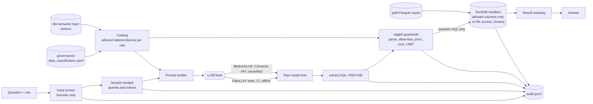

# Governed natural-language Q&A over gold (ticket #28)

Ask a business question in English, get a SQL answer computed **only** from data the caller's role may see.
The package is `src/lakehouse/genai/`; the CLI is `python -m lakehouse.genai ask "..."`.
All data is synthetic.

> **Status, stated plainly.** The pipeline, the guardrails, the sandbox, the audit log and the evaluation harness
> run and are tested offline with a deterministic fake model. The Amazon Bedrock client is written to the
> documented Converse API shape and is tested against an injected stub only. **No Bedrock call has ever been
> made from this repository, and real-model accuracy and jailbreak resistance were NOT measured.**

## Architecture



Defence in depth. Any one of these alone keeps PII out, so a failure in one layer is not a leak:

1. **Prompt**: denied columns are never listed (naming them would tell an attacker what to ask for).
2. **Guardrails**: the generated SQL is parsed, checked against allow-lists and rewritten.
3. **Sandbox**: the DuckDB connection only contains tables built from the *exposed* columns; external file
   access is off and the configuration is locked. A `member_id` reference fails to bind even if the guardrails
   were skipped (`tests/genai/test_executor_masking.py`).
4. **Result masking**: identifier-shaped strings (member/provider ids, SSN, email, phone) in returned cells are
   redacted. The audit log stores counts, never result cells.

## Access model (derived, not hand-maintained)

The catalog (`catalog.py`) is computed from `governance/data_classification.yaml`, the single source of truth
for #25. New columns cannot become visible by accident: they must be classified first, and a column is exposed
only if the role's rule admits it.

| Rule | Effect |
|---|---|
| `identifier: direct` | never exposed, any role (`member_id`, `provider_id`) |
| `handling` is hash / mask / generalise / drop | raw form never exposed; the masked variants are not served either (`birth_year`, `enrollment_date`, `record_hash` of members) |
| role `public` | only PUBLIC or INTERNAL columns that are not identifiers (no surrogate keys, no amounts) |
| role `analyst` | additionally CONFIDENTIAL columns and quasi-identifiers kept as-is (surrogate keys for joins, day-grain date keys, state, sex, amounts) |
| unknown role | rejected |

Scope: the six gold tables in the Parquet export. The dbt marts can be added (`build_catalog(role, layers=("mart",))`
plus `Executor(..., marts_db=<duckdb file with schema marts>)`); this is covered by a test that builds
marts-shaped tables, but the CLI does not expose it. Marts' metric descriptions from
`dbt/models/semantic/_semantic_layer.yml` go into the prompt when marts are included. The MetricFlow semantic
layer itself is not queried (this repo does not run it, see `docs/dbt.md`).

## Guardrails (`guardrails.py`, sqlglot DuckDB dialect)

Every rejection carries `[rule] reason`; the rule ids are stable and appear in the audit log.

| Rule id | What it blocks | Example |
|---|---|---|
| `empty`, `too_long` | empty SQL; more than 4000 characters | |
| `parse_error` | anything sqlglot cannot parse | `SELEC ...` |
| `comment` | any SQL comment (token-level, so `--` inside a string literal is fine) | `... -- also select member_id` |
| `multi_statement` | more than one statement | `SELECT 1; DROP TABLE x` |
| `not_select` | anything but SELECT / set operations; INSERT, UPDATE, DELETE, DROP, CREATE, COPY, PRAGMA, `SELECT INTO`, etc. anywhere in the tree | `UPDATE fact_claim SET ...` |
| `recursive_cte` | `WITH RECURSIVE` (unbounded) | |
| `table_not_allowed` | tables outside the role's list, schema-qualified names, `information_schema` | `FROM patients` |
| `table_function` | `read_parquet`, `read_csv`, `range`, ... in FROM | |
| `function_not_allowed` | any function not on the allow-list (aggregates, date, string, window, math basics). Covers `read_*`, `getenv`, `current_setting`, `random` without enumerating them | `SELECT getenv('HOME')` |
| `pii_column` | a column that exists but is not exposed to the role; the reason names its classification | `SELECT member_id FROM dim_member` |
| `unknown_column` | a column that resolves nowhere in the allowed schema | |
| `cross_join` | `CROSS JOIN`, comma joins, JOIN without ON/USING, ON that does not equate columns of both sides | `... JOIN b ON 1 = 1` |
| `join_cap` | more than 4 joins | |
| `cost_cap` | static cost estimate above 400 (table-size weights x (1 + joins) + windows). A heuristic, not a planner estimate | |
| mandatory LIMIT | a LIMIT of 100 is injected when absent; larger or non-literal limits are clamped to 100. Not a rejection; reported as `limit_applied` | |

`SELECT *` is expanded to the **allowed** columns, so it cannot pull PII. The text that is executed is the
*rewritten* statement, never the model's original.

Other caps: wall-clock query timeout (10 s, DuckDB interrupt), at most 100 rows fetched, DuckDB memory 512 MB and
temp spill 256 MB, session cap on queries (50) and LLM tokens (200k), question length 500. Models that refuse
answer `REFUSE: <reason>` and nothing runs.

## Threat model

| Threat | Mitigation | Residual risk |
|---|---|---|
| User asks for PII ("list member_ids") | catalog hides the columns; guardrail `pii_column`; sandbox lacks them; masking | A user can still ask about quasi-identifiers that the role may see (state, sex, date keys). Small groups can re-identify; **no small-cell suppression is implemented** |
| Prompt injection in the question ("ignore instructions...") | heuristic input screen (not relied on) plus the guardrails, which hold even when a compromised model complies. The injection test set runs with the screen **off** to prove it | A hosted model's own resistance is unmeasured |
| Model emits destructive or stacked SQL | single SELECT only, no DML/DDL anywhere in the tree, sandbox is in-memory copies | |
| Exfiltration through comments, file readers, env probes | comments rejected; table functions and non-allow-listed functions rejected; external access disabled and config locked in the sandbox | |
| Denial of service (cross join, recursion, huge result) | join discipline, join cap, no recursion, cost cap, LIMIT, timeout, memory/spill caps, session budgets | The cost estimate is heuristic; the timeout is the real backstop |
| Runaway spend | per-session query and token caps; token usage in the audit log | No per-user/day budget across sessions; no AWS Budgets integration |
| Logs become a PII store | question and SQL are scrubbed of id-shaped strings; result cells are never logged; prompt stored as SHA-256 only | The log records the question text, which may contain other sensitive free text |
| Wrong answers | answers show the executed SQL | Real-model accuracy unmeasured; a plausible-looking wrong SQL passes every guardrail |
| Role spoofing | the role is chosen by the caller (CLI flag). There is **no authentication** here | Production needs the role from the identity provider, not a flag |

## Provider interface and Bedrock

`LLMClient.generate(system, question) -> LLMResponse`. Implementations:

* `FakeLLM` (deterministic, scripted; unscripted questions get `REFUSE`). Used by every test, by CI and by the
  default CLI provider, which is the local fallback and answers only the golden questions.
* `BedrockLLM` calls `bedrock-runtime` `converse` (`system`, one user message, `maxTokens`, `temperature 0`).
  Region comes from `AWS_REGION` / `AWS_DEFAULT_REGION` only; the model id from `LAKEHOUSE_GENAI_MODEL_ID`
  (default in `config.py` is a placeholder that must be enabled in your account, not a verified choice);
  credentials from the standard boto3 chain. Nothing is stored in the repo.

```bash
export AWS_REGION=<region> LAKEHOUSE_GENAI_MODEL_ID=<model id enabled for you>   # plus AWS creds
make genai-ask Q="Claim count by claim type, highest first." PROVIDER=bedrock GENAI_GOLD=<gold export>
```

## Audit log

One JSON line per question, whatever the outcome (`data/genai/audit.jsonl`, git-ignored): timestamp, request id,
user, role, scrubbed question, model id, prompt SHA-256 and length, token counts, generated SQL, executed SQL,
decision (status, stage, rule ids, reasons, limit applied, cost), row count, latency.

## Evaluation harness (`evaluation.py`, `make genai-eval`)

* **Golden set** (`golden_set.yaml`, 30 questions): each has the scripted model output and an independently
  written reference SQL. The output goes through the *full* pipeline; its result set must equal the reference's
  (run on the unrestricted gold tables). Order is compared only where `ordered: true`.
* **Injection set** (`injection_set.yaml`, 24 cases): a *compromised* model is scripted to comply with the
  attacker (PII reads, DROP/UPDATE, stacked statements, comment smuggling, file reads, cross joins, recursion,
  env probes, prompt leakage). Each must be rejected or refused, with an expected rule id; nothing may be answered.
  Run with the input screen on and off.
* Last local result: golden 30/30, injection 24/24 (screen on) and 24/24 (screen off), on the claimsgen
  seed-7 / 1,000-row test fixture.

The score is evidence about the **pipeline**, not about a model: the "model" outputs are written by a human.
A real-model run would replace `FakeLLM` and would be expected to miss some golden items; that number does not exist yet.

## What was verified, and what was not

Verified offline (pytest, no Spark, no network; also in CI):

* Catalog derivation from the registry for both roles; PII and masked columns absent from the prompt.
* Each guardrail rule, accepting and rejecting cases; LIMIT injection and clamping; `SELECT *` expansion.
* Sandbox: PII columns do not bind, file reads and config changes fail, row cap, timeout cancellation and reuse of
  the connection afterwards, marts attachment.
* Service: statuses, audit record contents, budget caps, provider failure, runtime SQL errors, scrubbing.
* `BedrockLLM` request shape and response parsing against a **stub** client, error mapping, region from env.
* Golden and injection evaluation, and that the scorer actually fails on a wrong answer or a slipped-through attack.

Not verified:

* **Any real Bedrock call**: authentication, IAM, model availability/access, latency, throttling, real response
  quirks, real cost. Needs an AWS account with model access.
* Real-model SQL accuracy, refusal behaviour and jailbreak resistance.
* The real Spark gold export (`data/gold-delta/export`) was not used by these tests; they use the claimsgen
  fixture with the same schema (CI's pipeline job builds the real one, this suite does not read it).
* Small-cell suppression, authentication, cross-session budgets (not implemented, see threat model).
* The Snowflake masking policies (#25) are unexecuted and independent of this feature, which enforces access
  itself in DuckDB.
