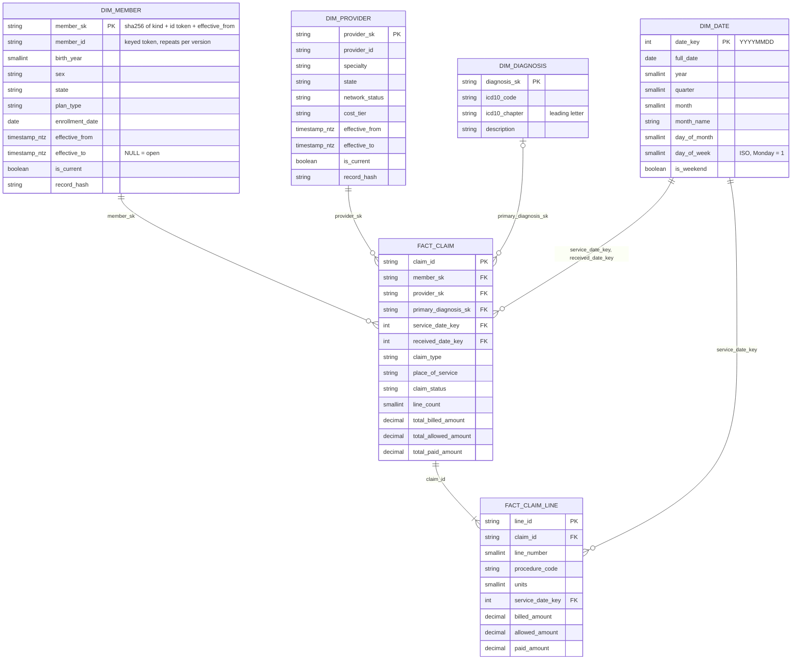

# Gold layer

Ticket #8. Turns [silver](silver.md) Delta tables into a **Kimball star schema** for BI: two facts, four dimensions (member and provider are SCD2), keyed identifier tokens, deterministic surrogate keys, a reconciliation of every number back to silver, and a Parquet export that Snowflake and dbt load. Code: `src/lakehouse/gold/`. Design context: [ADR-0001](adr/0001-medallion-layout.md) (gold = conformed, business-ready), [ADR-0002](adr/0002-delta-vs-iceberg.md), [ADR-0003](adr/0003-cloud-agnostic-boundary.md).

The column names and types are a **contract**: they equal `warehouse/snowflake/01_gold_ddl.sql` ([snowflake.md](snowflake.md)) exactly, and the [dbt project](dbt.md) is written against it. A test parses the DDL and fails if either side drifts.

> **What ran and what did not.** Everything here runs locally on Spark 3.5 + Delta 3.3 and in CI (`spark tests (gold)` and `pipeline e2e`). It has **not** run on S3 or ADLS, and the Parquet export has **not** been loaded into a real Snowflake account (no account exists); the DuckDB path in dbt is the only consumer that has read the export.

## Star schema



Every table also carries `load_batch_id` (`bYYYYMMDD` of the batch that wrote or last changed the row) and `loaded_at` (UTC wall clock, `timestamp_ntz`), except `dim_date`.

| Table | Grain | Type | Delta partition |
|---|---|---|---|
| `fact_claim` | one row per claim | transaction fact | `load_batch_id` |
| `fact_claim_line` | one row per claim line | transaction fact | `load_batch_id` |
| `dim_member` | one row per member **version** | SCD2 | none |
| `dim_provider` | one row per provider **version** | SCD2 | none |
| `dim_diagnosis` | one row per ICD-10 code | type 1 (overwrite in place) | none |
| `dim_date` | one row per calendar day | type 0 | none |

Amounts are `DECIMAL(12,2)`. Sums over many rows are widened (`decimal(22,2)`) in the reconciliation table. `icd10_chapter` is the leading letter of the code (the DDL column is `VARCHAR(2)`), not the roman-numeral chapter title; `description` comes from the generator's reference code set and falls back to `Synthetic ICD-10 code`.

The fact tables hold only what silver trusts: claims and lines in `silver_quarantine` (including orphan members and children of a quarantined claim) are not in silver, so they cannot be in gold. Gold never reads the quarantine table as data.

## Key scheme and identifier tokens

All keys and identifier tokens are minted in **one module**, `keys.py` (`natural_id`, `derive_sk`). Ticket #71: gold no longer carries the source ids.

```
member_id / provider_id (gold) = tok_<key_id>_<32 hex>   HMAC-SHA256 over "<domain>\0<source id>", key from env
sk = sha256_hex( "<kind>:v1" | part1 | part2 | ... )     64 hex chars, fits VARCHAR(64)

dim_member.member_sk       = derive_sk("member",    natural_id(member_id, "member"),     effective_from)
dim_provider.provider_sk   = derive_sk("provider",  natural_id(provider_id, "provider"), effective_from)
dim_diagnosis.diagnosis_sk = derive_sk("diagnosis", icd10_code)
```

- **Tokens are keyed.** The source ids are sequential (`M000000001`), so an unkeyed hash is reversible by enumeration. The HMAC key comes from `LAKEHOUSE_PSEUDONYM_KEY` (`LAKEHOUSE_PSEUDONYM_KEY_ID` names its generation, default `v1`); the gold CLI fails fast with `MissingKeyError` if it is missing, and the key is in no file, table or log. DDL: `member_id`/`provider_id` are `VARCHAR(48)` (a token is at most 45 chars). Details, rotation runbook and limitations: [privacy-and-access.md](privacy-and-access.md).
- **Surrogate keys are derived from the token**, so they are not enumerable without the key either. `diagnosis_sk` hashes a public ICD-10 code and stays unkeyed on purpose (non-sensitive; recorded in the classification registry together with the other per-column decisions).
- **Deterministic.** A key is a pure function of the id, the pseudonym key and, for SCD2, the version's start. Re-running with the same key re-derives the same tokens and keys byte for byte (idempotent gold, tested), so a fact needs no lookup table to find its dimension row. Timestamps render as `yyyy-MM-dd HH:mm:ss` (tests reproduce keys with `hashlib` and `Tokeniser`).
- **Key rotation rebuilds gold.** A new key changes every token and therefore every member/provider SK; the token carries its key id (`tok_v2_...`) so mixed generations are detectable. Rebuild from silver into a new root, see the runbook in [privacy-and-access.md](privacy-and-access.md#key-management-and-rotation-runbook).
- **Stable across history edits.** A version keeps its key as long as its `effective_from` (and the pseudonym key) does, so appending a version or closing one never re-keys older facts.
- **Facts** keep their business keys (`claim_id`, `line_id`) as primary keys; they are opaque synthetic ids, not tokenised (listed under limitations).
- A test fails if any other gold module calls `sha2`/`md5` to make a key (`scd2.py` hashes attribute values for `record_hash`, which is not an identifier and is deliberately key-independent: rotation must not churn SCD2 history).
- **Spark mechanics.** Spark has no HMAC, so `natural_id` is a Python UDF over `Tokeniser.token_fn`, a closure of key bytes and stdlib calls (workers need no project code). It is applied before joins (a Python UDF cannot sit in a join condition). The key is therefore inside the task closure; see the limitations table. `gold_exclusions.reason_detail` carries tokens, not source ids.
- Running: `export LAKEHOUSE_PSEUDONYM_KEY=...` before `make gold` (the target checks). `make pipeline-e2e` and the `pipeline e2e` CI job use a fake, public, test-only key because their data is synthetic.

## SCD2 rules (`scd2.py`)

`dim_member` (tracked: `birth_year`, `sex`, `state`, `plan_type`, `enrollment_date`) and `dim_provider` (tracked: `specialty`, `state`, `network_status`, `cost_tier`) keep history. A batch's silver members/providers rows are one **snapshot** dated by the batch date. Merging a snapshot is a single set-based Delta `MERGE`:

1. A key's history is a list of `(effective_from, attributes)` events. The snapshot adds `(batch_date, attributes)` for every key it contains. The **first** version of a key starts at `1900-01-01` (`EPOCH`), not at the snapshot date, so claims dated before the first snapshot still find a version.
2. If a version already starts exactly on the snapshot date, the snapshot **replaces** it (a correction). The version keeps its key.
3. Events are ordered; an event whose `record_hash` (SHA-256 of the tracked attributes, `NULL` distinct from `''`) equals the previous version's is not a change and is dropped. A correction that makes a version equal to its neighbour therefore **collapses** it.
4. `effective_to` is the next version's `effective_from`; the last version has `effective_to = NULL` and `is_current = true`. Versions of a key never overlap and never leave a gap.
5. **Late-arriving snapshot** (dated before versions that already exist): inserted into the middle of the history; later versions are untouched and keep their keys.
6. **Idempotent.** Re-running a snapshot, or replaying an older batch after newer ones, changes nothing (rows, keys, `loaded_at` and `load_batch_id` of untouched versions are stable).
7. Keys **absent** from a snapshot are untouched: a snapshot is evidence about the keys it contains, not a deletion.
8. A snapshot with two rows for one key is rejected (silver dedupes; a duplicate means an upstream bug).

`load_batch_id`/`loaded_at` change only for rows that were inserted, closed or corrected in that run.

**Limits, stated plainly.** (a) The generator emits one snapshot, so on generated data every entity has a single open version; versioning is proven by tests that hand-build a changed second snapshot and a late one (`tests/gold/test_gold_scd2_spark.py`), not by the generator. (b) A snapshot older than the first snapshot ever loaded for a key behaves like a late one inserted at its own date; the earliest version is not re-dated. (c) Changed keys are collected to the driver for the fact re-key (below), fine for corrections, heavy if millions of keys change in one snapshot.

### Facts resolve dimensions as of the service date

A claim points at the member/provider version with `effective_from <= service_date < effective_to` (`effective_to` NULL = open), so history is attributed correctly: a claim from January keeps pointing at the January plan even after the member changed plan in February.

If a late snapshot **changes history under facts that are already loaded**, the job re-points those facts: it recomputes `member_sk`/`provider_sk` for the claims of every key whose history moved (all silver batches) and updates only rows whose keys differ (`rekey_facts`). A test loads facts, then a late snapshot, and asserts the keys moved.

## Which silver claims reach gold

Only claims that can be loaded **whole** do. Others are held back in `gold_exclusions` (never dropped silently) and counted in the reconciliation:

| Reason | Meaning |
|---|---|
| `INCOMPLETE_LINES` | silver holds fewer (or no) lines than `line_count`, typically because a line was quarantined (bad procedure code, negative amount). Loading the header would break `header = sum(lines)`. |
| `TOTALS_MISMATCH` | header totals differ from the sum of the lines |
| `PARENT_CLAIM_EXCLUDED` / `PARENT_CLAIM_NOT_IN_BATCH` | a line whose claim is held back / not in this batch |
| `UNRESOLVED_MEMBER` / `UNRESOLVED_PROVIDER` | no dimension version covers the service date. Silver guarantees the id exists in bronze, so this means a dimension snapshot was not loaded first (ordering error): it is treated as a **failure**, not a data defect. |

On the 2000-claim test fixture about 2.5% of claims are held back as `INCOMPLETE_LINES` (the generator injects line defects at roughly 0.3-0.5% each over about 2.4 lines per claim). That is deliberate: it keeps every loaded claim internally consistent. Silver already exposes `is_line_complete`/`lines_in_silver` if a consumer wants the partial claims.

## Reconciliation (`gold_reconciliation`)

Per `(gold_table, batch_id)`, written for `fact_claim`, `fact_claim_line`, `dim_member`, `dim_provider`: `silver_rows`, `gold_rows`, `excluded_rows`; for the facts also `silver/gold/excluded` for `billed`, `allowed`, `paid` (`decimal(22,2)`); `key_violations`, `identity_ok`, `detail` (JSON of what failed), `_run_ts`.

**Asserted in the job** (the numbers are written first, then `ReconciliationError` is raised; the CLI exits 1 after the other batches):

- **Rows and sums:** `silver = gold + excluded` for the row count and each of billed/allowed/paid. All three sides are re-read from Delta after the write (silver batch, gold batch, silver rows whose key is in `gold_exclusions`), not taken from in-memory counters.
- **Key integrity (per batch):** primary key unique across all batches; every `member_sk`, `provider_sk`, `primary_diagnosis_sk`, `service_date_key`, `received_date_key` resolves to a dimension row; every line's `claim_id` is in `fact_claim`; header total and `line_count` equal the lines; no `UNRESOLVED_*` exclusions.
- **Dimensions:** every snapshot key has, at the snapshot date, a version with the snapshot's `record_hash`; and, over the whole table, exactly one current version per key, no overlap or gap, `is_current` agrees with `effective_to`, unique surrogate keys.

Tests break the identity on purpose (a lossy writer) and assert both the exception and the recorded row. On failure the Parquet export is **skipped**, so a bad gold is never published.

## Idempotency and partitioning

Facts are written with `mode("overwrite")` + `replaceWhere load_batch_id = 'bYYYYMMDD'` (one atomic Delta commit per table), like bronze and silver. Re-running a batch swaps exactly its rows and leaves other batches alone; `gold_exclusions`/`gold_reconciliation` are replaced per batch the same way. Dimensions are merged by key. `dim_date` is rewritten only when the data window must grow.

`load_batch_id` is the partition column because the DDL has no `_ingest_date`; it equals the silver batch date. A batch is written as `ceil(rows / 1,000,000)` files (one per partition at this scale).

## `dim_date`

A full calendar for every whole year touched by the data: from 1 January of the earliest year to 31 December of the latest, over claims' `service_date`/`received_date` and lines' `service_date`. The window only grows (a late claim from an earlier year widens it; replaying a narrower batch never shrinks it). `month_name` is from a fixed English list (not locale dependent); `day_of_week` is ISO (Monday = 1).

## Export: Parquet under `<gold>/export/`

After a clean run the job writes every star-schema table as Parquet, one directory per table:

```
<gold root>/export/dim_date/part-*.parquet
                  dim_member/ dim_provider/ dim_diagnosis/ fact_claim/ fact_claim_line/
```

This is the **load path** for the two consumers:

- **dbt (DuckDB):** `GOLD_PATH=<gold root>/export` (or `--vars '{gold_path: ...}'`); the dbt sources read `<GOLD_PATH>/<table>/*.parquet`. See [dbt.md](dbt.md).
- **Snowflake:** point the external stage of `warehouse/snowflake/20_copy_into.sql` at `<gold root>/export/` and `COPY INTO` each table. Column order and types equal the DDL (a Spark test reads the export back and compares), timestamps are `timestamp_ntz` so they load as `TIMESTAMP_NTZ` without a zone shift. Not run against a real account.

The export replaces each table directory wholesale (it is the current state, not history), is skipped when any batch failed to reconcile, and can be turned off with `--no-export`. Operational tables (`gold_reconciliation`, `gold_exclusions`) stay in Delta only.

## Maintenance hooks

Off by default; schedule them after backfills (Airflow, #9):

```bash
python -m lakehouse.gold --silver ... --gold ... --batch-date all --optimize                 # Delta OPTIMIZE (bin-packing) on every gold table
python -m lakehouse.gold --silver ... --gold ... --batch-date all --vacuum                   # VACUUM, retention 168 h
python -m lakehouse.gold ... --vacuum --vacuum-retention-hours 336                           # longer retention
```

`lakehouse.gold.job.optimize_tables` / `vacuum_tables` are the same functions. `VACUUM` refuses a retention below Delta's 168 h default (it could delete files a running reader or a time-travel query needs). Only exercised on the local test fixture; Z-ordering is not done (keys are high-cardinality hashes, tables are small).

## Run

```bash
PYTHONPATH=src python -m claimsgen --rows 100000 --seed 42 --out data/raw
make bronze && make silver
make gold                                     # data/silver -> data/gold-delta (+ export/)
make gold SILVER=... GOLD=... BATCH_DATE=2024-01-03
make gold-dbt                                 # dbt build on DuckDB against data/gold-delta/export
make pipeline-e2e                             # claimsgen -> bronze -> silver -> gold -> dbt, 2000 claims
```

Batches must be built in date order (`--batch-date all` does): the member/provider snapshot of the earliest batch has to be loaded before claims that reference it, otherwise the job fails with `UNRESOLVED_MEMBER`.

Roots are plain URIs (`/path`, `file://`, `s3a://bucket/prefix`), built in `lakehouse.gold.paths` which delegates to the same single function as bronze and silver. If `--silver`/`--gold` are omitted, both roots (and the Spark storage settings) come from `lakehouse_common.storage` for the `LAKEHOUSE_ENV` in use ([ADR-0003](adr/0003-cloud-agnostic-boundary.md)). `s3a://` was **not** exercised for gold.

## Tests

- `tests/gold/test_gold_ddl_contract.py`, `test_gold_cli.py` (plain pytest, run in the normal `pytest` job): the in-code schema equals the parsed Snowflake DDL (names, order, types, nullability); CLI argument handling; repo wiring.
- `tests/gold/test_gold_keyed_spark.py` (`-m spark`, #71): same key gives identical tokens and keys across runs and a re-run changes nothing; a different key changes every token and SK; no source id or unkeyed MD5/SHA-256 of one in any gold cell; exclusions detail holds tokens; a key rotation rebuild writes only the new key id while old tokens verify; a missing key fails before any write.
- `tests/gold/test_gold_scd2_spark.py` (`-m spark`, job `spark tests (gold)`): key scheme vs a `hashlib`/`Tokeniser` mirror; SCD2 first load, changed second snapshot, idempotent re-run and out-of-order replay, late-arriving snapshot, in-place correction, collapse, NULL vs `''`, duplicate-key rejection (hand-built snapshots, merge called directly); as-of fact resolution; fact re-key after a late snapshot; held-back claims with exact reconciled sums; unresolved dimension fails loudly (also through the CLI: exit 1, no export); a lossy writer breaks the reconciliation; `dim_date`; `dim_diagnosis`; OPTIMIZE/VACUUM.
- `tests/gold/test_gold_pipeline_spark.py` (`-m spark`): checks on the real claimsgen -> bronze -> silver -> gold output. They need the output of the three layers, so they are **skipped unless `GOLD_E2E_DIR` is set** and run in the `pipeline e2e` job: the Delta tables the job wrote equal the DDL, values fit the `VARCHAR(n)` limits, independent re-computation of rows and sums, tokens equal the configured key's tokens of the silver ids and no source id or unkeyed digest appears in any gold table or the export, quarantined/orphan rows absent, FK integrity, header = sum of lines, re-running every batch changes nothing, and the Parquet export equals the Delta tables and the DDL types.
- CI: **`pipeline e2e`** ([ci.md](ci.md)) runs claimsgen (2000 claims) -> bronze -> silver -> gold (the CLI, so a failed reconciliation fails the step), then `dbt build --target duckdb` on the real export (any failing dbt test fails the job), then the end-to-end checks above.
