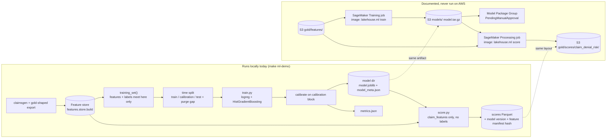

# Claim denial risk: training and batch scoring, SageMaker-ready

Ticket [#27](https://github.com/nikshepkulli/claims-lakehouse/issues/27) (M6). Code: `src/lakehouse/ml/`. Inputs: the point-in-time feature store from [#26](features.md). Model card: [model-card.md](model-card.md).

> **What ran and what did not.** Everything on this page that is marked "ran" ran **locally** (Python 3.12, scikit-learn 1.9.1, DuckDB; `make ml-demo`, `pytest tests/ml`, `terraform fmt/validate`). **No SageMaker job, endpoint, ECR push, S3 object, IAM role or Model Package Group was ever created in an AWS account**; the author had no account for this. The AWS side is code and documentation that is checked offline only (see the [verified table](#verified-and-not-verified)). The data is 100% synthetic and its denials are drawn at random, so **the model's metrics say nothing about real-world performance** (details in [model-card.md](model-card.md)).

## Architecture



The same container entrypoint (`python -m lakehouse.ml {train,score}`) runs both ways. Locally it takes `--store/--model-dir/--out`; in the container it follows SageMaker's directory contract.

## What each piece does

| File | Role |
| --- | --- |
| `guard.py` | Feature allow-list from `governance/feature_registry.yaml`: claim-table features only; rejects the label, ids (`claim_id`, `member_id`, `provider_id`), `as_of`, any PHI_LIKE/direct-identifier feature and anything not in the registry. Quasi-identifiers (`m_state`, `m_age_band`) are excluded unless `include_quasi=true` |
| `data.py`, `preprocess.py` | Load `training_set()` (training) or `claim_features` only (scoring) into numpy; vocab/encoding fitted on the train block only |
| `split.py` | Time-based train / calibration / test split with a purge gap |
| `models.py`, `calibrate.py` | Baseline logistic regression and `HistGradientBoostingClassifier`, both class-weighted; Platt (default) or isotonic calibration on the calibration block |
| `metrics.py` | AUC-PR, ROC-AUC, Brier, calibration table + ECE, precision/recall/lift at top 1/5/10%, per-segment slices |
| `train.py` | Orchestration; deterministic; writes `model.joblib`, `model_meta.json`, `metrics.json` |
| `score.py` | Batch scorer; idempotent; writes `part-00000.parquet` + `_manifest.json` |
| `sagemaker_env.py`, `hyperparams.py` | SageMaker container contract (`/opt/ml/...`, `hyperparameters.json`, `SM_*`), typed string-coerced hyperparameters |
| `inference.py` | `model_fn / input_fn / predict_fn / output_fn` handler contract |
| `jobs.py` | Request bodies for `CreateTrainingJob`, `CreateProcessingJob`, `CreateModelPackage` (not submitted) |
| `Dockerfile` | Image for both job types (not built in CI) |
| `infra/aws/modules/sagemaker_ml/` | Terraform: bucket, least-privilege execution role (+ optional permissions boundary), ECR, optional Model Package Group |

## Design decisions

**Time-based split, never random.** Features are trailing windows and claims of one member or provider are correlated over time. A random split puts training rows between test rows and measures a world in which the future is known. The blocks are ordered by `as_of` (the receipt day): earliest 60% train, next 20% calibration, last 20% test (cuts fall on whole days). A **purge gap** equal to the store's `outcome_lag_days` (30) drops the rows closest to each boundary, so every training label was already knowable when the first row of the next block was received. The tests assert ordering, disjointness, the gap, and that the split is a function of dates and not of row order.

**Selection never touches the test block.** The candidate (logistic baseline vs boosted model) is chosen by raw AUC-PR on the *calibration* block; the test block is evaluated once, after. Both candidates' test metrics are reported, so the choice is auditable.

**Class imbalance (~8% denied).** `class_weight="balanced"` during fitting keeps the minority class from being ignored; because that inflates probabilities, a monotone calibrator (Platt by default) is then fitted on the calibration block. AUC-PR and ROC-AUC are unchanged by calibration; Brier and the calibration table are what it fixes. AUC-PR (not accuracy) is the headline metric, with the prevalence as its no-skill baseline.

**Leakage and privacy.** The allow-list is derived, not hand-typed, and re-checked when a model is loaded and on every inference request (a request carrying `member_id` or `claim_id` is rejected). Registry features flagged `outcome_dependent` (trailing denial rates, paid sums) are kept: the feature store only counts outcomes that were already known at `as_of` (30-day lag, verified by #26's leakage guard), and each is labelled in `model_meta.json`. `training_set()` also fails if any label was available at or before its row's `as_of`.

**Determinism.** Seeded estimators, `early_stopping=False` (no random validation split), single-threaded BLAS/OpenMP via `threadpoolctl`, no wall-clock in any output. The model version is `v` + a 12-hex sha256 of (feature list, hyperparameters, feature-manifest hash, training claim ids and labels, scikit-learn version). `make ml-demo` trains twice and fails unless `metrics.json` is byte-identical.

**Scores written back to gold.** `score.py` writes `claim_id, as_of, denial_risk_score, model_name, model_version, feature_manifest_sha256` as Parquet next to the other gold outputs (`<gold>/scores/claim_denial_risk/` in the Terraform module). It contains no member or provider id. Re-running with the same model and feature manifest is a no-op (`skipped`); `--force` rewrites byte-identical scores; the write goes through a temp directory so a crash leaves no half table. The scores are **not** yet declared in `warehouse/snowflake/01_gold_ddl.sql`, dbt, or the classification registry; that is the remaining step before they reach Snowflake.

## SageMaker contract

Training container (what the code honours, tested against a temporary `/opt/ml`):

| Path / variable | Use |
| --- | --- |
| `/opt/ml/input/data/training/` | the feature store root (`feature_store/`, `labels/`, `_manifest.json`) |
| `/opt/ml/input/config/hyperparameters.json` | all values are strings; coerced by `hyperparams.py`; unknown keys fail the job; `sagemaker_*` keys are ignored |
| `/opt/ml/model/` | `model.joblib` + `model_meta.json`; SageMaker tars it to `model.tar.gz` in S3 |
| `/opt/ml/output/data/` | `metrics.json` |
| `/opt/ml/output/failure` | written with the exception text on failure (exit code 1) |
| `SM_MODEL_DIR`, `SM_OUTPUT_DATA_DIR`, `SM_CHANNEL_*`, `SM_HP_*` | honoured when set (the training toolkit sets them; a plain custom image only gets the fixed paths) |
| stdout `test:auc_pr=0.123;` | scraped by the job's `MetricDefinitions` regexes (defined in `jobs.py`, tested against the real output) |

Batch scoring is a **Processing job** (not Batch Transform): it reads the whole feature store, which is not a record-per-line payload. Layout: `/opt/ml/processing/input/features`, `/opt/ml/processing/input/model` (a directory with `model.joblib` or SageMaker's `model.tar.gz`), `/opt/ml/processing/output/scores`.

`inference.py` implements `model_fn/input_fn/predict_fn/output_fn` (JSON `{"instances": [...]}` or headerless CSV in feature order) and is exercised by round-trip tests. **No endpoint or transform job exists and the image has no HTTP server**, so the handler is a contract, not a deployed service.

## Run it locally

```bash
pip install -r requirements-ml.txt      # scikit-learn, DuckDB, pyarrow, numpy (no pandas)
make ml-demo                              # ~10 s: data -> features -> train x2 -> score x2 -> report
make ml-train FEATURES=data/gold-delta/features ML_MODEL=data/ml/model
make ml-score FEATURES=data/gold-delta/features ML_MODEL=data/ml/model ML_SCORES=data/ml/scores
make test-ml                              # tests/ml, part of `make test`
```

`make ml-demo` prints the metrics table, then `determinism ok` (two trainings, byte-identical `metrics.json`) and `idempotency ok` (re-run skipped; forced re-run byte-identical). On the demo data it also prints `NO DETECTABLE SIGNAL`, which is the correct result (see below).

### Why the demo model has ROC-AUC ~0.5

`claimsgen` draws each claim's denial as an independent 8% coin flip (`denied = r.random(n) < 0.08`), unrelated to any feature. Nothing can be learned. The pipeline reports that honestly (`interpretation` in `metrics.json`) instead of tuning until a number looks good. To prove the machinery *can* learn, the tests replace the labels with a planted rule (billed amount and line count) and assert ROC-AUC > 0.8, a Brier score below the no-skill reference, ECE < 0.05 and lift > 2 at the top 5%. Those numbers validate the code, not a claims model.

## Run it on your own AWS account (not done by the author)

Cost: an idle setup costs only S3/ECR storage (cents). Billing starts per job. A training or processing job on one `ml.m5.large`-class instance is billed per second for the life of the job, typically a few minutes including container start, so on the order of cents per run at published on-demand rates (**an estimate, not measured here; check current pricing for your region**). Nothing in the module creates an endpoint, notebook or domain; those are the things that bill while idle.

1. **Prerequisites.** An AWS account you control, `lakehouse_storage` applied (its KMS key and gold bucket), an IAM identity allowed to create the resources below, Docker, and the AWS CLI.
2. **Infrastructure.** Instantiate `infra/aws/modules/sagemaker_ml` (example in its README): pass `kms_key_arn`, `gold_bucket_name`, and `permissions_boundary_arn` if your account requires one. Set `create_model_package_group = true` if you want the registry. Review the plan; the module has never been applied by the author. Check that the KMS key policy allows the new role (the `lakehouse_storage` key delegates to IAM, so the role policy suffices).
3. **Image.** `make ml-image`, then log in to the ECR repository from the module output and push an immutable tag. Not built or pushed by the author.
4. **Features.** Build the store from your gold export (`make features`) and `aws s3 sync` it to `s3://<gold>/features/` with SSE-KMS.
5. **Train.** Build the request with `lakehouse.ml.jobs.training_job_request(...)`, review it, then submit with `jobs.submit("training", request)` (boto3) or `aws sagemaker create-training-job --cli-input-json`. Defaults: one CPU instance, 1-hour hard limit, network isolation, KMS on volume and output.
6. **Register.** `jobs.model_package_request(...)` creates a `PendingManualApproval` version in the Model Package Group, with the `metrics.json` attached as model-quality statistics and the feature-manifest hash as metadata. Approve manually after reading the model card. The package is for lineage and approval only; do not deploy it as an endpoint (no serving code).
7. **Score.** `jobs.scoring_job_request(...)` runs `lakehouse.ml score` as a Processing job and uploads Parquet to `s3://<gold>/scores/claim_denial_risk/`.
8. **Tear down.** `terraform destroy` (empty the buckets first or set `force_destroy`). Delete the ECR images.

If a step fails, training writes the reason to `/opt/ml/output/failure` (shown in `DescribeTrainingJob`), and `metrics.json`/logs go to CloudWatch under `/aws/sagemaker/TrainingJobs`.

## Verified and not verified

| Claim | Status | Evidence |
| --- | --- | --- |
| Time split never leaks future rows or labels across blocks | **Verified locally and in CI** | `tests/ml/test_ml_split.py` |
| Metrics computed correctly | **Verified** | `test_ml_metrics.py` (hand-computed precision@k, sklearn parity, calibration, slices) |
| Feature list excludes PII, labels and keys; fails if a registry PII feature appears | **Verified** | `test_ml_guard.py` |
| Training is deterministic; selection uses calibration block; planted signal is learned | **Verified** | `test_ml_train.py`, `make ml-demo` |
| Model reaches real-world accuracy | **Not claimed**: synthetic, random labels | [model-card.md](model-card.md) |
| Container contract (paths, hyperparameters, env, failure file, metric lines) | **Verified against a temporary directory**, not inside SageMaker | `test_ml_hyperparams_sm.py` |
| Inference handler round-trip; rejects ids and PII in requests | **Verified locally** | `test_ml_inference_score.py` |
| Scorer is idempotent, versioned, hashes the feature manifest, never reads labels | **Verified locally** | `test_ml_inference_score.py` |
| Terraform module is valid and meets static invariants | **`terraform fmt` + `validate` pass; static tests pass.** Never planned or applied | `test_ml_terraform.py`, CI terraform matrix |
| IAM policy is sufficient for a real SageMaker job | **Not verified**; written from the documented permission needs, may miss an action (the first real run will show it) | |
| Job request bodies are well-formed | **Verified offline** against botocore's SageMaker model (skipped in CI, where botocore is not installed); never submitted | `test_ml_jobs.py` |
| Dockerfile is sane | **Structural lint only** (pinned base, non-root, exec-form entrypoint, COPY sources exist); **never built** | `test_ml_dockerfile.py` |
| Training, processing, registry, or scoring on AWS | **Not run** | |
| Real-time endpoint / Batch Transform | **Not built** (no server in the image, no endpoint resource in Terraform) | |
| Scores in Snowflake / dbt / classification registry | **Not built**; Parquet only | follow-up |
| Python 3.11 compatibility of scikit-learn 1.9.1 | wheels exist for cp311; CI runs the tests on 3.11 | CI |

## Limitations and follow-ups

* Model files are scikit-learn pickles (joblib). `load` checks the file's sha256 against `model_meta.json` before unpickling, which detects corruption but is **not authentication**: only load models from a bucket you control.
* No drift monitoring, no automated retraining trigger, no SageMaker Pipeline definition (the three requests in `jobs.py` are the steps; chaining them in Step Functions, Airflow or SageMaker Pipelines is a follow-up, as is a model-approval gate).
* Subpopulation slices use small segments; with ~4,000 test rows a 200-row slice swings widely by chance (see the Radiology slice in the model card).
* The scoring input is the whole `claim_features` table; incremental scoring by `--as-of-from/--as-of-to` exists but the scheduler does not.
