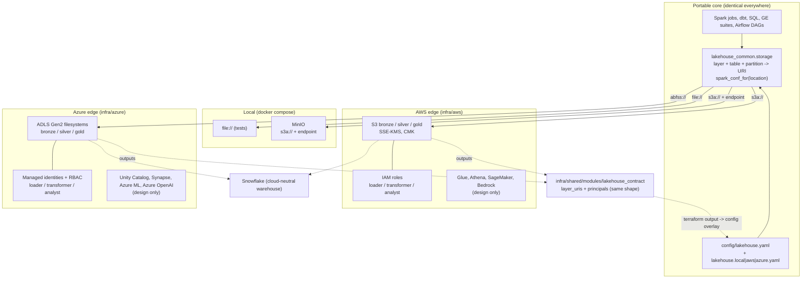

# Multi-cloud design

How the lakehouse targets AWS and Azure (and a laptop) without two codebases, and where it deliberately does not try. Decision record: [ADR-0003](adr/0003-cloud-agnostic-boundary.md). Ticket: #20.

## What this repo implements vs only designs

Be strict about the difference.

| Item | Status |
|---|---|
| URI resolver for `file://`, `s3a://` (AWS and MinIO endpoint), `abfss://` (`src/lakehouse_common/storage.py`) | **Implemented and unit-tested.** Pure Python; tests need no Spark, Java or cloud. |
| Spark/Hadoop config builders per scheme (`spark_conf_for`) | **Implemented; shape unit-tested only.** The settings follow hadoop-aws / hadoop-azure 3.3.x docs but were **not run against Spark**, S3, MinIO or ADLS. |
| Config files `config/lakehouse{,.local,.aws,.azure}.yaml` | **Implemented**, parsed and resolved by tests. The AWS and Azure overlays hold placeholder names, not real resources. |
| Terraform AWS and Azure storage modules, `lakehouse_contract` adapter | **Implemented; `fmt`, `init -backend=false` and `validate` only.** Never planned against an account, never applied. |
| Anything running on real AWS or Azure | **Not done.** Nothing in this repo has been deployed or executed on a real cloud. |
| MinIO as the local S3 stand-in | Defined in `docker-compose.yml`; the `s3a://` Spark path against it is not exercised by tests in this ticket. |
| Glue / Unity Catalog, Athena / Synapse, SageMaker / Azure ML, Bedrock / Azure OpenAI, KMS / Key Vault integration with Spark | **Design only** (this document). KMS and Key Vault exist as Terraform resources inside the storage modules; nothing consumes them yet. |

## Layout



Flow of truth: Terraform emits `layer_uris` and `principals` in one shape; a human (or later CD, #21) copies bucket or account names into `config/lakehouse.<env>.yaml`; jobs only ever call the resolver. Moving a pipeline between clouds means selecting another overlay (`LAKEHOUSE_ENV=azure`) and applying the other module.

## Using the abstraction

```python
from lakehouse_common import load_location, spark_conf_for

loc = load_location()  # LAKEHOUSE_ENV=local|aws|azure, base file if unset
path = loc.uri("silver", "claims", {"service_year": 2024})
conf = spark_conf_for(loc)  # pass to SparkSession.builder.config(...)
```

Secrets: `spark_conf_for` never returns a credential. It emits either nothing (AWS default credential chain, Azure managed identity) or Hadoop `${env.NAME}` references (`MINIO_ROOT_USER`/`MINIO_ROOT_PASSWORD` for MinIO; `AZURE_CLIENT_ID`, `AZURE_TENANT_ID`, `AZURE_CLIENT_SECRET` for a service principal) that Hadoop expands from the process environment at runtime. Tests assert no literal secret appears in any config or output.

## Native services compared

| Concern | AWS | Azure | Portability note |
|---|---|---|---|
| Object storage | S3 (flat key space, no atomic rename, strong consistency) | ADLS Gen2 (hierarchical namespace, atomic directory rename, POSIX-style ACLs) | URI scheme and Hadoop connector differ; Delta's log protocol covers commit safety on both. Listing- and rename-heavy code needs testing on both. |
| Encryption keys | KMS CMK, rotation, key policy + IAM grants | Key Vault key (BYO, purge protection), user-assigned identity with Crypto Service Encryption User | Same intent, different custody model: AWS module creates the key, Azure module takes an existing one. Not abstracted. |
| Identity and access | IAM roles assumed by trusted principals; bucket and role policies | Entra managed identities + RBAC role assignments scoped per filesystem | Both end in three personas (loader, transformer, analyst) with least privilege. Semantics differ (assume-role vs direct RBAC), so only the *names* are common. |
| Workload auth to storage | Default credential chain / instance profile / IRSA | Managed identity (MSI) / workload identity via `abfss` OAuth | Handled in `spark_conf_for`; no long-lived keys either side. |
| Catalog and governance | Glue Data Catalog (+ Lake Formation) | Unity Catalog (Azure Databricks) or Purview | **Not portable.** Delta tables registered in one catalog are not visible to the other; Unity Catalog can run on AWS too, which is the usual way to unify. Design only here. |
| SQL over the lake | Athena (serverless, per-TB scanned) | Synapse serverless SQL (per-TB processed) or Fabric | Both read Delta/Parquet; engines differ in Delta feature support and SQL dialect. dbt models must stay within a common SQL subset or be gated per adapter. |
| ML platform | SageMaker | Azure Machine Learning | Training code (sklearn, MLflow) ports; pipelines, endpoints and registries do not. |
| GenAI | Bedrock (Claude, Titan, others) | Azure OpenAI | **Different model catalogs and APIs.** Prompts and evals port; client code sits behind an interface. AWS-native by design (#27, #28). |
| Logging and audit | CloudTrail, S3 access logs | Diagnostic settings to Log Analytics | Separate pipelines; not unified here. |
| IaC | Terraform `aws` provider | Terraform `azurerm` provider | Same tool, different resource graphs; the contract module unifies *outputs* only. |

## Interface mapping

Variable names on the two storage modules are **not renamed**: renaming would break existing callers and the gain is cosmetic. Instead the inputs are mapped and the *outputs* are made identical.

| Concept | AWS input | Azure input |
|---|---|---|
| Name prefix | `name_prefix` | `project` |
| Loader / transformer / analyst principals | `*_trusted_principal_arns` (required) | `*_principal_ids` (optional, extra) |
| Retention / tiering / logs | `noncurrent_version_expiration_days`, `bronze_intelligent_tiering_days`, `access_log_retention_days` | `noncurrent_version_delete_after_days`, `bronze_cool_after_days` + `bronze_archive_after_days`, `log_retention_days` |
| Key | `kms_deletion_window_days` (module creates key) | `key_vault_id` + `key_vault_key_id` (bring your own) |

Output contract (enforced by `infra/shared/modules/lakehouse_contract`, which creates no resources):

| Output | Shape (both clouds) |
|---|---|
| `layer_uris` | `{bronze, silver, gold} => s3a://<bucket>/` or `abfss://<fs>@<account>.dfs.core.windows.net/` |
| `principals` | `{loader, transformer, analyst} => {id, principal_id}`. AWS: both are the role ARN. Azure: `id` = identity resource ID, `principal_id` = Entra object ID. |

The contract module validates exact keys, URI scheme per cloud, and the principal shape at `validate`/`plan` time. Existing outputs (`bucket_names`, `bucket_arns`, `role_arns`, `abfss_uris`, ...) are unchanged. The module lives in `infra/shared/modules/` so CI's `infra/*/modules/*` discovery validates it.

## Portability limits and the cost of portability

- **The abstraction stops at URIs and Hadoop config.** Per ADR-0003, if it grows into wrapping object APIs, delete it and go native.
- **Lowest-common-denominator tax.** Staying portable means skipping Lake Formation row filters, Azure ACL-level control, Synapse- or Athena-specific SQL, and cloud-specific ML features. The repo accepts this for storage and compute-neutral logic, and accepts native services at the edges.
- **Duplicated infrastructure.** Two Terraform modules, two CI validations, and two sets of security reasoning (SSE-KMS vs CMK in Key Vault, bucket policy vs RBAC). Drift is the real risk; the contract module catches output drift only, not behavioural drift.
- **Test surface doubles.** `file://` and MinIO tests prove the S3 path locally; `abfss://` needs Azurite or a real account (not done). Until then Azure behaviour is unverified at runtime.
- **Semantics differ under the same URI.** Rename atomicity, listing cost, directory ACLs, soft-delete vs versioning (versioning unsupported on HNS accounts) all differ.
- **Cost and egress are not abstracted.** Cross-cloud reads incur egress charges; this design assumes each deployment is self-contained. Private endpoints, KMS requests, Log Analytics ingestion and NAT/VPC endpoints have no equivalent line items, so cost comparisons need per-cloud calculation (see `docs/infra-azure.md` cost notes).
- **Catalogs and governance do not transfer.** Moving clouds means re-registering tables and re-granting access; only table data and job code move.
- **Operational cost.** Two sets of credentials, runbooks and on-call knowledge. For a single-team product this often outweighs the portability benefit; this repo is a portfolio demonstration of the pattern, not a claim that multi-cloud is the right default.

## Open follow-ups

- Run `spark_conf_for` output against local MinIO in the stack test (depends on the Spark job tickets).
- Azurite or a real storage account for an `abfss://` integration check in CD (#21).
- Generate `config/lakehouse.<env>.yaml` from `terraform output -json` instead of copying names by hand.
