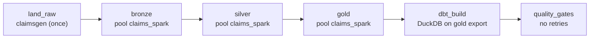

# Orchestration (Airflow)

Ticket #9. One DAG, `claims_daily`, runs the medallion batch pipeline for one **logical date** per run:
land raw files, bronze, silver, gold, `dbt build`, quality gates. Code: `orchestration/airflow/`
(DAG files in `dags/`, logic in the Airflow-free package `claims_dags/`). Layer behaviour is in
[bronze.md](bronze.md), [silver.md](silver.md), [gold.md](gold.md), [dbt.md](dbt.md).

> **What ran and what did not.** See [Verification status](#verification-status) at the end. In short:
> unit/structural tests and the DagBag import run in CI; the DAG is **not** deployed anywhere.
> MWAA (AWS) and Astronomer are plausible deployment targets for these DAG files, but neither has
> been used. All data is synthetic.

## The DAG



| Task | Runs | Writes only to | Retries | Timeout | SLA (after interval end) |
|---|---|---|---|---|---|
| `land_raw` | `python -m claimsgen` if `raw/claims` is missing | `<root>/raw` | 1 | 15 min | 30 min |
| `bronze` | `python -m lakehouse.bronze --batch-date {{ ds }}` | `<root>/bronze` | 3 | 45 min | 1 h |
| `silver` | `python -m lakehouse.silver --batch-date {{ ds }}` | `<root>/silver` | 3 | 45 min | 2 h |
| `gold` | `python -m lakehouse.gold --batch-date {{ ds }}` | `<root>/gold` | 3 | 45 min | 3 h |
| `dbt_build` | `dbt deps` + `dbt build --target duckdb` on `<gold>/export` | `<root>/dbt` | 3 | 30 min | 3.5 h |
| `quality_gates` | `python -m claims_dags.gates` | nothing | 0 | 10 min | 4 h |

`<root>` is `$CLAIMS_DATA_ROOT` (default `data/airflow`). The task list, retries, timeouts, SLAs, pools
and write scopes live in one place, `claims_dags/spec.py`; `factory.py` turns it into `BashOperator`s.
The tasks are plain CLI calls, so swapping `BashOperator` for `DockerOperator` / `KubernetesPodOperator`
(one image per layer) is a change in `factory.py` only; that variant is not built here.

### Reliability settings

- **Retries with backoff:** 3 retries, 2 min initial delay, exponential, capped at 30 min. `quality_gates`
  has 0 retries: its checks are deterministic, a retry cannot fix them.
- **`max_active_runs=1` and `depends_on_past=True`:** batches never interleave (the layers share Delta
  tables) and run in date order. Order matters: the generator's members/providers snapshot is dated
  `2024-01-01`, so that date must run before claims dates, or gold would hold claims back as
  `UNRESOLVED_MEMBER`.
- **Pool `claims_spark` (1 slot):** the three Spark layers each use `local[*]`, so they must not overlap
  across runs or DAGs. Create it once: `airflow pools set claims_spark 1 "Spark layers"` (the local
  entrypoint does this).
- **Timeouts:** per-task `execution_timeout` plus a 6 h `dagrun_timeout`.
- **`catchup=False`:** the first scheduler start does not fire hundreds of runs; backfill explicitly.

## Idempotency: the logical date is the key

Each layer replaces exactly one batch (`replaceWhere _batch_id = 'bYYYYMMDD'`, see the Idempotency
sections of the layer docs). The DAG passes `{{ ds }}` as `--batch-date` to bronze, silver and gold and
never uses the wall clock, so `batch_key(ds)` (`b20240105` for 2024-01-05, the same formula as bronze's
`batch_id_for`) is stable across schedules, clears, retries and backfills. Re-running a date rewrites
that batch and nothing else; a test asserts every layer command carries `--batch-date '{{ ds }}'` and no
wall-clock expression. `land_raw` is guarded by `test -d raw/claims` because the generator is seeded:
the raw tree is identical every time, and a landed file must not be rewritten under a replay.

Safety nets that are tested: each task's write flag (`--out`, `--bronze`, `--silver`, `--gold`) must be
the root of its own layer and reads must come from the layer directly upstream (`tests/orchestration/test_spec.py`).

## Runbook

All commands are for Airflow 2.10 (inside `make airflow-sh`, or any environment with the DAGs folder set).

**Backfill a date range** (runs sequentially because of `max_active_runs=1`; the first date must be
`2024-01-01`, or an earlier run must already have succeeded):

```bash
make airflow-backfill AIRFLOW_START=2024-01-01 AIRFLOW_END=2024-01-31
# equivalent: airflow dags backfill claims_daily -s 2024-01-01 -e 2024-01-31
```

Re-running dates that already succeeded is safe (idempotent). To force the tasks to run again add
`--reset-dagruns -y`; `--rerun-failed-tasks` re-runs only what failed.

**Replay one date** (for example a corrected raw file): clear its tasks and let the scheduler (or a
backfill of the same date) re-run them:

```bash
airflow tasks clear claims_daily -s 2024-01-05 -e 2024-01-05 -y            # whole day
airflow tasks clear claims_daily -t '^(silver|gold|dbt_build|quality_gates)$' -s 2024-01-05 -e 2024-01-05 -y -r
```

Clearing a middle task while later dates already ran is fine for the data (every batch is independent),
but gold's dimensions are SCD2: replaying an older batch after newer ones is supported and a no-op
unless the snapshot changed (see gold.md), and the Parquet export is rebuilt from the full gold tables.

**Retry a failed task:** the scheduler already retries with backoff. After the retries are exhausted the
task is `failed`, downstream tasks stay `upstream_failed`, and the next date waits (`depends_on_past`).
Fix the cause, then `airflow tasks clear claims_daily -t <task> -s <date> -e <date> -y -d` (`-d` also
clears downstream).

**Failures and alerts:** after the last retry the `on_failure_callback` logs one JSON line from logger
`claims_dags.alerts`:

```json
{"dag_id": "claims_daily", "event": "claims_pipeline_task_failed", "exception": "...", "logical_date": "2024-01-05", "task_id": "silver", "try_number": 4}
```

If `CLAIMS_ALERT_WEBHOOK_URL` is set (any http(s) endpoint taking JSON; the body also has a Slack-style
`text` field) the same record is POSTed with a 5 s timeout. A webhook error is logged and swallowed so the
alert path can never hide the real failure. No credentials or data values are in the payload. The
`quality_gates` failure message is in the task log (`GATE FAILED: ...`).

**SLA misses:** each task has an SLA measured from the end of the schedule interval (Airflow 2.x
semantics). A miss calls `sla_miss_callback`, which logs `claims_pipeline_sla_miss` records the same way
and posts them to the webhook. The task is not killed; the timeouts do that. Airflow 3 removed task SLAs
(replaced by Deadline Alerts), which is why `requirements-airflow.txt` pins 2.10.5.

**Quality gates** (`claims_dags/gates.py`, run on the gold Parquet export): all six star tables exist and
have rows; `fact_claim.claim_id` unique; every line's claim exists; if the raw tree has a claims partition
for the logical date, gold has rows with that date's `load_batch_id`. dbt's own tests ran in the
preceding task, and the gold job itself already fails on reconciliation errors.

## Running it locally

```bash
make airflow-test            # airflow dags test claims_daily for 2024-01-01..03, in order, in Docker
make airflow-up              # UI on http://localhost:8085 (8080-8082 belong to the main stack), user admin
docker compose -f orchestration/airflow/docker-compose.yml logs airflow | grep -i password
make airflow-backfill AIRFLOW_START=2024-01-01 AIRFLOW_END=2024-01-03
make airflow-down            # keeps the cache volume and data/airflow
make airflow-clean           # deletes both
```

One container (the pinned Spark image) holds Airflow 2.10.5, pyspark/delta, claimsgen and dbt-duckdb,
installed once into the `claims-airflow-cache` volume (first run: several minutes, needs internet).
The Spark jobs run in-process, so there is no docker-in-docker, and the container does not need the main
`make up` stack (data is on the local filesystem under `data/airflow`; files are root-owned because the
container runs as root, like the other Spark make targets). Two local workarounds, both only inside this
container: numpy is relaxed to `<2.3` because the image's Python 3.10 cannot take the pinned 2.4.6
(issue #76, same as `mk/streaming_spark.mk`), and dbt is 1.9.x because 1.12 needs Python 3.11+ (CI's
`pipeline e2e` uses the pinned versions on 3.12). Pointing the roots at MinIO (`s3a://`) works for the
Spark layers ([bronze.md](bronze.md)) but the `land_raw`, `dbt_build` and `quality_gates` tasks read local
paths, so it is not wired up.

Without Docker: `pip install -r requirements-airflow.txt -c <constraints-2.10.5 for your Python>` on
Python 3.8-3.12, then `make test-airflow` for the DagBag and structural tests. Environment knobs:
`CLAIMS_REPO`, `CLAIMS_DATA_ROOT`, `CLAIMS_ROWS`, `CLAIMS_DBT_BIN`, `CLAIMS_SCHEDULE`,
`CLAIMS_ALERT_WEBHOOK_URL`.

## Not included

- **Streaming maintenance DAG:** not built. The streaming job (#12) is a long-running process, and
  compaction/vacuum of its tables has no CLI entry point to schedule yet; silver/gold `--optimize` /
  `--vacuum` exist but need a safe schedule against the daily batch, which is future work.
- No deployment to MWAA or Astronomer, no secrets backend, no production executor (Celery/Kubernetes);
  the local run uses `airflow standalone` (SQLite + LocalExecutor).
- Lineage events (#24) are not emitted from the DAG yet.

## Tests

`tests/orchestration/`: `test_spec.py` (graph order, retries/timeouts/SLAs, pool, idempotency key,
write scopes), `test_callbacks_gates.py` (alert record, webhook failure handling, gates on tiny Parquet
fixtures), `test_dagbag.py` (real `DagBag`, no import errors, DAG matches the spec; skipped when Airflow
is not installed). The `pytest` job in `ci.yml` runs everything except the DagBag file; the separate
`airflow` workflow installs Airflow with the official constraints and runs all of it plus
`airflow dags list-import-errors`.

## Verification status

VERIFICATION_PLACEHOLDER
