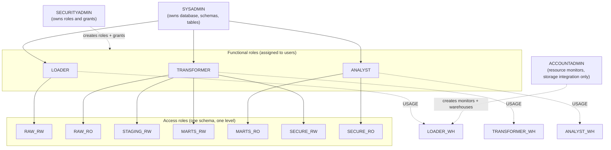

# Snowflake: warehouses, roles, gold schema and load path

Ticket #14 (part of M3). Code lives in `infra/snowflake/` (Terraform) and `warehouse/snowflake/` (SQL).

> **Status: validated offline only. This has NOT been executed against a live Snowflake account.**
> There is no Snowflake account attached to this repo. What was checked: `terraform fmt`, `init -backend=false` and `validate` (provider schema and attribute names), `sqlfluff lint` with the `snowflake` dialect (syntax parses), `pytest tests/snowflake` and `infra/snowflake/tests/static_checks.sh` (structural and least-privilege invariants). What was **not** checked: `terraform plan/apply`, every SQL statement's behaviour on Snowflake (COPY, MERGE, COPY_HISTORY, clustering functions), and the external-stage/IAM handshake. Run it on a free trial using the steps below and record results in #14 before treating any of it as proven. Known risks to watch on the first run are listed at the end.

## What gets created

| Object | Name (dev) | Notes |
|---|---|---|
| Database | `CLAIMS_DEV` | Time Travel 1 day |
| Schemas | `RAW`, `STAGING`, `MARTS`, `SECURE` | managed access (only the schema owner or `MANAGE GRANTS` grants privileges) |
| Warehouses | `CLAIMS_DEV_LOADER_WH`, `_TRANSFORMER_WH`, `_ANALYST_WH` | XSMALL, auto-suspend 60 s, start suspended |
| Resource monitors | `CLAIMS_DEV_<WORKLOAD>_RM` | monthly quota, notify 50/75/90 %, suspend at 100 %, cancel running queries at 110 % |
| Functional roles | `CLAIMS_DEV_LOADER`, `_TRANSFORMER`, `_ANALYST` | what people and services use |
| Access roles | `CLAIMS_DEV_RAW_RW`, `_RAW_RO`, `_STAGING_RW`, `_MARTS_RW`, `_MARTS_RO`, `_SECURE_RW`, `_SECURE_RO` | one schema, one level; granted only to functional roles |
| File format | `RAW.FF_PARQUET` | Parquet, logical types on |
| Storage integration + stage (opt-in) | `CLAIMS_DEV_GOLD_S3_INT`, `RAW.GOLD_STAGE` | `enable_external_stage = true` |

Users are out of scope: the roles are created, but granting them to people or service users is a manual step (see "Run it on a free trial").

## Role model



An arrow means "is granted to" in the inheritance direction (parent gets the child's privileges): `SYSADMIN` inherits the three functional roles, which inherit the access roles.

Design rules, all enforced by `tests/snowflake` and `infra/snowflake/tests/static_checks.sh`:

- Nothing is granted to `PUBLIC`. No `ALL PRIVILEGES`, `OWNERSHIP`, `MANAGE GRANTS` or `WITH GRANT OPTION`.
- Privileges attach to **access roles** on a single schema, never to users or functional roles directly (the exception is warehouse `USAGE`, which goes on the functional role).
- Table and view privileges are **future grants** (the DDL runs after Terraform), so objects created later are covered without re-granting.
- `LOADER` can only write `RAW`. `TRANSFORMER` reads `RAW` and writes `STAGING`/`MARTS`/`SECURE`. `ANALYST` is read-only on `MARTS` and `SECURE` and cannot see `RAW` or `STAGING`.
- Each role can use only its own warehouse, with no `OPERATE`/`MODIFY`/`MONITOR`.
- Terraform uses three provider aliases (`SYSADMIN`, `SECURITYADMIN`, `ACCOUNTADMIN`), the documented system-role split. `ACCOUNTADMIN` is used only for what requires it. Trade-off: because a warehouse must be created by `ACCOUNTADMIN` to attach a resource monitor, the warehouses are owned by `ACCOUNTADMIN` (access is still via `USAGE` grants). Transferring ownership to `SYSADMIN` afterwards is a possible hardening step.
- Masking and row access policies are a placeholder: `warehouse/snowflake/90_masking_policies.sql`, tracked in #25. Until #25 lands, `SECURE` holds no objects and `ANALYST` reads `MARTS` directly. All data is synthetic.

## Warehouse sizing and cost guardrails

| Warehouse | Size | Auto-suspend | Statement timeout | Monthly quota (credits) | Why |
|---|---|---|---|---|---|
| `LOADER_WH` | XSMALL | 60 s | 1 h | 5 | COPY from many small Parquet files parallelises per file; an XS handles the trial volume. Bigger only if a measured load is slow |
| `TRANSFORMER_WH` | XSMALL | 60 s | 1 h | 10 | MERGEs on millions of rows. Raise to SMALL only if a MERGE spills to disk (check the query profile) |
| `ANALYST_WH` | XSMALL | 60 s | 5 min | 10 | Interactive BI; a short timeout stops runaway queries |

- An XSMALL warehouse bills 1 credit per running hour (SMALL 2, MEDIUM 4, doubling per size), per second after a 60-second minimum each time it resumes. Auto-suspend at 60 s avoids paying for idle time; very short suspend values also throw away the warehouse cache, so 60 s is a compromise, not a law.
- Total monthly ceiling across the three monitors is 25 credits. Check your trial's credit allowance and the current price per credit yourself; this repo does not assume either.
- Guardrails in layers: warehouse starts suspended, auto-suspends, per-warehouse monitor (notify, then suspend, then cancel running statements), statement timeouts. A monitor suspends warehouses only after usage is reported, which can lag, so the 110 % cancel trigger is a backstop, not a hard cap.
- `notify_users` must list real Snowflake users who enabled notifications, otherwise the notify triggers go nowhere.
- All sizes and quotas are **hypotheses** until measured in #16.

## Load path: gold (Delta) to Snowflake

Per [ADR-0002](adr/0002-delta-vs-iceberg.md), Delta is the system of record and Snowflake cannot natively read Delta tables through a plain stage. So:

1. **Primary path (implemented as code here): export gold as Parquet, then COPY.** A Spark job (not part of this PR; depends on #8) writes a snapshot of each gold table as plain Parquet to `s3://<bucket>/<prefix>/<table>/export_date=YYYY-MM-DD/`. Copying a live Delta table's data files directly is **wrong**: Delta files include rows that were later updated or deleted and only the transaction log says which are current. The export must read the table through Delta (or a pinned version) and write a clean snapshot. Then `COPY INTO` lands the Parquet in `RAW.landing_*` and `MERGE` upserts into `MARTS`. This is the "load gold into native tables" path of ADR-0002, trading credits for Snowflake's performance and governance features.
2. **Secondary path (not implemented here): Iceberg metadata over the Delta files.** Delta UniForm can write Iceberg metadata beside the Delta data, and Snowflake can read that through Iceberg tables backed by an external volume and a catalog integration, with no copy. It is read-only from Snowflake, constrained by UniForm feature support (for example deletion vectors), and its query cost versus native tables is what #16 measures. It does not use the stage or the `COPY` scripts. Snowflake also has other ways to create Iceberg tables over Delta files; they were not evaluated.

### Stage and storage integration

`enable_external_stage = true` creates a `STORAGE INTEGRATION` (type S3, allowed location limited to the gold export prefix) and `RAW.GOLD_STAGE` using it. No keys are stored anywhere: Snowflake assumes an AWS IAM role. The handshake has two steps because the role's trust policy needs values Snowflake generates:

1. Create the AWS role first (read-only `s3:GetObject`, `s3:GetObjectVersion`, `s3:ListBucket` on the export prefix, plus KMS decrypt if the bucket uses SSE-KMS) with any placeholder trust. The role is **not** created by `infra/aws/` today; adding a Snowflake reader role there is follow-up work.
2. Apply with the role ARN, read the outputs `storage_aws_iam_user_arn` and `storage_aws_external_id`, and update the role's trust policy to trust that principal with that `sts:ExternalId`.

### Scripts (`warehouse/snowflake/`)

Run in numeric order, with the database selected by the connection (`snow sql --database CLAIMS_DEV ...`). Scripts never hardcode the database and contain no `GRANT`s (grants are Terraform).

| File | Role | Purpose |
|---|---|---|
| `01_gold_ddl.sql` | SYSADMIN | star schema in `MARTS`: `dim_date`, `dim_member` and `dim_provider` (SCD2), `dim_diagnosis`, `fact_claim`, `fact_claim_line` |
| `02_raw_landing_ddl.sql` | SYSADMIN | `RAW.landing_*` tables (append-only, with `_source_file`, `_batch_id`, `_loaded_at`) and `RAW.load_audit` |
| `20_copy_into.sql` | LOADER | `COPY INTO` each landing table, then record files in `load_audit` |
| `30_merge_dimensions.sql`, `31_merge_facts.sql` | TRANSFORMER | idempotent `MERGE` into the gold tables, dimensions first |
| `40_reconcile.sql` | any reader | count, orphan-key, header-vs-lines and SCD2 checks (expect zero diff) |
| `50_clustering_experiments.sql` | TRANSFORMER | clustering measurements for #16, nothing enabled by default |
| `90_masking_policies.sql` | n/a | placeholder for #25, no executable SQL |

Table notes: `PRIMARY KEY`/`FOREIGN KEY` are informational in Snowflake (not enforced); integrity relies on the MERGE keys and the reconcile queries. Surrogate keys (`member_sk`, `provider_sk`, `diagnosis_sk`) are assigned in the Spark gold job so Delta and Snowflake agree. SCD2 versions (`effective_from`, `effective_to`, `is_current`) are also computed upstream; Snowflake upserts versions rather than computing them. Amounts are `NUMBER(12, 2)` (the raw layer is float64; see `docs/data-generator.md`).

### Idempotency and re-load

- `COPY INTO` skips files it has already loaded into that table (load metadata is kept 64 days), so re-running `20_copy_into.sql` loads nothing twice. `ON_ERROR = ABORT_STATEMENT` means a bad file fails the statement with nothing partial for that table.
- The audit insert is guarded by `NOT EXISTS` on `(table_name, file_name, last_load_time)`. `COPY_HISTORY` can lag a few minutes; a missed file is audited on the next run (2-day window).
- `MERGE` dedupes the landing rows to the latest per business key and updates a matched row only if its content hash differs, so repeated runs and duplicate landings leave gold unchanged.
- **Reload a batch** (a corrected export, or files older than the 64-day metadata): delete that batch's rows from the landing table, `COPY INTO ... FORCE = TRUE` for that path only, then re-run the MERGE scripts:

  ```sql
  DELETE FROM raw.landing_fact_claim WHERE _batch_id = 'export_date=2024-03-01';
  -- then run the fact_claim COPY from 20_copy_into.sql with FORCE = TRUE and a narrower
  -- FROM @gold_stage/fact_claim/export_date=2024-03-01/ path, then 31_merge_facts.sql
  ```

  `FORCE` is deliberately absent from the default script, and a test fails if it appears there.
- Deletes are not propagated: a claim missing from a later export stays in gold. Handling deletes needs a tombstone column in the export; not done.

## Clustering and micro-partitions: hypotheses to measure in #16

Nothing is clustered in the DDL. These are hypotheses, not findings, and `50_clustering_experiments.sql` holds the measurements.

- **H1, no key needed at trial scale.** At 1M claims (about 2.4M lines) the tables are well under 1 GB compressed, a handful to a few dozen micro-partitions. Pruning on such small tables saves little, and loads arrive roughly in `received_date` order, so natural order already clusters on date.
- **H2, late arrivals degrade `service_date_key` clustering first.** About 2 % of claims land 31-90 days after service (`docs/data-generator.md`), so micro-partitions overlap more on `service_date_key` than on `received_date_key`. Measure `SYSTEM$CLUSTERING_INFORMATION` (average depth, overlaps) before choosing the key; the candidate is `service_date_key` on `fact_claim_line` and `fact_claim`.
- **H3, automatic clustering costs more than it saves at this size.** Reclustering is billed serverless compute. Enable it only if H2 shows deep overlap *and* the dashboard queries (#29, #30) filter on that column; the script has the `SUSPEND RECLUSTER` / `DROP CLUSTERING KEY` exit.
- **Dimensions are not clustered**; they are small and joined on their key.
- **Landing tables are append-only and unclustered**; they are scanned in full by the MERGE.

Decision rule: record clustering depth, bytes scanned and credits before and after in #16; keep a key only if it cuts scanned partitions on real dashboard queries by an amount that justifies the reclustering credits.

## Run it on a free trial

Everything below is the owner's manual procedure; none of it has been run.

1. **Create a trial account.** Pick AWS and the same region as your S3 bucket (avoids cross-region transfer). Note the organization name and account name (not the login URL) for the env vars below.
2. **Create key-pair auth.** Locally:
   ```bash
   openssl genrsa 2048 | openssl pkcs8 -topk8 -inform PEM -nocrypt -out ~/.snowflake/rsa_key.p8
   openssl rsa -in ~/.snowflake/rsa_key.p8 -pubout -out ~/.snowflake/rsa_key.pub
   ```
   In a worksheet as `ACCOUNTADMIN`: `ALTER USER <you> SET RSA_PUBLIC_KEY = '<public key body>';`. Keep the key outside the repo checkout. For the trial, that user needs `SYSADMIN`, `SECURITYADMIN` and `ACCOUNTADMIN`, which Terraform switches between. Do not do this on a real account; use separate, narrower users.
3. **Export credentials as environment variables** (never in code or tfvars):
   ```bash
   export SNOWFLAKE_ORGANIZATION_NAME=<org>
   export SNOWFLAKE_ACCOUNT_NAME=<account>
   export SNOWFLAKE_USER=<user>
   export SNOWFLAKE_AUTHENTICATOR=SNOWFLAKE_JWT
   export SNOWFLAKE_PRIVATE_KEY="$(cat ~/.snowflake/rsa_key.p8)"
   ```
4. **Plan, review, apply the base stack** (no S3 yet):
   ```bash
   cd infra/snowflake/envs/dev
   terraform init && terraform plan -out tfplan   # read it
   terraform apply tfplan
   ```
   Fix any provider errors here first; they are the most likely failures (see risks).
5. **Give yourself the roles:** as `SECURITYADMIN`, `GRANT ROLE CLAIMS_DEV_LOADER TO USER <you>;` and the same for `_TRANSFORMER` and `_ANALYST`.
6. **Create tables.** Install the Snowflake CLI (`snow`), add a connection, then as `SYSADMIN`:
   ```bash
   snow sql --database CLAIMS_DEV --role SYSADMIN -f warehouse/snowflake/01_gold_ddl.sql
   snow sql --database CLAIMS_DEV --role SYSADMIN -f warehouse/snowflake/02_raw_landing_ddl.sql
   ```
7. **Produce a gold Parquet export** in S3 under `<prefix>/<table>/export_date=YYYY-MM-DD/` (needs the gold job, #8; until then export from any Spark session reading your silver/gold Delta tables). Use synthetic data from `claimsgen` only.
8. **Enable the stage.** Create the AWS read-only role (see "Stage and storage integration"), then:
   ```bash
   terraform apply -var enable_external_stage=true \
     -var gold_s3_url=s3://<bucket>/<prefix>/ -var storage_aws_role_arn=arn:aws:iam::<acct>:role/<role>
   terraform output storage_aws_iam_user_arn storage_aws_external_id
   ```
   Update the AWS role trust policy with those two values, then verify as `CLAIMS_DEV_LOADER`: `LIST @raw.gold_stage;`.
9. **Load and merge:**
   ```bash
   snow sql --database CLAIMS_DEV --role CLAIMS_DEV_LOADER --warehouse CLAIMS_DEV_LOADER_WH -f warehouse/snowflake/20_copy_into.sql
   snow sql --database CLAIMS_DEV --role CLAIMS_DEV_TRANSFORMER --warehouse CLAIMS_DEV_TRANSFORMER_WH \
     -f warehouse/snowflake/30_merge_dimensions.sql -f warehouse/snowflake/31_merge_facts.sql
   snow sql --database CLAIMS_DEV --role CLAIMS_DEV_ANALYST --warehouse CLAIMS_DEV_ANALYST_WH -f warehouse/snowflake/40_reconcile.sql
   ```
   Re-run step 9 to confirm idempotency: row counts must not change and `load_audit` must not gain duplicate rows.
10. **Check least privilege:** as `CLAIMS_DEV_ANALYST`, `SELECT * FROM raw.landing_fact_claim` and `INSERT INTO marts.fact_claim ...` must both fail.
11. **Tear down:** `terraform destroy`, or let the trial expire. Warehouses are suspended anyway, but monitors and the integration persist until destroyed.

Record in #14: Snowflake edition, Terraform apply result, row counts, first-run errors fixed, credits used.

## Known risks for the first live run

- Provider enum values for future grants (`STAGES`, `FILE FORMATS`) and `with_managed_access` plus future grants were validated against the provider schema, not against Snowflake.
- With managed-access schemas, grants must be issued by a role with `MANAGE GRANTS` (`SECURITYADMIN` here); `SYSADMIN` cannot grant on objects it creates.
- The provider's strict privilege management is on by default: privileges granted outside Terraform to these roles on the same targets will be revoked on the next apply.
- Parquet `DATE`/`TIMESTAMP` handling from Spark (physical type, INT96) depends on `USE_LOGICAL_TYPE` and how the export is written; check date and timestamp columns first.
- `COPY INTO` column casting from `$1:col::TYPE` raises on a non-castable value (`ABORT_STATEMENT`); amounts must be exported already rounded to cents.
- `INFORMATION_SCHEMA.COPY_HISTORY` is database-scoped and may need `SELECT`/`MONITOR` visibility on the landing tables for `LOADER`.
- The Terraform provider is pinned `~> 2.22`; its docs note that some grant behaviour is experimental and scheduled to change. Re-check on upgrade.
