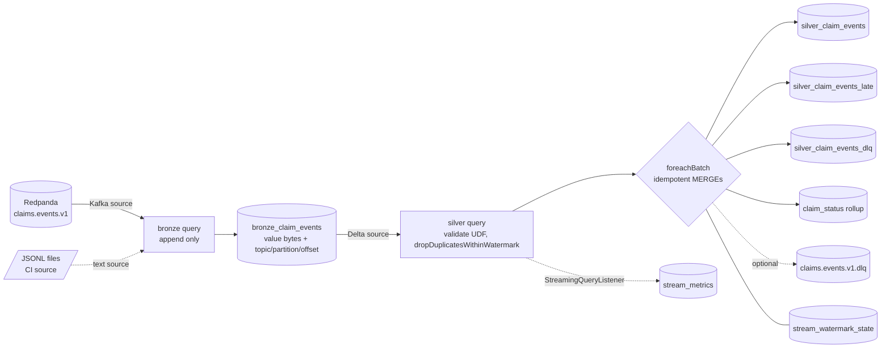

# Spark Structured Streaming: bronze to silver (ticket #12)

Consumes the `claims.events.v1` topic produced by [streaming.md](streaming.md) and lands it in Delta: a raw bronze table, then a validated, deduplicated silver table with late-data diversion, a dead-letter table, a claim-status rollup and a metrics table.

Status: tested locally (PySpark 3.5.9 + Delta 3.3.3 in the pinned `apache/spark` image) with a file source in CI and against the local Redpanda stack by `tests/stack/streaming_spark_smoke.sh`. It has not run on a managed Kafka service or a real cloud.

## Architecture



Two queries, two checkpoints (`<root>/_checkpoints/bronze_events`, `.../silver_events`). Bronze is the system of record: the silver query can be rebuilt by deleting its checkpoint and silver tables.

## Tables

| Table | Key | Content |
|---|---|---|
| `bronze_claim_events` | none (append-only) | raw `value` bytes, `topic`, `partition`, `offset`, `kafka_ts`, `source_file`, `ingested_at` |
| `silver_claim_events` | `event_id` | typed, contract-valid, deduped, on-time events |
| `silver_claim_events_late` | `event_id` | valid events older than the watermark, with `lateness_seconds` |
| `silver_claim_events_dlq` | `dlq_key` | invalid events: `reason_code`, `reason_detail`, `failed_fields`, original bytes, DLQ envelope JSON |
| `claim_status` | `claim_id` | latest status per claim (submitted, paid, denied) |
| `stream_watermark_state` | `(query, batch)` | per-batch max event time (drives late classification) |
| `stream_metrics` | `(query_id, batch_id)` | throughput, duration, watermark lag, late and DLQ counts |

DLQ reason codes: `malformed_json`, `contract_violation` (with `failed_fields`), `null_payload`. The DLQ envelope is the one from `lakehouse.streaming.dlq` (stage `consumer`); with `--dlq-kafka` it is also published to `claims.events.v1.dlq`.

## Watermark and late-data policy

- Event time is `event_ts` (UTC, second precision). Default watermark delay: **6 hours** (`--watermark-delay`).
- Why 6h: the generator shifts out-of-order events at most 4 hours earlier than the preceding event ([data-generator.md](data-generator.md)); 2 extra hours of margin. The test over real generator output shows zero late events at 6h.
- Tradeoff: a longer delay accepts more disorder and holds more dedupe state, but a event is only classified late relative to a high-water mark that lags by that delay. A shorter delay bounds state and diverts stragglers sooner. Late events are not lost; they are in `silver_claim_events_late` and can be replayed.
- Dedupe uses `dropDuplicatesWithinWatermark("event_id")` (Spark 3.5.0+, the pinned line). It evicts state when the watermark passes, unlike plain `dropDuplicates` on `event_id` which would grow forever. Duplicates that outlive the state are caught by the `MERGE ... WHEN NOT MATCHED` on `event_id`, so correctness does not depend on the state window.
- Measured: `dropDuplicatesWithinWatermark` does not drop late rows (a row 6h behind the watermark still reached the sink). Spark therefore only bounds state here, and lateness is classified in `foreachBatch`: late iff `event_ts < max(event_ts of previous batches) - delay`, the same rule as Spark's watermark. The high-water mark is stored per `(query, batch_id)`, so a replayed batch recomputes the same cutoff.
- Late events are diverted and counted (`late_count`), excluded from silver and from the rollup. A "late" row whose `event_id` is already in silver is a duplicate, not a late arrival, and is not reported.
- A single micro-batch has no earlier batch, so nothing in the first batch is late. Disorder inside a batch is always accepted.

## Delivery semantics

| Hop | Guarantee | Mechanism |
|---|---|---|
| producer to broker | at-least-once, idempotent per session | see [streaming.md](streaming.md); replays re-send |
| Kafka to bronze | exactly-once per micro-batch | offsets in the checkpoint plus Delta's transactional streaming sink |
| bronze to silver tables | effectively-once | at-least-once replay of a batch, every write keyed: MERGE insert-if-absent on `event_id` / `dlq_key`, upsert on `(query, batch)` |
| claim_status | idempotent, order-independent | MERGE updates only when the incoming `(event_ts, rank, event_id)` is newer |
| DLQ Kafka topic (`--dlq-kafka`) | at-least-once | plain Kafka write; a replayed batch re-publishes. Record key = `dlq_key` for consumer dedupe |

Honest summary: the source is at-least-once, so there is no true exactly-once; at-least-once source plus an idempotent sink gives effectively-once results. The five sink writes in a batch are separate Delta commits, not one transaction. A crash between them leaves a partial batch, and the restart replays the whole batch from the checkpoint, which converges because every write is idempotent. `tests/streaming/test_spark_job.py` injects a crash after each step and compares with a clean run.

Status rollup order: latest `event_ts` wins; at equal time a terminal event (paid, denied) beats `submitted`; remaining ties break on `event_id`.

## Triggers and how to run

| Mode | Flag | Use |
|---|---|---|
| `availableNow` (default) | `--trigger availableNow` | CI and tests: bronze drains the source, then silver drains bronze, then exit. Batch size via `--max-offsets-per-trigger` / `--max-files-per-trigger` |
| `processingTime` | `--trigger processingTime --interval "5 seconds" [--run-seconds N]` | demo: both queries run concurrently until stopped |

```bash
# CI-style, no broker: JSONL directory source
make spark-py PY=...   # or:  python -m lakehouse.streaming.spark_job --root /tmp/lake \
#   --source files --input-dir data/raw/events --max-files-per-trigger 1

# Local stack (Docker, joins the compose network; Redpanda internal listener redpanda:9092)
make up && make produce-demo
make streaming-spark-run STREAM_MODE=availableNow      # or streaming-spark-demo (processingTime)
make streaming-spark-test                               # Spark tests in the pinned image
make streaming-spark-smoke                              # 5,000-event integration run
make down
```

Storage: `--root URI` (writes `<root>/bronze`, `/silver`, `/_checkpoints`; any local path, `file://` or `s3a://`) or `--env local|aws|azure` to resolve roots through `lakehouse_common.storage` (ADR-0003). The Kafka source package `spark-sql-kafka-0-10` is resolved at startup (needs network on first run).

Docker note: the pinned image has Python 3.10 while `requirements-claimsgen.txt` pins numpy 2.4 (Python 3.11+, what CI uses). `mk/streaming_spark.mk` therefore installs the same requirements with numpy relaxed into a separate cache dir. Modules the job imports avoid 3.11-only APIs for this reason.

## Metrics

`stream_metrics`, one row per `(query_id, batch_id)` (MERGE, so restarts and re-runs do not double-count), written from a `StreamingQueryListener`:

`num_input_rows`, `input_rows_per_sec`, `processed_rows_per_sec`, `batch_duration_ms`, `watermark_ts`, `watermark_lag_s` (progress time minus watermark; large on replayed historical data by design), `duplicates_dropped`, `offsets_behind_latest` (Kafka lag), and for the silver query `on_time_count`, `late_count`, `dlq_count`.

The listener only buffers; the driver loop flushes to Delta, because running Spark jobs on the listener-bus thread is unsafe. `late_count` counts arrivals: a late event re-sent later is counted again but stored once.

## Checkpoint and recovery runbook

| Situation | Action |
|---|---|
| Job crashed or was stopped | Re-run the same command with the same `--root`. It resumes from the checkpoint and replays the in-flight batch. No cleanup needed |
| Bad deploy wrote wrong silver rows | Fix code; delete `silver_*`, `claim_status`, `stream_watermark_state` and the `silver_events` checkpoint; re-run. Bronze is untouched and is replayed |
| Need to reprocess late events | Read `silver_claim_events_late`, fix or widen `--watermark-delay`, append to bronze or MERGE into silver by hand |
| DLQ rows after a contract fix | `dlq.original_payload(envelope)` recovers the exact bytes; re-produce them |
| Kafka retention removed unread offsets | Bronze query fails (`failOnDataLoss`). Decide to accept loss, then delete the bronze checkpoint knowingly |
| Changing `--watermark-delay` | Allowed between runs, but state evicts under the new delay and the late cutoff changes for new batches only |
| Deleting only the bronze checkpoint | Re-reads the topic from the start: bronze gets duplicate rows (append-only), silver stays correct (MERGE) |

Never delete a checkpoint of a running query. Checkpoints hold offsets and the dedupe state; keep them on the same storage as the tables.

## Scale notes (not done)

Silver is unpartitioned; at real volume partition by `event_date` and add it to the MERGE predicate for file pruning. The validation UDF is a row-at-a-time Python UDF (fine for the contract's 8 fields; Pandas UDF if it becomes hot). The late-event anti-join reads the whole silver key column per batch.

## Measured (local, Docker Desktop, single laptop)

`tests/stack/streaming_spark_smoke.sh` against Redpanda v24.3.11 and Spark 3.5.9 (local[*] in the pinned image): 5,000 generated events produced (4,966 distinct `event_id`s, so 34 injected duplicates), `availableNow` with 1,500 offsets per batch: bronze 5,000 rows, silver 4,966, late 0, DLQ 0, 2,525 claims in the rollup, 6 metric rows; wall time 79 s including JVM start and Kafka package resolution (not a throughput benchmark). A second run with no new data changed no table.
The Spark suite (13 tests) takes about 6.5 minutes locally.

## Tests

- `pytest -m "not spark" tests/streaming/test_spark_rules.py`: validation outcomes, reason codes, envelope, storage-root resolution, CLI.
- `pytest -m spark tests/streaming` (CI job `spark tests (streaming)`, or `make streaming-spark-test`): duplicates collapse, out-of-order accepted, beyond-watermark diverted and counted, late duplicate not reported, DLQ reason codes, rollup order, restart without duplicates or loss, crash after each sink step then restart equals a clean run, metrics table, and the real generator stream with its injected defects.
- `tests/stack/streaming_spark_smoke.sh`: needs the compose stack; **not wired into CI** (no broker there).
