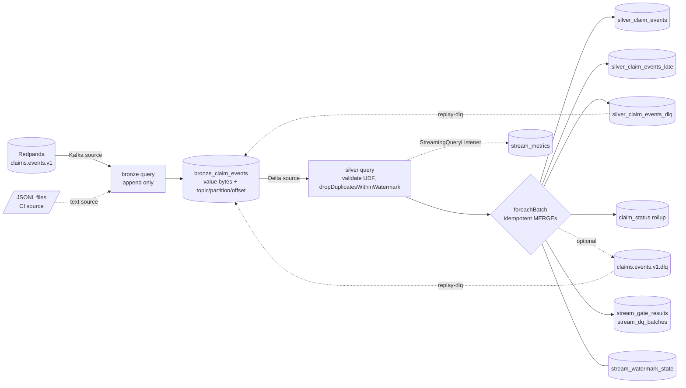

# Spark Structured Streaming: bronze to silver (tickets #12, #13)

Consumes the `claims.events.v1` topic produced by [streaming.md](streaming.md) and lands it in Delta: a raw bronze table, then a validated, deduplicated silver table with late-data diversion, a dead-letter table, a claim-status rollup and a metrics table.

Ticket #13 adds per-batch data-quality gates, a finished Kafka dead-letter topic and an idempotent DLQ replay (sections [Data-quality gates](#data-quality-gates-ticket-13), [Dead-letter topic](#dead-letter-topic-dlq-kafka), [Replaying dead letters](#replaying-dead-letters-replay-dlq)).

Status: tested locally (PySpark 3.5.9 + Delta 3.3.3 in the pinned `apache/spark` image) with a file source in CI and against the local Redpanda stack by `tests/stack/streaming_spark_smoke.sh`. It has not run on a managed Kafka service or a real cloud.

## Architecture



Two queries, two checkpoints (`<root>/_checkpoints/bronze_events`, `.../silver_events`). Bronze is the system of record: the silver query can be rebuilt by deleting its checkpoint and silver tables.

## Tables

| Table | Key | Content |
|---|---|---|
| `bronze_claim_events` | none (append-only) | raw `value` bytes, `topic`, `partition`, `offset`, `kafka_ts`, `source_file`, `ingested_at` |
| `silver_claim_events` | `event_id` | typed, contract-valid, deduped, on-time events |
| `silver_claim_events_late` | `event_id` | valid events older than the watermark, with `lateness_seconds` |
| `silver_claim_events_dlq` | `dlq_key` | invalid events: `reason_code`, `reason_detail`, `failed_fields`, original bytes, DLQ envelope JSON |
| `claim_status` | `claim_id` | latest status per claim (submitted, paid, denied) |
| `stream_watermark_state` | `(query, batch)` | per-batch max event time (drives late classification) |
| `stream_metrics` | `(query_id, batch_id)` | throughput, duration, watermark lag, late and DLQ counts |
| `stream_gate_results` | `(query_name, batch_id, gate)` | one row per gate per batch: value, numerator/denominator, thresholds, `pass/warn/fail/skipped`, batch status and action |
| `stream_dq_batches` | `(query_name, batch_id)` | dashboard-ready per-batch counts: rows, valid, contract failures, DLQ, late, duplicates, diverted, status, action, breach text |
| `stream_dlq_replay` | `dlq_key` | replay log: `replayed` / `still_invalid`, attempts, last reason, run id |

DLQ reason codes: `malformed_json`, `contract_violation` (with `failed_fields`), `null_payload`, and `gate_diverted` (a valid event swept into the DLQ because its batch failed a gate with `on_fail: divert`). The DLQ envelope is the one from `lakehouse.streaming.dlq` (stage `consumer`); with `--dlq-kafka` it is also published to `claims.events.v1.dlq`.

## Watermark and late-data policy

- Event time is `event_ts` (UTC, second precision). Default watermark delay: **6 hours** (`--watermark-delay`).
- Why 6h: the generator shifts out-of-order events at most 4 hours earlier than the preceding event ([data-generator.md](data-generator.md)); 2 extra hours of margin. The test over real generator output shows zero late events at 6h.
- Tradeoff: a longer delay accepts more disorder and holds more dedupe state, but a event is only classified late relative to a high-water mark that lags by that delay. A shorter delay bounds state and diverts stragglers sooner. Late events are not lost; they are in `silver_claim_events_late` and can be replayed.
- Dedupe uses `dropDuplicatesWithinWatermark("event_id")` (Spark 3.5.0+, the pinned line). It evicts state when the watermark passes, unlike plain `dropDuplicates` on `event_id` which would grow forever. Duplicates that outlive the state are caught by the `MERGE ... WHEN NOT MATCHED` on `event_id`, so correctness does not depend on the state window.
- Measured: `dropDuplicatesWithinWatermark` does not drop late rows (a row 6h behind the watermark still reached the sink). Spark therefore only bounds state here, and lateness is classified in `foreachBatch`: late iff `event_ts < max(event_ts of previous batches) - delay`, the same rule as Spark's watermark. The high-water mark is stored per `(query, batch_id)`, so a replayed batch recomputes the same cutoff.
- Late events are diverted and counted (`late_count`), excluded from silver and from the rollup. A "late" row whose `event_id` is already in silver is a duplicate, not a late arrival, and is not reported.
- A single micro-batch has no earlier batch, so nothing in the first batch is late. Disorder inside a batch is always accepted.

## Delivery semantics

| Hop | Guarantee | Mechanism |
|---|---|---|
| producer to broker | at-least-once, idempotent per session | see [streaming.md](streaming.md); replays re-send |
| Kafka to bronze | exactly-once per micro-batch | offsets in the checkpoint plus Delta's transactional streaming sink |
| bronze to silver tables | effectively-once | at-least-once replay of a batch, every write keyed: MERGE insert-if-absent on `event_id` / `dlq_key`, upsert on `(query, batch)` |
| claim_status | idempotent, order-independent | MERGE updates only when the incoming `(event_ts, rank, event_id)` is newer |
| DLQ Kafka topic (`--dlq-kafka`) | at-least-once | plain Kafka write; a replayed batch re-publishes. Record key = `dlq_key` for consumer dedupe |

Honest summary: the source is at-least-once, so there is no true exactly-once; at-least-once source plus an idempotent sink gives effectively-once results. The five sink writes in a batch are separate Delta commits, not one transaction. A crash between them leaves a partial batch, and the restart replays the whole batch from the checkpoint, which converges because every write is idempotent. `tests/streaming/test_spark_job.py` injects a crash after each step and compares with a clean run.

Status rollup order: latest `event_ts` wins; at equal time a terminal event (paid, denied) beats `submitted`; remaining ties break on `event_id`.

## Triggers and how to run

| Mode | Flag | Use |
|---|---|---|
| `availableNow` (default) | `--trigger availableNow` | CI and tests: bronze drains the source, then silver drains bronze, then exit. Batch size via `--max-offsets-per-trigger` / `--max-files-per-trigger` |
| `processingTime` | `--trigger processingTime --interval "5 seconds" [--run-seconds N]` | demo: both queries run concurrently until stopped |

```bash
# CI-style, no broker: JSONL directory source
make spark-py PY=...   # or:  python -m lakehouse.streaming.spark_job --root /tmp/lake \
#   --source files --input-dir data/raw/events --max-files-per-trigger 1

# Local stack (Docker, joins the compose network; Redpanda internal listener redpanda:9092)
make up && make produce-demo
make streaming-spark-run STREAM_MODE=availableNow      # or streaming-spark-demo (processingTime)
make streaming-spark-test                               # Spark tests in the pinned image
make streaming-spark-smoke                              # 5,000-event integration run
make down
```

Storage: `--root URI` (writes `<root>/bronze`, `/silver`, `/_checkpoints`; any local path, `file://` or `s3a://`) or `--env local|aws|azure` to resolve roots through `lakehouse_common.storage` (ADR-0003). The Kafka source package `spark-sql-kafka-0-10` is resolved at startup (needs network on first run).

Docker note: the pinned image has Python 3.10 while `requirements-claimsgen.txt` pins numpy 2.4 (Python 3.11+, what CI uses). `mk/streaming_spark.mk` therefore installs the same requirements with numpy relaxed into a separate cache dir. Modules the job imports avoid 3.11-only APIs for this reason.

## Metrics

`stream_metrics`, one row per `(query_id, batch_id)` (MERGE, so restarts and re-runs do not double-count), written from a `StreamingQueryListener`:

`num_input_rows`, `input_rows_per_sec`, `processed_rows_per_sec`, `batch_duration_ms`, `watermark_ts`, `watermark_lag_s` (progress time minus watermark; large on replayed historical data by design), `duplicates_dropped`, `offsets_behind_latest` (Kafka lag), and for the silver query `on_time_count`, `late_count`, `dlq_count`.

The listener only buffers; the driver loop flushes to Delta, because running Spark jobs on the listener-bus thread is unsafe. `late_count` counts arrivals: a late event re-sent later is counted again but stored once.

## Checkpoint and recovery runbook

| Situation | Action |
|---|---|
| Job crashed or was stopped | Re-run the same command with the same `--root`. It resumes from the checkpoint and replays the in-flight batch. No cleanup needed |
| Bad deploy wrote wrong silver rows | Fix code; delete `silver_*`, `claim_status`, `stream_watermark_state` and the `silver_events` checkpoint; re-run. Bronze is untouched and is replayed |
| Need to reprocess late events | Read `silver_claim_events_late`, fix or widen `--watermark-delay`, append to bronze or MERGE into silver by hand |
| DLQ rows after a contract fix | `replay-dlq` (see [Replaying dead letters](#replaying-dead-letters-replay-dlq)); `dlq.original_payload(envelope)` still recovers the exact bytes for manual work |
| Kafka retention removed unread offsets | Bronze query fails (`failOnDataLoss`). Decide to accept loss, then delete the bronze checkpoint knowingly |
| Changing `--watermark-delay` | Allowed between runs, but state evicts under the new delay and the late cutoff changes for new batches only |
| Deleting only the bronze checkpoint | Re-reads the topic from the start: bronze gets duplicate rows (append-only), silver stays correct (MERGE) |

Never delete a checkpoint of a running query. Checkpoints hold offsets and the dedupe state; keep them on the same storage as the tables.

## Scale notes (not done)

Silver is unpartitioned; at real volume partition by `event_date` and add it to the MERGE predicate for file pruning. The validation UDF is a row-at-a-time Python UDF (fine for the contract's 8 fields; Pandas UDF if it becomes hot). The late-event anti-join reads the whole silver key column per batch.

## Measured (local, Docker Desktop, single laptop)

`tests/stack/streaming_spark_smoke.sh` against Redpanda v24.3.11 and Spark 3.5.9 (local[*] in the pinned image): 5,000 generated events produced (4,966 distinct `event_id`s, so 34 injected duplicates), `availableNow` with 1,500 offsets per batch: bronze 5,000 rows, silver 4,966, late 0, DLQ 0, 2,525 claims in the rollup, 6 metric rows; wall time 79 s including JVM start and Kafka package resolution (not a throughput benchmark). A second run with no new data changed no table.
The Spark suite (13 tests) takes about 6.5 minutes locally.

## Tests

- `pytest -m "not spark" tests/streaming/test_spark_rules.py`: validation outcomes, reason codes, envelope, storage-root resolution, CLI.
- `pytest -m spark tests/streaming` (CI job `spark tests (streaming)`, or `make streaming-spark-test`): duplicates collapse, out-of-order accepted, beyond-watermark diverted and counted, late duplicate not reported, DLQ reason codes, rollup order, restart without duplicates or loss, crash after each sink step then restart equals a clean run, metrics table, and the real generator stream with its injected defects.
- `pytest -m "not spark" tests/streaming/test_gates.py`: gate math, threshold semantics, YAML validation (no JVM).
- `tests/streaming/test_spark_gates.py` (Spark, file source): every metric family is measured and logged; `halt` stops with the sink untouched and the same batch replays after the fix; `divert` writes the whole batch to the DLQ, does not advance the watermark and keeps going; a crash mid-divert converges.
- `tests/streaming/test_dlq_replay.py` (Spark): dry run, replay appends only now-valid payloads, second run and a lost-log crash do not re-append, replayed events reach silver (including an event still in the dedupe state), reason filter and limit, unfixable records stay dead.
- `tests/stack/streaming_spark_smoke.sh` and `tests/stack/streaming_dq_smoke.sh`: need the compose stack; **not wired into CI** (no broker there). The second one covers the Kafka DLQ topic end to end (see below).

## Data-quality gates (ticket 13)

Evaluated in `foreachBatch` of the silver query, before any sink write, from `config/streaming_gates.yaml` (`--gates-config`, `--no-gates`, `--on-fail halt|divert` override). The file is validated when the job starts: unknown keys or gates, thresholds outside `[0, 1]`, `warn > fail`, a bad `on_fail` or a typo'd field all stop the job before Spark starts and list every problem (`GateConfigError`). Gates are on by default in the CLI; `StreamConfig.gates` defaults to `None` for library callers.

A gate **breaches when the value is strictly greater than the threshold** (`fail: 0` = any occurrence). `null` disables one level, an absent gate is not evaluated. Rate gates are `skipped` for batches smaller than `min_batch_rows`.

| Gate | Value | Default warn / fail |
|---|---|---|
| `contract_failure_rate` | `contract_violation` rows / all rows in the batch | 1% / 5% |
| `dlq_rate` | all dead letters (malformed, null, contract) / all rows | 2% / 10% |
| `late_rate` | late events (beyond the watermark, not already accepted) / valid rows | 1% / 5% |
| `duplicate_rate` | valid rows duplicated inside the batch or already accepted by an earlier batch / valid rows | 10% / 30% |
| `null_rate` (per field) | rows with the field NULL / rows whose JSON parsed | 0% / 5% for `claim_id`, `amount`, `event_ts` |
| `watermark_lag_seconds` | processing time minus (high-water mark - watermark delay) | off (replaying history makes it huge by design); enable on a live topic |

`min_batch_rows` defaults to 20. The defaults are judgement calls sized for the generator stream (about 0.1% injected defects); there is no production traffic to calibrate them against.

Honest limits: `duplicate_rate` only sees duplicates that reach the sink, because `dropDuplicatesWithinWatermark` already removes the in-state ones upstream (so it is mostly 0 until state is evicted). Because contract-valid rows cannot have required fields NULL, `null_rate` is non-zero only on rows that are also contract failures; it exists to say *which field* broke.

### Outcome and action

Each batch writes one row per gate to `stream_gate_results` and one summary row to `stream_dq_batches` (both MERGE-keyed, so a replayed batch overwrites its own evidence), and logs structured JSON on logger `lakehouse.streaming.spark`: `{"event":"dq_gate",...}` per gate (INFO pass, WARNING warn, ERROR fail) and `{"event":"dq_batch",...}` per batch. The effective config is logged once at startup as `dq_gates_config`.

| Overall status | What happens |
|---|---|
| `pass` / `warn` | batch is processed normally; warn is only recorded and logged |
| `fail`, `on_fail: halt` | `DQ_GATE_FAILED` is raised, the query stops (CLI exit code 3 with a message), the batch is **not written** to silver, late, DLQ or the rollup. The gate evidence is written first. Fix the cause or the thresholds and re-run with the same `--root`: the checkpoint replays the same batch |
| `fail`, `on_fail: divert` | the whole batch goes to the dead-letter path and the query continues: invalid rows keep their reason codes, valid events are written as `gate_diverted` (see below). No silver, late, rollup or watermark-state write, so a diverted batch does not advance the watermark |

A diverted valid event's `payload` is a canonical re-serialisation of the parsed event (contract format), not the original bytes (valid rows drop the payload before the stateful dedupe to keep state small); the original bytes remain in bronze at the same source coordinates. It re-validates on replay.

Dashboard query for rejected events by batch: `SELECT batch_id, status, action, dlq_rows, late_rows, diverted_rows, breaches FROM stream_dq_batches ORDER BY batch_id`; by reason: `SELECT reason_code, count(*) FROM silver_claim_events_dlq GROUP BY 1`.

## Dead-letter topic (`--dlq-kafka`)

With `--dlq-kafka` (needs `--bootstrap`) every micro-batch also publishes its dead letters to `<topic>.dlq` (created by `make topics`) after the Delta write, with an idempotent `acks=all` producer.

| Part | Content |
|---|---|
| key | `dlq_key`: `<source_topic>:<partition>:<offset>` for Kafka (deterministic, so re-publishing and replay dedupe on it); `sha256:<hex of payload>` when the source has no offsets (file source) |
| value | the DLQ envelope JSON (`lakehouse.streaming.dlq`, stage `consumer`): `source_topic`, `source_partition`, `source_offset`, `error_type` (reason code), `errors[]`, `failed_at`, `payload_b64` (the original bytes, base64) |
| headers | `dlq-reason` (reason code), `dlq-stage` (`consumer`) |

Delivery is at-least-once: a micro-batch replayed after a crash publishes again, so consumers (including `replay-dlq --source kafka`) dedupe on the record key. The envelope has no original Kafka message key (bronze does not store it); the claim id is inside the payload.

## Replaying dead letters (`replay-dlq`)

```bash
make streaming-dlq-replay STREAM_ARGS="--dry-run"                                   # count only
make streaming-dlq-replay                                                           # from the DLQ table
make streaming-dlq-replay STREAM_ARGS="--source kafka --bootstrap redpanda:9092"    # from claims.events.v1.dlq
# or: python -m lakehouse.streaming.spark_job replay-dlq --root data/streaming [--reason gate_diverted] [--limit N]
```

It re-validates each dead letter with the **current** contract rules and appends the ones that now pass to `bronze_claim_events` (`source_file = 'dlq-replay:<dlq_key>'`, no offset), where the running or next silver query picks them up. Records that still fail are left in the DLQ and logged `still_invalid`. Printed summary: `considered`, `already_replayed`, `replayed`, `still_invalid`, `still_invalid_by_reason`.

Idempotent: the bronze append is an insert-if-absent MERGE on `source_file` (insert-only, so the streaming reader of bronze is unaffected), and `stream_dlq_replay` records `replayed` per `dlq_key`, which is never considered again. A crash between the two steps re-runs cleanly (the append is a no-op, the log completes). `still_invalid` records are re-checked on every run (their `attempts` count grows). Replayed events are ordinary arrivals: one older than the silver watermark lands in `silver_claim_events_late`. Replayed rows bypass the stateful `dropDuplicatesWithinWatermark` operator (like invalid rows do): an event diverted a moment ago is still in its state, and Spark filtered replayed events that were hours behind the watermark before `foreachBatch` (measured: 3 of 4 replayed rows vanished). True duplicates are still stopped by the MERGE on `event_id`, lateness is still classified in `foreachBatch`.

Runbook:

| Situation | Action |
|---|---|
| Job halted with `DQ_GATE_FAILED` | Read `stream_dq_batches` / `stream_gate_results` for the batch. Fix the producer, or raise the threshold in the YAML if the data is acceptable. Re-run the same command: the failed batch is replayed from the checkpoint |
| Batches were diverted | Fix the cause, then `replay-dlq --reason gate_diverted`, then run the job (it consumes the new bronze rows) |
| Contract bug fixed in code | `replay-dlq` (all reasons): records that now validate are appended, the rest stay dead |
| Want to see before touching anything | `replay-dlq --dry-run` |
| Replay ran twice / crashed | Safe to re-run; nothing is appended twice |

## What ran where (ticket 13)

- Ran locally (Python 3.11, PySpark 3.5.9, Delta 3.3.3, JDK 17 on the host): the whole `tests/streaming` Spark suite with a file source (gates, halt, divert, replay, idempotency) and the non-Spark suite.
- Written but **not run**: the Kafka halves, i.e. publishing to `<topic>.dlq` with `--dlq-kafka`, `replay-dlq --source kafka`, and `tests/stack/streaming_dq_smoke.sh` (the local Docker daemon was unavailable while this was built). Treat the DLQ topic publish and the Kafka replay source as untested until that script has been run (`HOST_SPARK=1` runs the job on the host against the published broker port).
- Never run on a managed Kafka or any real cloud.
